# sewing-pattern-generator

*Deutsche Version: [README.md](README.md)*

A [Claude skill](https://docs.claude.com/en/docs/agents-and-tools/agent-skills/overview) that drafts
**sewable, true-to-scale sewing patterns** from measurements, a free-text description, or photos of a
garment. Parametric drafting, seam validation, and print-ready 1:1 PDFs for plotter rolls, A0/A1, or A4
tiling.

All generated files (pattern labels, sewing booklet, reports) are in English, or in German if you
ask for it (*"Anleitung auf Deutsch"*). Claude answers in the language you write in, and the skill
also triggers on German requests ("Schnittmuster erstellen", "Lieblingshose kopieren" …).

## Example prompts

Just describe what you want, in any language:

- *"Harem pants for my daughter, size 122, sweat fabric, print on the 24" roll."*
- *"A raglan T-shirt in size 140 as A4 pages to tape together."*
- *"Hoodie with kangaroo pocket for me, chest 96 cm, hip 102 cm, height 168 cm."*
- *"Here is a photo of my son's favourite joggers next to the reference card, make me a pattern from it."*
- *"A dress for my daughter's 45 cm fabric doll."*
- *"A sweatshirt shaped like a starfish, size 128."*
- *"Schnittmuster für einen Tellerrock, Größe 128, auf A1."*

## Install in claude.ai (2 minutes)

1. Download the newest `sewing-pattern-generator-x.y.z.zip` from
   [**Releases → Latest**](https://github.com/JRuiter/sewing-pattern-generator/releases/latest).
   Don't unzip it.
2. Open [claude.ai](https://claude.ai) in a **browser** (the mobile app can't upload skills; on a
   phone, switch the browser to desktop view).
3. Go to **Settings → Capabilities**, make sure *Code execution and file creation* is on, then
   under **Skills** click **Upload skill** and pick the zip.
4. Start a new chat and use one of the prompts above.

**Updating:** in *Settings → Capabilities → Skills*, delete the old `sewing-pattern-generator` first,
then upload the new zip as in step 3.

## What you can ask for

- **Garments:** 37 garment modules, from pants, jeans, dungarees and jumpsuits over T-shirts,
  hoodies, shirts, blouses, cardigans, vests, jackets and coats to skirts and dresses, bodysuits,
  swimwear, underwear, pyjamas, baby rompers, sleeping bags, hats, gloves, socks and bags, plus clothes
  for fabric dolls (20–100 cm). **[All garments with example prompts](#all-garments)**.
- **Details:** pockets, cuffs, waistbands, sleeve types, necklines, collars, button stands, zips,
  style lines (princess seams, yokes, colour blocking), hood lining, leg shapes … just say
  what you want; Claude tells you honestly if something isn't supported and offers the closest option.
- **Sizes:** children 86–176, women 34–56, men 44–60, US/UK sizes, or your own measurements (in cm or
  inches). Several sizes nested on one sheet work too: *"sizes 98, 110 and 122 on one pattern"*.
- **Printing:** plotter roll (e.g. 24" / 610 mm), A0/A1, A4 or US Letter pages to tape together, a
  projector file, or DXF for cutting machines. Every page has a 5 cm and a 1-inch control square.
- **What you get:** the pattern as PDF (true to scale) and SVG, a cutting layout with how much fabric
  you need, and an illustrated sewing booklet with a picture for every step.
- **From a photo:** show an inspiration photo and Claude maps it onto a pattern, or lay your
  favourite garment flat next to the printable [reference card](assets/reference-card.pdf), take a
  photo from above, and Claude rebuilds the pattern from it.
- **Creative shapes:** a starfish sweatshirt, balloon legs, bell sleeves, a zigzag or petal hem, an
  elf hood, cat ears or dino spikes, for every garment. Claude shows you the shape as a list of
  features first; the shape goes on top of a normal pattern and is checked again for room to move.
- **Fitting:** after a test garment, say what was off (*"hips 2 cm too tight, crotch 1.5 cm too
  low"*) and get a corrected pattern.
- **Your setup:** tell Claude once which machines you have (sewing machine, overlocker, coverstitch)
  and whose measurements to remember; seam allowances and instructions follow.

Every pattern is checked before printing: seams that are sewn together must match in length,
cuffs and bands must fit, the head must fit through the neckline. A pattern that fails is not printed.

## Features in pictures

All pictures come straight from the [examples](#examples) below, generated by this skill.

### A true-to-scale pattern, ready to print

> *"Harem pants for my daughter, size 122, sweat fabric, print on the 24" roll."*

Seam allowance, grainline, notches, fold lines and labels on every piece. On a plotter roll the
pieces are packed onto one long page; on A4 or Letter you get numbered pages with glue areas to tape
together, plus an overview page.

<table><tr>
<td width="60%">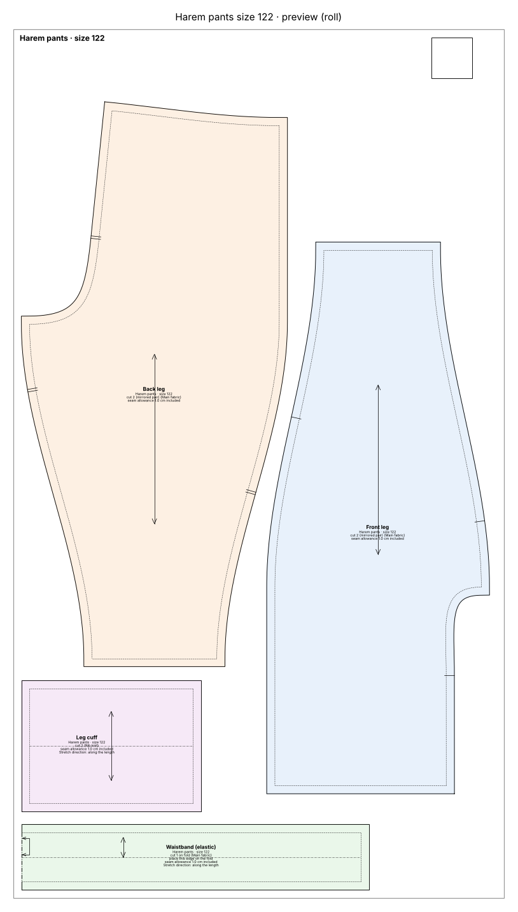</td>
<td width="40%">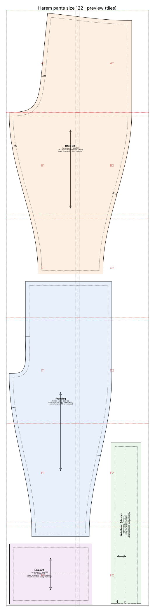</td>
</tr><tr><td>610 mm plotter roll</td><td>A4 pages to tape together</td></tr></table>

### An illustrated sewing booklet

> *"A hoodie with kangaroo pocket, size 140."*

A title page with the finished garment from the front and back (waistband, cuffs, sleeves and hood
drawn on) and what it is sewn with; all parts large and at the same scale with their counts, the
material with fabric amounts, notions and tools; the basics for your machines; then two steps per
page with numbered actions, tips, warnings and alternatives, and a "Done!" panel at the end. Every picture is drawn
from your actual pattern pieces: right side shaded, wrong side hatched, pins, stitch line, sewing direction,
and the stitch setting for your machine. Seams sewn in earlier steps stay visible (grey dashed), and pieces that
are already joined are shown together, so you can check your work against every picture.

<table><tr>
<td>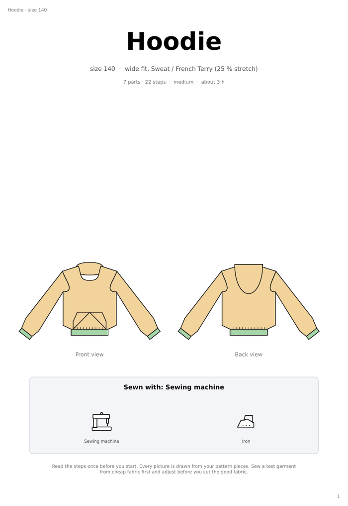</td>
<td>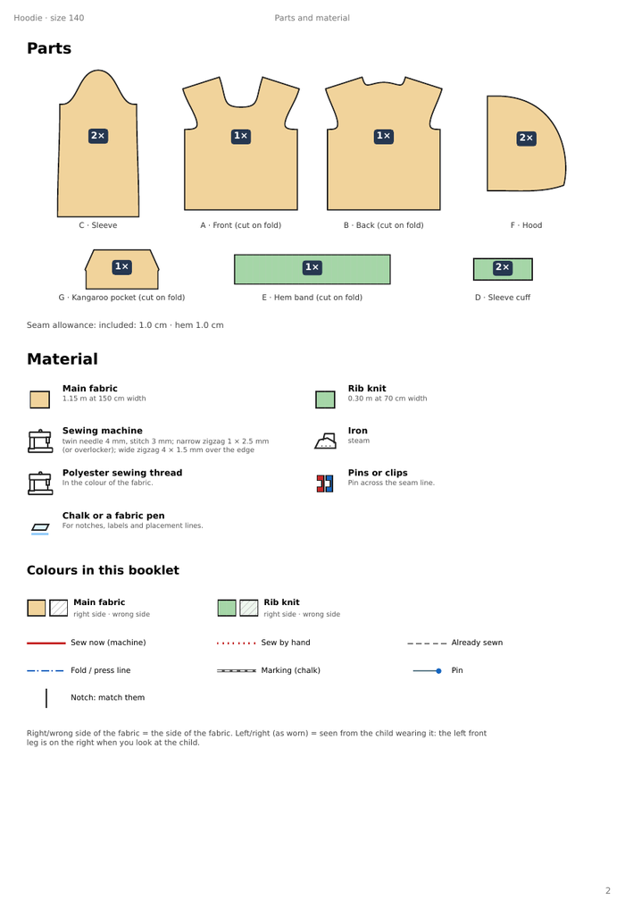</td>
<td>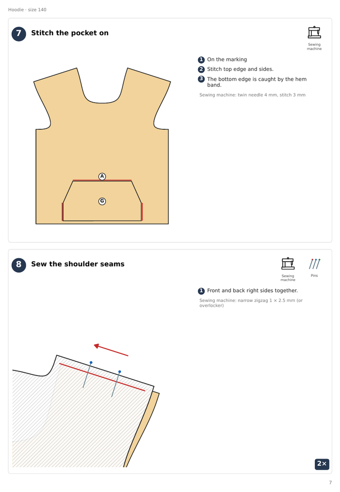</td>
</tr><tr><td>Title page</td><td>Parts and material</td><td>Steps</td></tr></table>

### A cutting layout and how much fabric to buy

Every piece placed on your fabric width (folded or single layer, whichever needs less), with the
amount of main fabric and rib knit to buy.

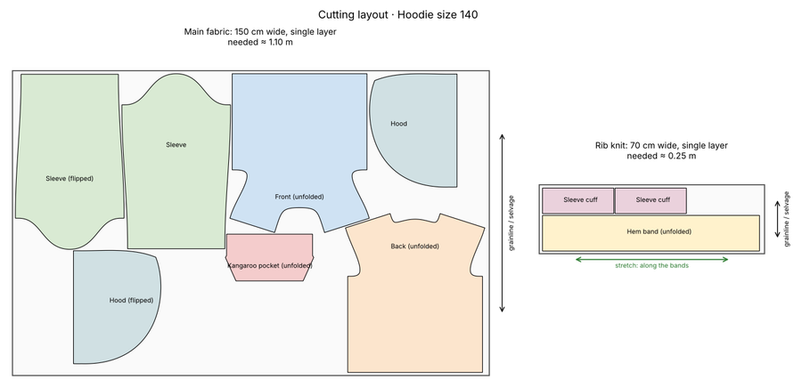

### Several sizes on one sheet

> *"Joggers in sizes 98, 110 and 122 on one pattern."*

Each size has its own colour and line style, and its own PDF layer, so you can hide the sizes you
don't need before printing.

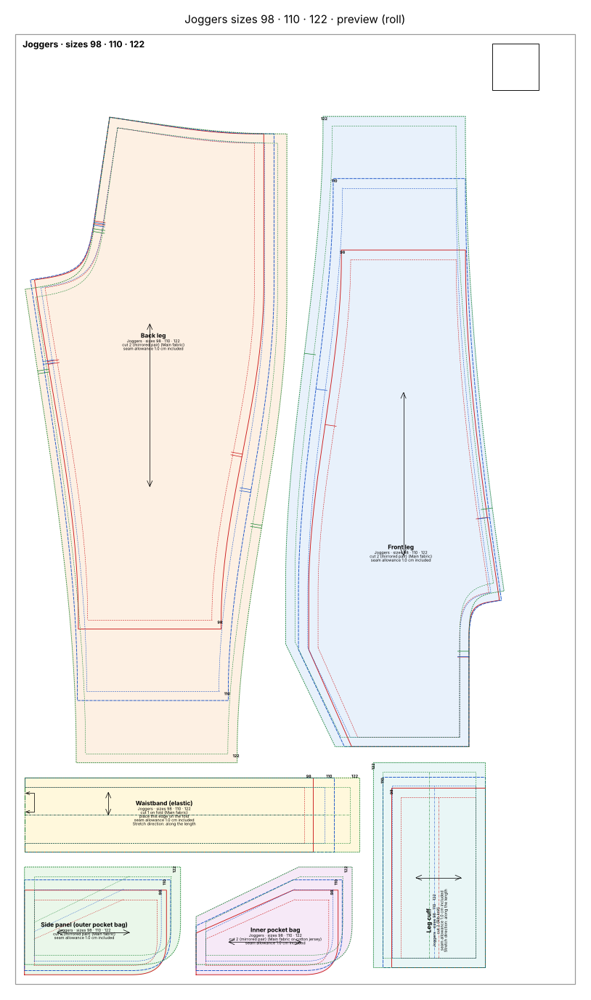

### Copy a favourite garment from a photo

> *"Here is a photo of my son's favourite joggers next to the reference card, make me a pattern from it."*

Lay the garment flat next to the printable [reference card](assets/reference-card.pdf) and take a
photo from above. Claude straightens the photo, measures the garment, shows you what it measured,
and rebuilds a pattern you can also grade to other sizes.

<table><tr>
<td>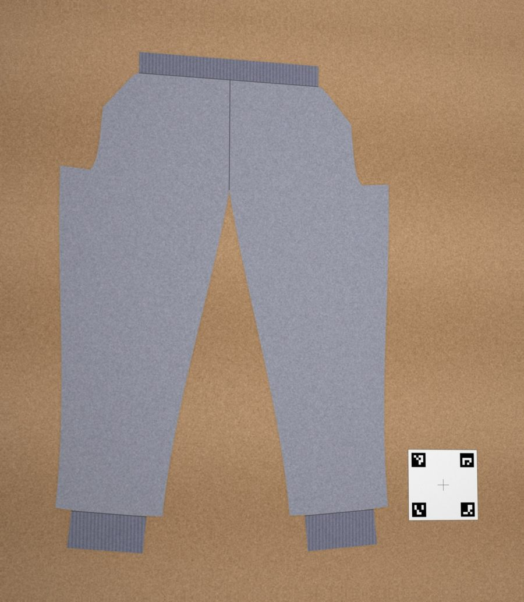</td>
<td>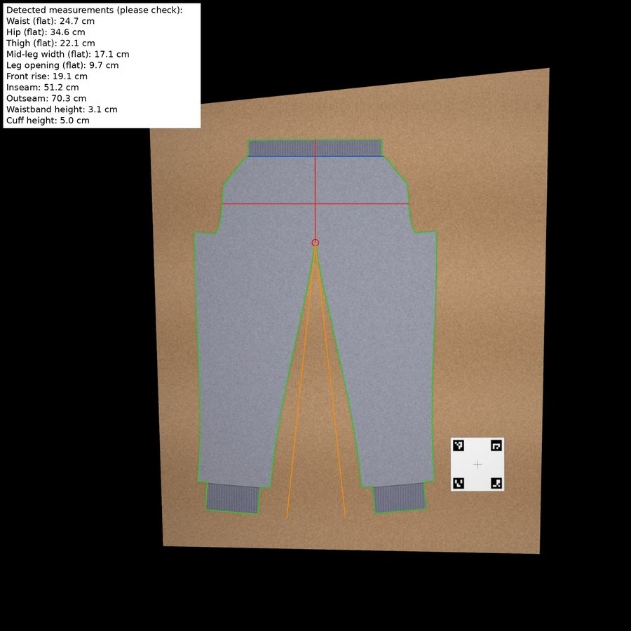</td>
</tr><tr><td>Your photo</td><td>What Claude measured</td></tr></table>

### Doll clothes

> *"A dress for my daughter's 45 cm fabric doll."*

Dresses, skirts, pants and T-shirts for fabric dolls and soft toys from 20 to 100 cm, with narrow
seam allowances and a back opening with Velcro instead of a neckline the doll's head wouldn't fit
through.

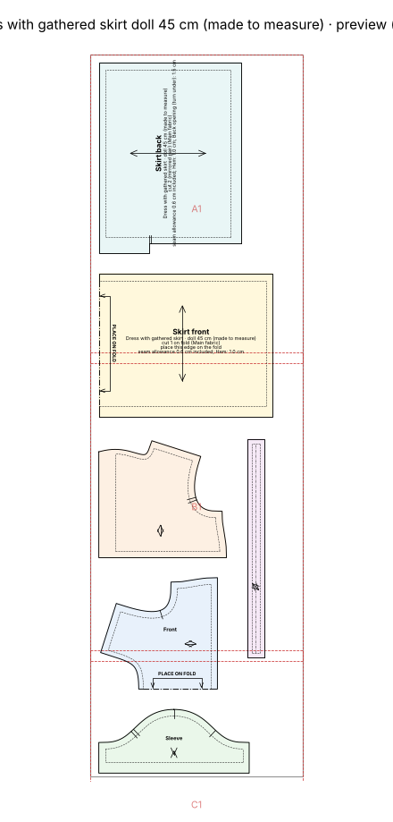

### Creative shapes

> *"A sweatshirt shaped like a starfish for my son, size 128."*

Any garment can get a shape of its own: rounder, wider, pointed, scalloped, with spikes or ears sewn
into a seam. Claude turns your description, sketch or photo into a short list of features for you to
confirm, reshapes the normal pattern and checks it again: the seams still match, there is enough room
to move, and the points can be sewn and turned. The check report marks every change as intended.

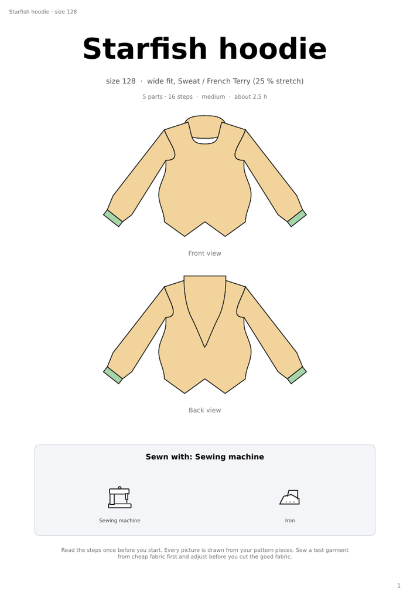

## Examples

Complete output folders, each with its own README (prompt, pictures, what every file is):

1. [Harem pants, size 122, sweat, 610 mm roll](examples/1_harem_pants_122_roll610)
2. [The same as A4 pages to tape together](examples/2_harem_pants_122_a4)
3. [Copied from a photo](examples/3_photo_mode_b): flat-lay photo with reference card → rebuilt joggers
4. [Doll dress](examples/4_doll_dress_45cm_a4) for a 45 cm fabric doll, A4 pages
5. [Hoodie with kangaroo pocket, size 140](examples/5_hoodie_140_a4), A4 pages
6. [Joggers in sizes 98, 110 and 122](examples/6_joggers_nested_98_110_122_roll610) nested on a 610 mm roll
7. [Starfish hoodie, size 128](examples/7_starfish_hoodie_128_a4): a creative silhouette, A4 pages

## All garments

Every garment has its own page with a picture and an example prompt for every option.

<!-- GARMENTS -->
### Pants and overalls

| | Garment | Example prompt |
|---|---|---|
| 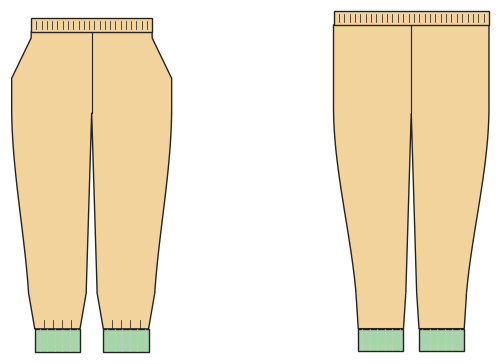 | [Pants (joggers, harem pants, leggings, pull-on trousers)](examples/garments/pants_basic/README.en.md) | *"Harem pants in size 122 from sweat fabric."* |
| 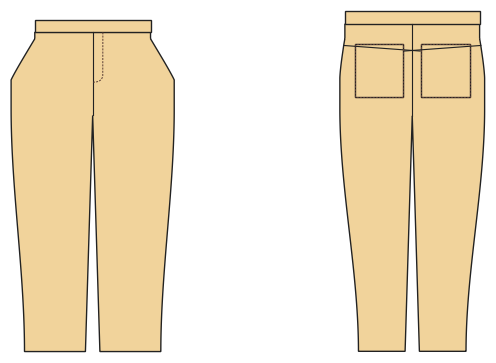 | [Jeans](examples/garments/jeans/README.en.md) | *"Slim jeans for me, size 38, stretch denim."* |
| 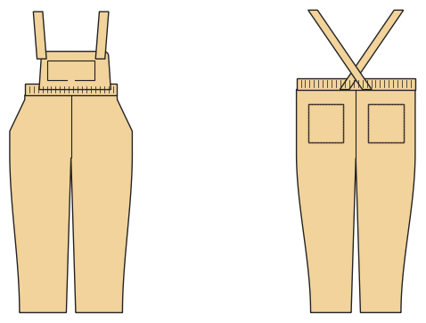 | [Dungarees](examples/garments/dungarees/README.en.md) | *"Corduroy dungarees for my son, size 104."* |
| 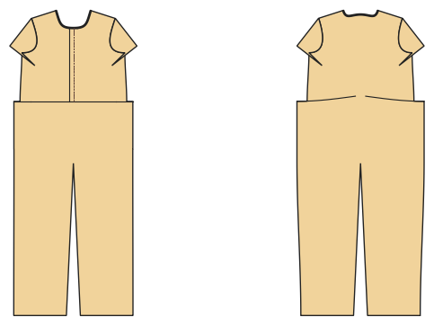 | [Jumpsuit, playsuit, boiler suit](examples/garments/jumpsuit/README.en.md) | *"A viscose jumpsuit for me, size 38."* |

### Tops

| | Garment | Example prompt |
|---|---|---|
| 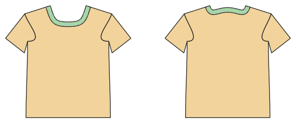 | [T-shirt and long-sleeve top](examples/garments/tshirt_basic/README.en.md) | *"A raglan top in 140."* |
| 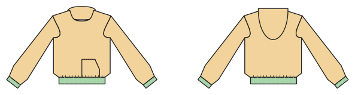 | [Hoodie, sweatshirt, zip jacket](examples/garments/hoodie/README.en.md) | *"A hoodie with a lined hood in 140."* |
| 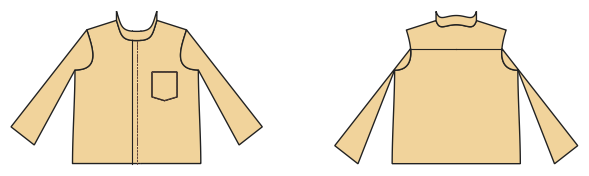 | [Shirt and blouse](examples/garments/shirt/README.en.md) | *"A blouse for me, size 40."* |
| 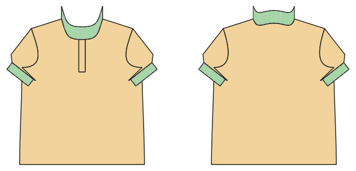 | [Polo shirt](examples/garments/polo/README.en.md) | *"A polo shirt in men's 52."* |
| 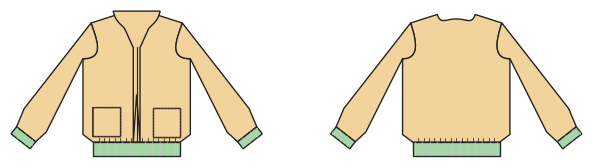 | [Cardigan](examples/garments/cardigan/README.en.md) | *"A round-neck cardigan in 128."* |
| 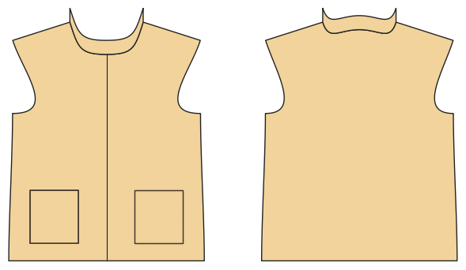 | [Vest / gilet](examples/garments/vest/README.en.md) | *"A fleece vest with snaps in 128."* |

### Jackets and coats

| | Garment | Example prompt |
|---|---|---|
| 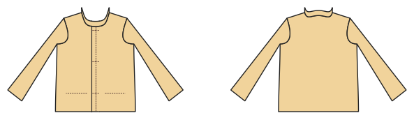 | [Jacket (lined, woven)](examples/garments/jacket/README.en.md) | *"A lined jacket with jetted pockets, size 38."* |
| 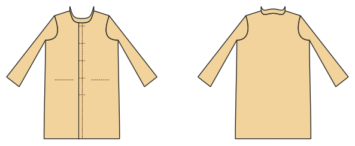 | [Coat](examples/garments/coat/README.en.md) | *"A knee-length wool coat, size 40."* |
| 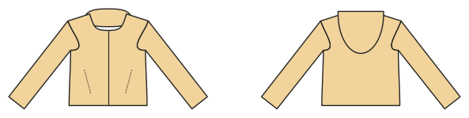 | [Softshell / outdoor jacket](examples/garments/softshell/README.en.md) | *"Softshell jacket without hood, size 140."* |

### Skirts and dresses

| | Garment | Example prompt |
|---|---|---|
| 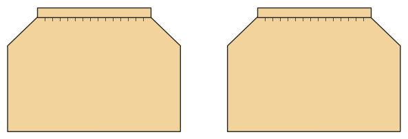 | [Skirt](examples/garments/skirt/README.en.md) | *"A circle skirt in 128."* |
| 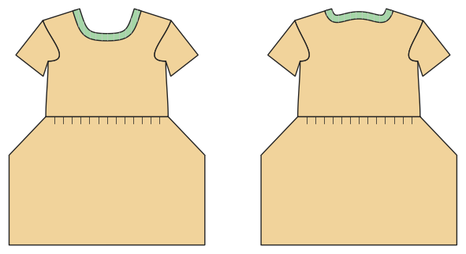 | [Dress](examples/garments/dress/README.en.md) | *"A T-shirt dress in 116."* |
| 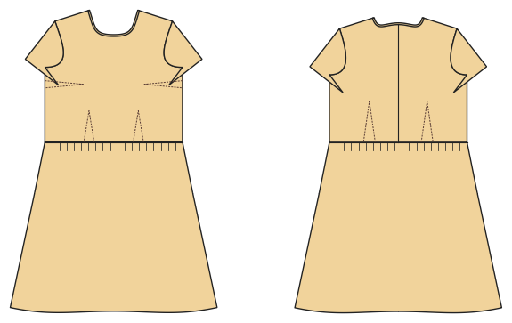 | [Fitted woven dress](examples/garments/fitted_dress/README.en.md) | *"A fitted dress with a gathered skirt, size 38."* |
| 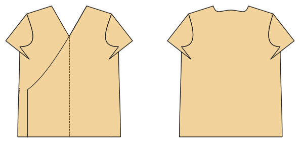 | [Wrap top and wrap dress](examples/garments/wrap/README.en.md) | *"A jersey wrap dress, size 38."* |
| 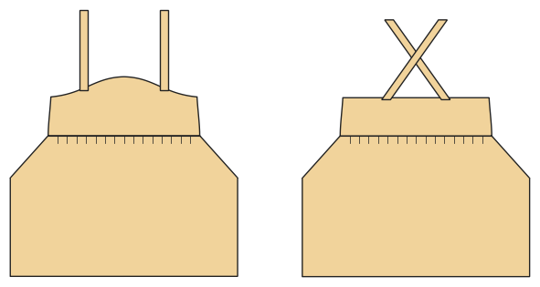 | [Pinafore dress](examples/garments/pinafore/README.en.md) | *"A corduroy pinafore, size 116, A-line skirt."* |

### Bodysuits, swimwear and underwear

| | Garment | Example prompt |
|---|---|---|
| 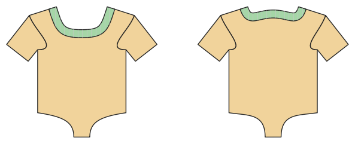 | [Bodysuit, swimsuit, wrap bodysuit](examples/garments/bodysuit/README.en.md) | *"A swimsuit for me, size 38."* |
| 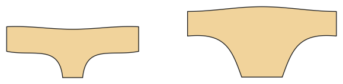 | [Underwear: briefs and boxers](examples/garments/underwear/README.en.md) | *"Boxer briefs for my husband, size 52."* |
| 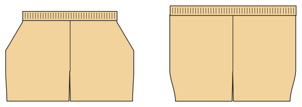 | [Swim trunks](examples/garments/swim_trunks/README.en.md) | *"Knee-length swim trunks, size 52."* |

### Baby and sleepwear

| | Garment | Example prompt |
|---|---|---|
| 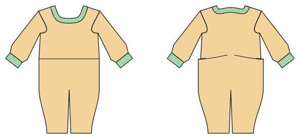 | [Baby romper](examples/garments/romper/README.en.md) | *"A footed romper, size 68."* |
| 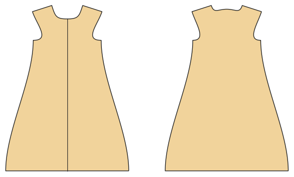 | [Baby sleeping bag and swaddle sack](examples/garments/sleeping_bag/README.en.md) | *"A swaddle sack for a newborn (size 56)."* |
| 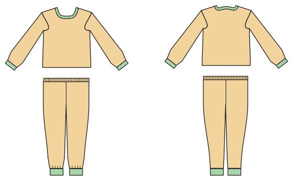 | [Pyjamas](examples/garments/pyjama/README.en.md) | *"Pyjamas with a button-up top for me, men's 52."* |
| 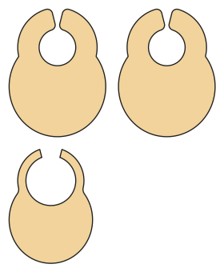 | [Baby bib](examples/garments/bib/README.en.md) | *"A bandana bib in 74."* |

### Accessories

| | Garment | Example prompt |
|---|---|---|
| 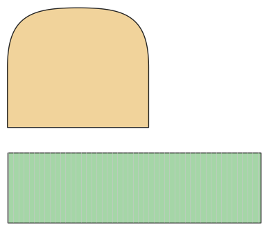 | [Beanie](examples/garments/beanie/README.en.md) | *"Beanie without brim."* |
|  | [Loop scarf](examples/garments/loop/README.en.md) | *"A loop scarf to wear doubled."* |
| 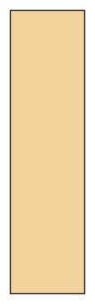 | [Scarf](examples/garments/scarf/README.en.md) | *"A flat scarf with fringe."* |
|  | [Headband](examples/garments/headband/README.en.md) | *"A twist headband for me."* |
| 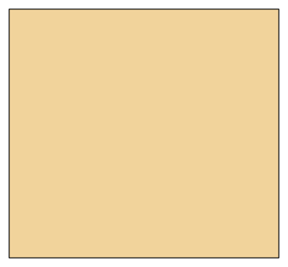 | [Neck gaiter and neckerchief](examples/garments/neckwear/README.en.md) | *"A neckerchief for my child, 116."* |
| 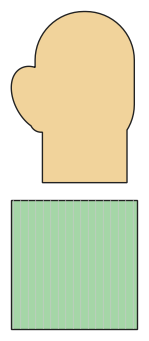 | [Mittens](examples/garments/mittens/README.en.md) | *"Thumbless baby mittens, size 74."* |
| 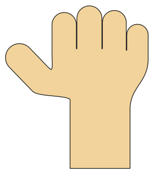 | [Gloves](examples/garments/gloves/README.en.md) | *"Fleece gloves with fourchettes."* |
| 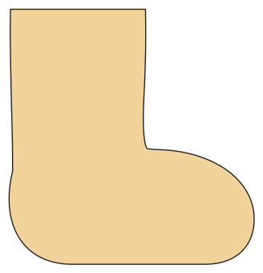 | [Socks and house socks](examples/garments/socks/README.en.md) | *"House socks with an anti-slip sole in 128."* |
| 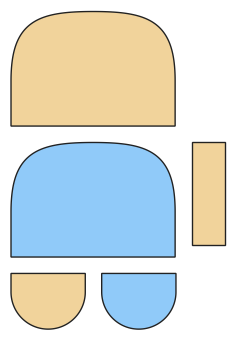 | [Earflap hat](examples/garments/earflap_hat/README.en.md) | *"Earflap hat without ties."* |
| 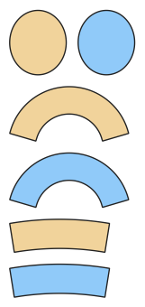 | [Bucket hat / sun hat](examples/garments/bucket_hat/README.en.md) | *"A reversible bucket hat."* |
| 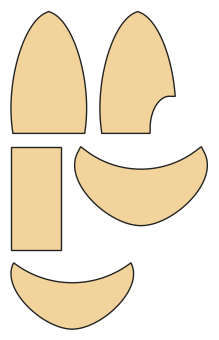 | [Baseball cap](examples/garments/cap/README.en.md) | *"A cap with a longer peak (8 cm)."* |

### Bags

| | Garment | Example prompt |
|---|---|---|
| 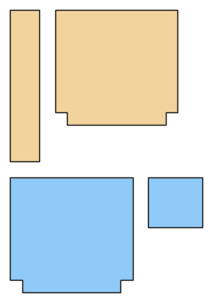 | [Bags: tote and drawstring bag](examples/garments/bag/README.en.md) | *"A drawstring bag."* |
<!-- /GARMENTS -->

## Claude Code and command line

For Claude Code, clone the repository into your skills folder:

```bash
git clone https://github.com/JRuiter/sewing-pattern-generator ~/.claude/skills/sewing-pattern-generator
pip install -r ~/.claude/skills/sewing-pattern-generator/requirements.txt
```

Everything else (running the generator from Python, all options and flags, how the checks work,
tests, repository layout) is in the **[deep dive](docs/DEEP_DIVE.md)**.

## Your patterns belong to you

Patterns generated with this tool are **yours**. Use, print, sew, sell the finished garments, or share
the pattern files however you like; no attribution required. The MIT license below covers the
*software*; it places no restrictions on what you create with it.

The constructions are original parametric drafts based on generally known drafting principles; no
commercial or copyrighted patterns were copied. When working from a photo of a designer garment the
skill creates its own construction in a similar style, not a copy.

**Always sew a test garment (toile)** from inexpensive fabric with similar stretch the first time you
use a new pattern.

## License

[MIT](LICENSE) © JRuiter. The bundled DejaVu fonts are under their own free license
([assets/fonts/DejaVu-LICENSE.txt](assets/fonts/DejaVu-LICENSE.txt)).

