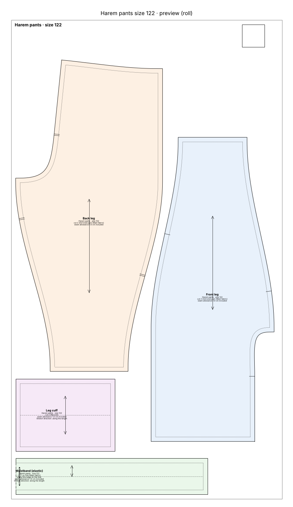

# sewing-pattern-generator

A [Claude skill](https://docs.claude.com/en/docs/agents-and-tools/agent-skills/overview) that drafts
**sewable, true-to-scale sewing patterns** from measurements, a free-text description, or photos of a
garment. Parametric drafting, seam validation, and print-ready 1:1 PDFs for plotter rolls, A0/A1, or A4
tiling.

All generated files (pattern labels, sewing instructions, reports) are in English. Claude answers
in the language you write in, and the skill also triggers on German requests ("Schnittmuster
erstellen", "Lieblingshose kopieren" …).



## What it does

- **Drafts patterns parametrically** (no image generation): body measurements + ease + construction
  rules → smooth Bézier pieces with seam allowance, grainline, notches, fold lines and labels.
- **Validates sewability** before anything is printed: matching seam lengths (±2 mm), rib band ratios,
  sleeve-cap ease, right angles at centre/side seams, smooth joined corners, finished circumferences
  (±1 %), head opening, self-intersections, seam allowance on every edge, grainline on every piece.
  A pattern with errors is never rendered.
- **Prints exactly 1:1**: vector PDF with embedded fonts, lines ≥ 0.5 pt, cut line solid, seam line
  dashed, fold dash-dot, a 5 × 5 cm and a 1-inch control square on every page.
  - **Plotter roll** (e.g. 610 mm / 24" → 600 mm wide portrait page, pieces packed with rotation and
    ≥ 10 mm gap; pieces wider than the roll are split into glue-together strips)
  - **A0 / A1** sheets (oversized pieces tiled)
  - **A4 / US Letter** tiles with 10 mm overlap, glue areas, row/column labels, registration diamonds
    and an overview page
  - plus a 1:1 **SVG master**, PNG preview, cutting layout with fabric consumption, and sewing
    instructions (Markdown + PDF) with a **diagram for every seam step**, drawn from the real pieces:
    right side shaded, the two edges to sew highlighted, matching notches marked
  - **DXF** for cutting machines and pattern CAD (AAMA layer convention: cut line, seam line, fold,
    notches, grainline on separate layers; one block per piece; mm, 1:1)
- **Nested multi-size patterns**: `--size 98,110,122` overlays all sizes on one sheet, each with
  its own colour, line style and **PDF layer** (toggle sizes before printing) and its own SVG group;
  every size is validated on its own.
- **Sews cleanly**: hem and casing allowances get mirrored corners, so a folded-up hem on a tapered
  leg or sleeve lies flat under the side seam; notches are projected onto the cutting line (also at
  corners) as slit, T or V notches.
- **Transparent and adjustable**: the report lists every construction value (hip width, crotch
  extensions, rise, armhole depth, …) with its formula; any of them can be overridden, e.g. after a
  toile.
- **Fit adjustments from the test garment**: `--adjust '{"hip_tight": "2cm", "crotch_low": "1.5cm"}'`
  changes the matching construction values; the instructions show finished measurements before
  and after, and the adjustments are kept for the next size.
- **Measurement files**: reads and writes `.smis` / `.vit` XML measurement files, so measurements
  taken once can be reused here and in open-source pattern CAD programs.
- **Photo mode A** (inspiration photo): feature list with confidence → confirmed by the user → mapped
  onto a garment module; unsupported features are named honestly with the closest alternative.
- **Photo mode B** (copy a favourite garment): lay it flat next to the printable ArUco
  [reference card](assets/reference-card.pdf), take a photo from above → perspective correction,
  segmentation, measurements and an overlay image → **reverse engineering** (least-squares fit of the
  parametric model) → deviation report (lengths ±1 cm, widths ±2 %) → savable project JSON that can be
  graded to other sizes.

### Garments

| Module | Variants |
|---|---|
| `pants_basic` | jogger, harem pants, leggings, woven pull-on trousers; lengths, waistbands (elastic casing, rib, yoga, tunnel), cuffs, slant/side/back/cargo pockets, tapered/bootcut/flared legs, shorts with turn-up |
| `tshirt_basic` | set-in or raglan sleeve; short/¾/long; round or V neck; neck band, cuffs, hem band |
| `hoodie` | hood (optionally lined), kangaroo pocket, set-in or raglan, zip-up jacket variant |
| `skirt` | gathered, A-line, circle skirt with elastic waistband |
| `dress` | T-shirt bodice + gathered/A-line/circle skirt with waist seam, or A-line T-shirt dress; pockets in the side seam |
| `beanie`, `loop` | beanie with brim/slouch, single or double loop scarf |

Sizes: children 86–176 (`122`), women 34–56 (`w38`), men 44–60 (`m52`), or any custom measurements (measured values always
take precedence over the size table).

## Installation

### As a Claude skill
Clone (or download) this repository into your skills folder, e.g. for Claude Code:

```bash
git clone https://github.com/JRuiter/sewing-pattern-generator ~/.claude/skills/sewing-pattern-generator
pip install -r ~/.claude/skills/sewing-pattern-generator/requirements.txt
```

For claude.ai / the Claude app, zip the repository folder and upload it under *Settings → Capabilities →
Skills*. Then just ask, e.g. *"Harem pants for my daughter, size 122, sweat fabric, print on the 24" roll"*.

### As a command-line tool
Python ≥ 3.10:

```bash
pip install -r requirements.txt
python scripts/generate.py --garment pants_basic --style harem --size 122 \
    --fabric sweat --format roll610,a4 --out out/harem122
```

More examples:

```bash
python scripts/generate.py --garment tshirt_basic --size 140 --options '{"sleeve_style":"raglan"}' --format a4
python scripts/generate.py --garment hoodie --size w38 --format roll914,a0
python scripts/generate.py --garment skirt --size 128 --style circle --format a1
python scripts/generate.py --spec order.json                 # everything as JSON

# photo mode B: measure a flat-lay photo with the reference card, rebuild the pattern, print it
cd scripts && python -m reverse.pipeline ../photo.jpg --type pants --out ../project
python generate.py --project ../project/project.json --format roll610 --out ../out/copy
```

Exit code 2 means the sewability check failed; `validation_report.md` explains why and no print files are
written.

## Examples

All generated by the code in this repository (`python tools/make_examples.py`):

1. [Harem pants, size 122, sweat, 610 mm roll](examples/1_harem_pants_122_roll610) – one 600 × 1062 mm
   page, sewing instructions, cutting layout, validation report (28/28 checks OK)
2. [The same as A4 tiles](examples/2_harem_pants_122_a4) – 12 pages + overview
3. [Photo mode B](examples/3_photo_mode_b) – synthetic flat-lay photo with reference card → overlay →
   reverse-engineering report → reconstructed pattern. Round-trip comparison with the original pattern:
   all lengths within 0.5 cm, all widths within 2 % ([round_trip_comparison.md](examples/3_photo_mode_b/round_trip_comparison.md))

Validation tables and previews for every garment in three sizes: [`test-results/`](test-results/OVERVIEW.md)
(780 of 780 checks passed).

## Tests

```bash
pip install -r requirements-dev.txt
python -m pytest tests
```

110 tests: every check with deliberately broken patterns, every garment in 5 sizes, the 141.73 pt control
square in the PDFs, embedded fonts and minimum line widths, identical content in A4 overlaps (needs
`pdftoppm` from poppler, otherwise skipped), roll layouts for 610 and 914 mm with ≥ 10 mm gaps,
photo-mode B accuracy on three synthetic photos (< 1 cm / < 2 %), photo-mode A classification, and the
full round trip pattern → photo → reverse engineering → pattern.

## Repository layout

```
SKILL.md          skill instructions: what Claude does step by step
scripts/          geometry, measurements, ease, garments/, validate, layout, render, instructions,
                  notches, construction, adjust, diagrams, nested, export_dxf, measure_files,
                  photo_analyze, photo_measure, reverse/ (decompose, unfold, fit, verify, store)
references/       drafting rules, size tables, print specs, photo guide
assets/           printable reference card (ArUco), DejaVu fonts
tests/            pytest suite
tools/            zip builder, example/test-result generator
examples/         the three example outputs
test-results/     validation reports and previews per garment and size
```

## Your patterns belong to you

Patterns generated with this tool are **yours**. Use, print, sew, sell the finished garments, or share
the pattern files however you like; no attribution required. The MIT license below covers the
*software*; it places no restrictions on what you create with it.

The constructions are original parametric drafts based on generally known drafting principles; no
commercial or copyrighted patterns were copied. When working from a photo of a designer garment the
skill creates its own construction in a similar style, not a copy.

**Always sew a test garment (toile)** from inexpensive fabric with similar stretch the first time you
use a new pattern.

## License

[MIT](LICENSE) © JRuiter. The bundled DejaVu fonts are under their own free license
([assets/fonts/DejaVu-LICENSE.txt](assets/fonts/DejaVu-LICENSE.txt)).

