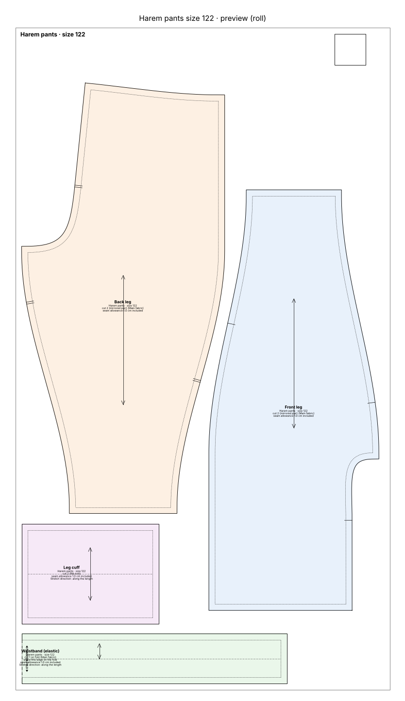
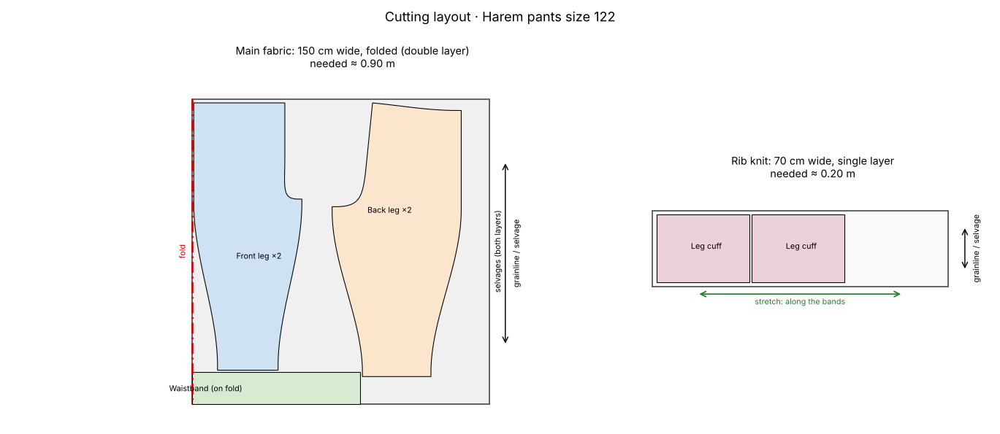

# Harem pants, size 122, on a 610 mm roll

> *"Harem pants for my daughter, size 122, sweat fabric, print on the 24" roll."*

Wide harem pants with an elastic waistband and rib cuffs, printed on one long page of a 24" (610 mm) plotter roll.

## At a glance

- **Pieces:** 4
- **Fabric to buy:** main fabric 0.90 m at 150 cm width, rib knit 0.25 m at 70 cm width
- **Sewing steps:** 20
- **Sewability checks:** 31 of 31 OK

## Cutting layout

## Files

| File | What it is |
|---|---|
| [`cutting_layout.png`](cutting_layout.png) | Cutting layout on the fabric, with fabric amounts |
| [`harem_pants_size122_master_1to1.svg`](harem_pants_size122_master_1to1.svg) | The whole pattern as one 1:1 SVG |
| [`harem_pants_size122_roll610.pdf`](harem_pants_size122_roll610.pdf) | Print file for the 610 mm roll, 1:1 |
| [`harem_pants_size122_roll610_preview.png`](harem_pants_size122_roll610_preview.png) | Preview picture of the print file |
| [`pattern.json`](pattern.json) | All pieces, measurements and construction values as data |
| [`sewing_instructions.md`](sewing_instructions.md) | The same instructions as text, with a picture per step |
| [`sewing_instructions.pdf`](sewing_instructions.pdf) | Illustrated sewing booklet, then measurements, pieces and checks |
| [`steps`](steps) | Step pictures used by sewing_instructions.md |
| [`validation_report.md`](validation_report.md) | Every sewability check with target and actual value |

Print the PDF at **100 % / actual size** and check the 5 × 5 cm square before cutting.
