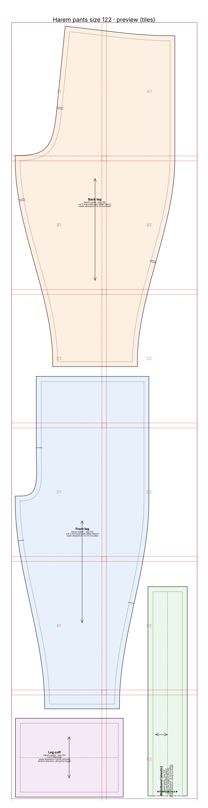
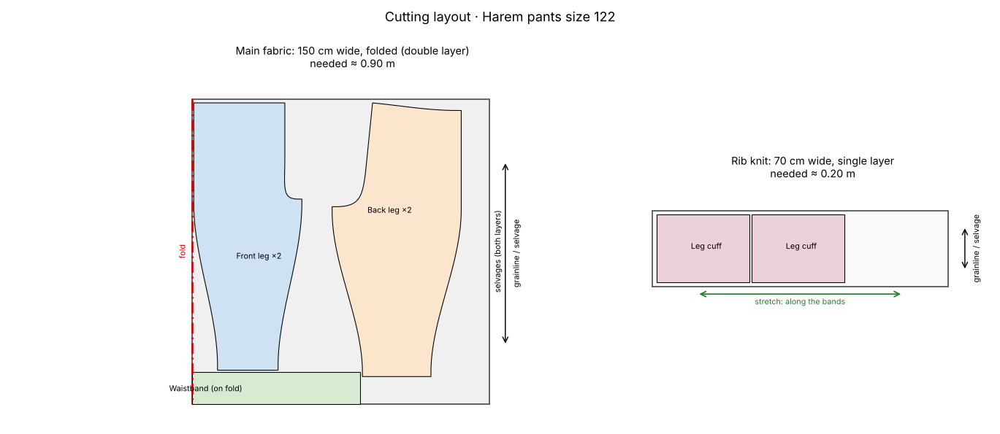

# Harem pants, size 122, as A4 pages

> *"The same harem pants, but as A4 pages I can print at home."*

The same pattern as example 1, tiled onto A4 pages with 10 mm overlap, glue areas, row and column labels and an overview page.

## At a glance

- **Pieces:** 4
- **Fabric to buy:** main fabric 0.90 m at 150 cm width, rib knit 0.20 m at 70 cm width
- **Sewing steps:** 20
- **Sewability checks:** 32 of 32 OK

## Cutting layout

## Files

| File | What it is |
|---|---|
| [`cutting_layout.png`](cutting_layout.png) | Cutting layout on the fabric, with fabric amounts |
| [`harem_pants_size122_a4_preview.png`](harem_pants_size122_a4_preview.png) | Preview picture of the print file |
| [`harem_pants_size122_a4_tiled.pdf`](harem_pants_size122_a4_tiled.pdf) | Print file as A4 pages to tape together (last page: overview) |
| [`harem_pants_size122_master_1to1.svg`](harem_pants_size122_master_1to1.svg) | The whole pattern as one 1:1 SVG |
| [`pattern.json`](pattern.json) | All pieces, measurements and construction values as data |
| [`sewing_instructions.md`](sewing_instructions.md) | The same instructions as text, with a picture per step |
| [`sewing_instructions.pdf`](sewing_instructions.pdf) | Illustrated sewing booklet, then measurements, pieces and checks |
| [`steps`](steps) | Step pictures used by sewing_instructions.md |
| [`validation_report.md`](validation_report.md) | Every sewability check with target and actual value |

Print the PDF at **100 % / actual size** and check the 5 × 5 cm square before cutting.
