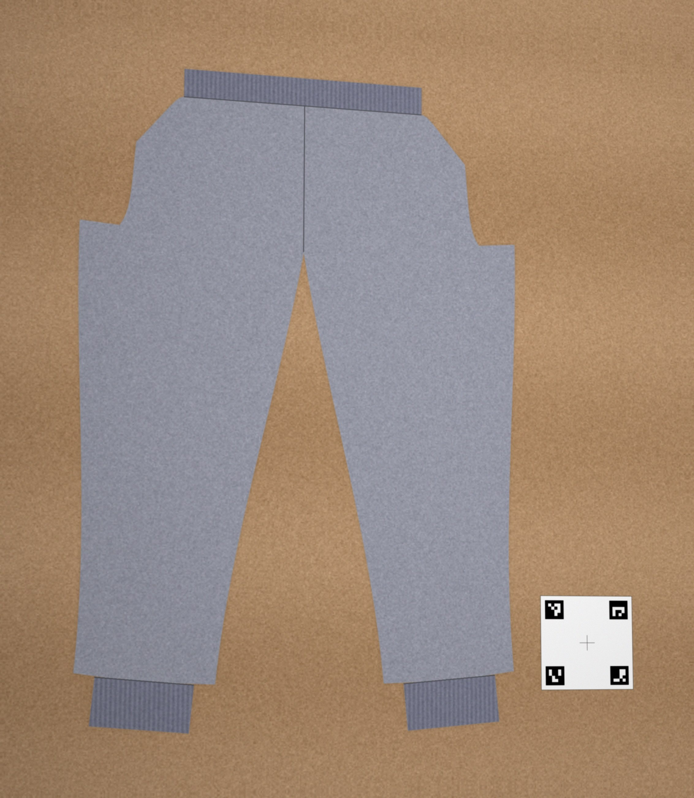
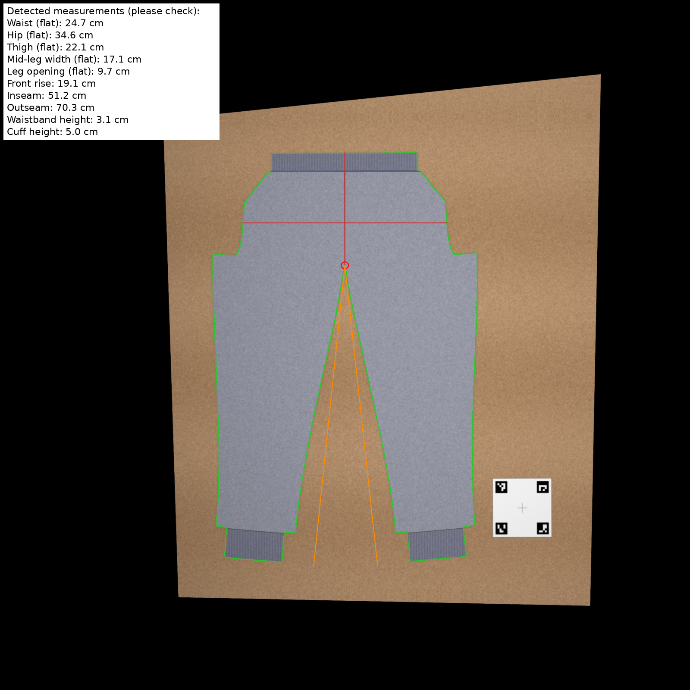
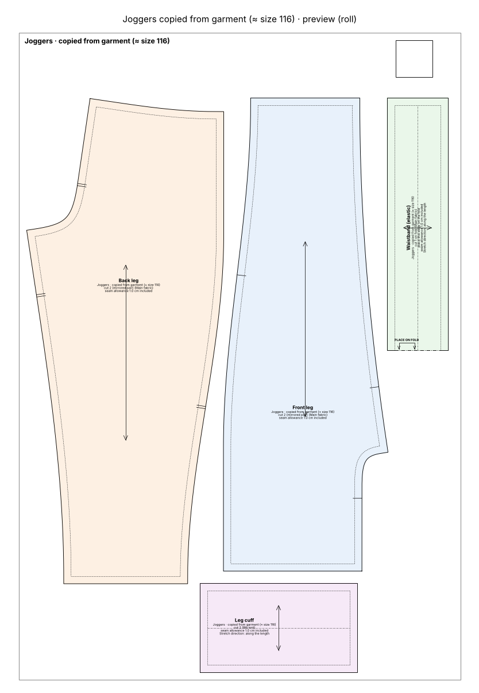

# Joggers copied from a photo

> *"Here is a photo of my son's favourite joggers next to the reference card, make me a pattern from it."*

The garment lies flat next to the printable [reference card](../../assets/reference-card.pdf). Claude straightens the photo, finds the outline, measures it, fits the pattern model to the measurements and drafts a new pattern. Here the photo is synthetic, made from a known pattern (joggers size 116), so the result can be compared with the truth.

<table><tr>
<td></td>
<td></td>
</tr><tr><td>The photo</td><td>What Claude measured</td></tr></table>

## How close is the copy?

| Measurement | Original (truth) | Reconstructed | Δ | Tolerance | Result |
|---|---|---|---|---|---|
| Hip width | 69.3 cm | 69.2 cm | -0.1 cm (-0.1 %) | ± 2 % | ✅ |
| Thigh width | 44.2 cm | 44.0 cm | -0.2 cm (-0.5 %) | ± 2 % | ✅ |
| Leg width at mid-leg | 34.4 cm | 34.5 cm | +0.1 cm (+0.3 %) | ± 2 % | ✅ |
| Leg opening | 19.1 cm | 19.4 cm | +0.3 cm (+1.6 %) | ± 2 % | ✅ |
| Waistband relaxed | 49.5 cm | 49.4 cm | -0.1 cm (-0.2 %) | ± 2 % | ✅ |
| Outseam | 69.9 cm | 70.4 cm | +0.4 cm | ± 1 cm | ✅ |
| Inseam | 50.9 cm | 51.3 cm | +0.3 cm | ± 1 cm | ✅ |
| Front rise | 19.0 cm | 19.1 cm | +0.1 cm | ± 1 cm | ✅ |

## The rebuilt pattern

- **Pieces:** 4
- **Fabric to buy:** main fabric 0.85 m at 150 cm width, rib knit 0.20 m at 70 cm width
- **Sewing steps:** 20
- **Sewability checks:** 31 of 31 OK

## Files

| File | What it is |
|---|---|
| [`photo_flat_with_reference_card.jpg`](photo_flat_with_reference_card.jpg) | The input photo |
| [`project/overlay_measurement.png`](project/overlay_measurement.png) | Outline and measurements drawn on the photo |
| [`project/reverse_report.md`](project/reverse_report.md) | Measurements, fitted values and deviations |
| [`project/project.json`](project/project.json) | Saved project; can be graded to other sizes |
| [`round_trip_comparison.md`](round_trip_comparison.md) | Original vs. reconstructed measurements |
| [`truth_finished_mm.json`](truth_finished_mm.json) | The true measurements of the original |
| [`pattern/cutting_layout.png`](pattern/cutting_layout.png) | Cutting layout on the fabric, with fabric amounts |
| [`pattern/joggers_copied_a4_preview.png`](pattern/joggers_copied_a4_preview.png) | Preview picture of the print file |
| [`pattern/joggers_copied_a4_tiled.pdf`](pattern/joggers_copied_a4_tiled.pdf) | Print file as A4 pages to tape together (last page: overview) |
| [`pattern/joggers_copied_master_1to1.svg`](pattern/joggers_copied_master_1to1.svg) | The whole pattern as one 1:1 SVG |
| [`pattern/joggers_copied_roll610.pdf`](pattern/joggers_copied_roll610.pdf) | Print file for the 610 mm roll, 1:1 |
| [`pattern/joggers_copied_roll610_preview.png`](pattern/joggers_copied_roll610_preview.png) | Preview picture of the print file |
| [`pattern/pattern.json`](pattern/pattern.json) | All pieces, measurements and construction values as data |
| [`pattern/sewing_instructions.md`](pattern/sewing_instructions.md) | The same instructions as text, with a picture per step |
| [`pattern/sewing_instructions.pdf`](pattern/sewing_instructions.pdf) | Illustrated sewing booklet, then measurements, pieces and checks |
| [`pattern/steps`](pattern/steps) | Step pictures used by sewing_instructions.md |
| [`pattern/validation_report.md`](pattern/validation_report.md) | Every sewability check with target and actual value |
