# Joggers · copied from garment (≈ size 116)

*normal fit, Sweat / French Terry (25 % stretch)* · original parametric draft. The pattern is yours to use.

> **Important:** With a new pattern, first sew a **test garment** from inexpensive fabric with similar stretch and check the fit.

## Files

- PDF roll 610 mm (600 × 877 mm): `joggers_copied_roll610.pdf`
- Preview roll 610 mm: `joggers_copied_roll610_preview.png`
- PDF A4 tiles to glue (10 pages + overview): `joggers_copied_a4_tiled.pdf`
- Preview A4 tiles: `joggers_copied_a4_preview.png`
- SVG master 1:1: `joggers_copied_master_1to1.svg`
- Cutting layout: `cutting_layout.png`
- Sewing instructions (PDF): `sewing_instructions.pdf`
- Sewing instructions (Markdown): `sewing_instructions.md`

## Printing

- Always print at **100 % / "Actual size"** (not "Fit to page").
- Measure the **5 × 5 cm** control square before you cut.
- Plotter (610 mm roll): the page is 600 mm wide in portrait. In the print dialog choose a custom paper size with exactly this width and length, and turn rotation/scaling off.

## Body measurements

| Body measurement | Value | Source |
|---|---|---|
| Body height | 116.0 cm | table |
| Chest | 60.0 cm | table |
| Waist | 55.0 cm | table |
| Hip | 63.0 cm | table |
| Head | 51.5 cm | table |
| Neck | 28.0 cm | table |
| Inseam | 51.0 cm | table |
| Side length | 68.5 cm | table |
| Arm length | 44.0 cm | table |
| Back length | 28.5 cm | table |
| Shoulder width | 9.6 cm | table |
| Thigh | 35.3 cm | table |
| Ankle | 17.0 cm | table |

## Finished measurements (virtually sewn)

| Finished measurement | Value |
|---|---|
| Hip width | 69.2 cm |
| Thigh width | 44.0 cm |
| Leg width at mid-leg | 34.5 cm |
| Leg opening | 19.4 cm |
| Waistband relaxed | 49.4 cm |
| Waistband stretched (pants top edge) | 66.4 cm |
| Outseam | 70.4 cm |
| Inseam | 51.3 cm |
| Front rise | 19.1 cm |
| Back rise | 20.7 cm |
| Waistband height | 3.1 cm |
| Cuff height | 5.0 cm |
| Crotch seam total | 45.7 cm |

## Pattern pieces

| Piece | Cutting | Fabric | Seam allowance |
|---|---|---|---|
| Front leg | cut 2 (mirrored pair) | Main fabric | seam allowance 1.0 cm included |
| Back leg | cut 2 (mirrored pair) | Main fabric | seam allowance 1.0 cm included |
| Waistband (elastic) | cut 1 on fold | Main fabric | seam allowance 1.0 cm included |
| Leg cuff | cut 2 | Rib knit | seam allowance 1.0 cm included |

## Fabric needed

- **Main fabric:** about 0.85 m at 150 cm width (folded selvage to selvage, cut on fold pieces at the fold, incl. 10 % for shrinkage; single layer would need 0.85 m)
- **Rib knit:** about 0.20 m at 70 cm width (single layer, incl. 10 % for shrinkage)
- Elastic 20 mm wide, length 49 cm (+2 cm overlap for joining)

Cutting layout: see `cutting_layout.png` (grainline arrow parallel to the selvage, "flipped" = place the piece face down, "×2" = cut through both layers of the folded fabric, which gives a mirrored pair, "(unfolded)" = cut-on-fold piece shown opened out).

**Cut on fold** (Waistband (elastic)): the paper piece is only one half. Its fold edge (dash-dot line, bracket arrows "PLACE ON FOLD") is the centre of the piece: it gets no seam allowance and is never cut. On the folded fabric, lay the fold edge exactly on the fabric fold, pin it and cut through both layers; opened out you get the whole piece. Where the cutting layout shows a piece "(unfolded)" on a single layer, fold the fabric along the grain just wide enough for the piece and place the fold edge on that fold, or trace the paper piece, flip it over along the fold edge and trace the second half.

## Sewing instructions

The printed instructions (`sewing_instructions.pdf`) show every step as a picture of your pieces: parts list, tools, then one action per step.

Seam allowance is included in the pattern (see table). Use a jersey/stretch needle for jersey and sweat.

1. **Pre-wash the fabric**. Wash and dry it the way you will wash the garment later, so it shrinks now, not after sewing.
2. **Cut out all pieces**. Follow the cutting layout; grainline arrows parallel to the selvage. Rib knit: the ribs run along the grainline, so every band stretches along its length (across the fabric). Cut both layers at once with long strokes; keep the fabric flat on the table.
3. **Snip the notches**. Cut 3–4 mm into the seam allowance at every notch. Tip: Never deeper than half the seam allowance.
4. **Set up the machine**. Sewing machine: jersey/stretch needle 75–80, polyester thread. Sew a test seam on two layers of a scrap. See the basics page at the front of the booklet.
5. **Sew the side seams**. Lay front and back of the same leg right sides together, side edges level: single notches = front, double notches = back. Pin, then sew with 10 mm seam allowance from the top edge to the hem. (an overlocker or a narrow zigzag/stretch stitch) Do this twice. Tip: Always the front and back of the SAME leg (FL + BL, FR + BR).
   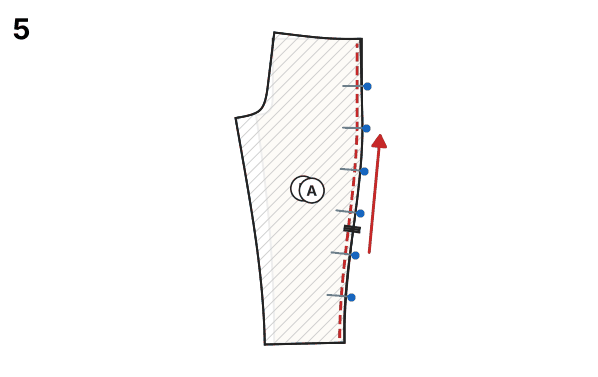
6. **Sew the inseams**. Open the leg out at the side seam and fold it right sides together, inseam edges level. Pin the notches first, then the ends. Sew with 10 mm seam allowance from the crotch point to the hem. (an overlocker or a narrow zigzag/stretch stitch) Do this twice. Tip: Start exactly at the crotch point: the four seams meet there later.
   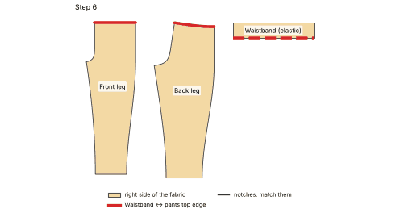
7. **Put one leg inside the other**. Turn leg 2 right side out. Leg 1 stays wrong side out. Push leg 2 into leg 1 until the top edges are even; the hems point the same way. Now the legs lie right sides together and the crotch curves lie exactly on top of each other.
8. **Sew the crotch seam**. Pin the crotch curves together, starting at the inseams: they lie exactly on top of each other. Sew with 10 mm seam allowance in one go from the front top edge to the back top edge. (an overlocker or a narrow zigzag/stretch stitch) Tip: Sew the crotch curve a second time for strength. Press the inseam allowances in opposite directions: the crossing lies flat. Pull the inner leg out afterwards.
   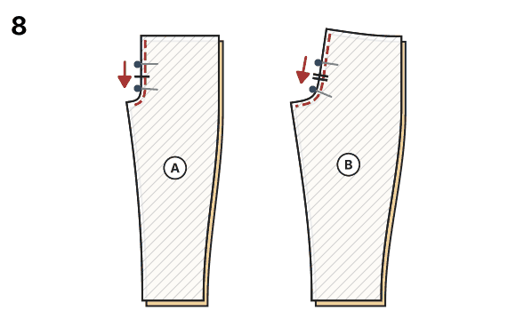
9. **Close the waistband into a ring**. Fold the waistband crosswise right sides together and sew the short ends (centre back) with 10 mm seam allowance; leave 3 cm open for the elastic. (an overlocker or a narrow zigzag/stretch stitch)
   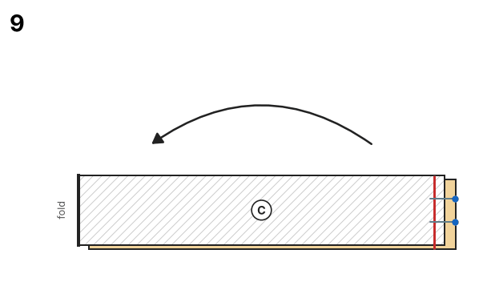
10. **Fold the waistband in half**. Fold lengthwise wrong sides together along the fold line and press.
   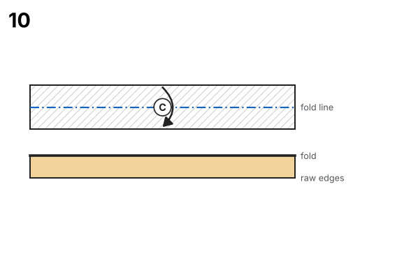
11. **Mark quarters**. Mark centre front, centre back and both sides with pins, on the waistband and on the pants top edge.
   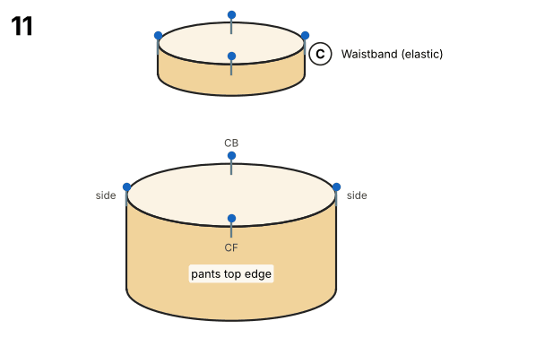
12. **Sew the waistband on**. Pants right side out: slide the waistband over them, raw edges level, the opening at the back on the inside. Match the quarter pins. Sew all round with 10 mm seam allowance. (an overlocker or a narrow zigzag/stretch stitch)
   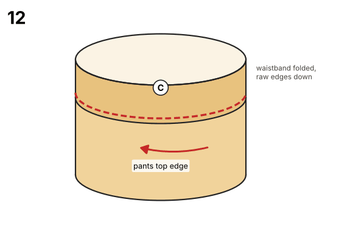
13. **Thread the elastic**. With a safety pin through the opening; overlap the ends by 2 cm and sew them together. (sewing machine: wide zigzag 4 × 2.5 mm)
14. **Close the opening**. Spread the gathers evenly, close the opening and stitch in the ditch at the side seams so the elastic cannot twist. (sewing machine: twin needle 4 mm, stitch 3 mm)
15. **Close the cuffs into rings**. Fold each cuff crosswise right sides together, short edges level. Sew with 10 mm seam allowance; finger-press the allowances open. (an overlocker or a narrow zigzag/stretch stitch) Do this twice.
   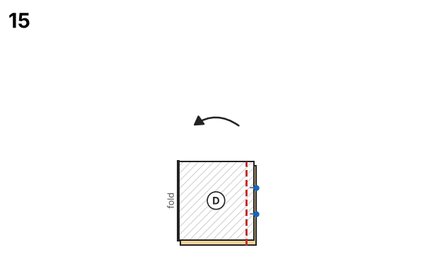
16. **Fold the cuffs in half**. Fold the ring lengthwise wrong sides together, raw edges level. The seam allowance is now inside; the right side shows all round. Do this twice.
   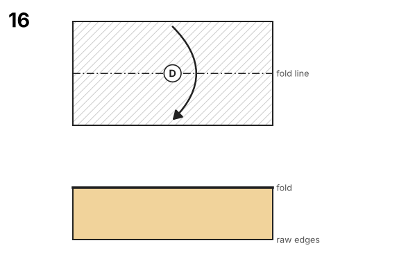
17. **Mark quarters**. Mark quarters with pins on the cuff and on the leg opening; the cuff seam is one of them. Do this twice.
   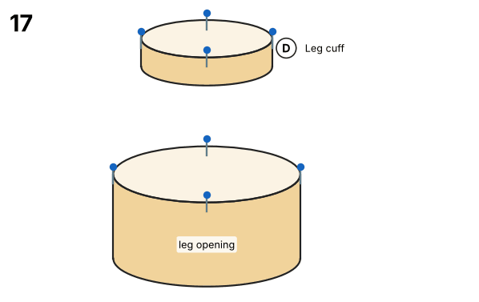
18. **Sew the cuffs on**. Turn the leg right side out. Slide the cuff over the leg end, raw edges level, cuff seam on the inseam. Match the quarter pins. Sew with 10 mm seam allowance, cuff on top, stretching only the cuff. (an overlocker or a narrow zigzag/stretch stitch) Do this twice. One hand in front of the presser foot, one behind it: both stretch evenly.
   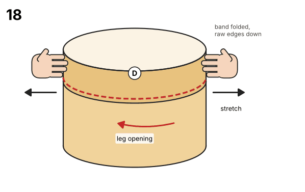
19. **Press the allowance up**. Press the seam allowance up towards the pants. Do this twice.
   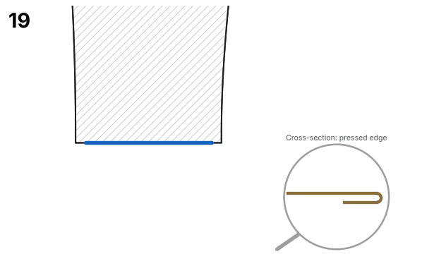
20. **Final pressing**. Press all seams with steam; do not press down hard on sweat.

## Validation report

### Sewability check

| Area | Check | Target | Actual | Δ | Result | Note |
|---|---|---|---|---|---|---|
| Seam pairs | Side seam front ↔ back | 62.3 cm | 62.3 cm | +0.0 mm | ✅ OK |  |
| Seam pairs | Inseam front ↔ back | 46.4 cm | 46.4 cm | +0.0 mm | ✅ OK |  |
| Seam pairs | Front crotch seam (left ↔ right piece) | 17.8 cm | 17.8 cm | +0.0 mm | ✅ OK |  |
| Seam pairs | Back crotch seam (left ↔ right piece) | 21.6 cm | 21.6 cm | +0.0 mm | ✅ OK |  |
| Seam pairs | Waistband ↔ pants top edge | 66.4 cm | 66.4 cm | +0.0 mm | ✅ OK |  |
| Seam pairs | Leg cuff ↔ leg opening (stretched) | 70–85 % of 27.7 cm | 19.4 cm = 70 % | -83.0 mm | ✅ OK | rib band is stretched while sewing |
| Angles/transitions | Centre front ↔ waistband | 90° | 90.0° | +0.0° | ✅ OK |  |
| Angles/transitions | Centre back ↔ waistband | 90° | 90.0° | -0.0° | ✅ OK |  |
| Angles/transitions | Crotch ↔ inseam (front + back) | 180° | 180.7° | +0.7° | ✅ OK |  |
| Angles/transitions | Inseam ↔ hem front | 90° | 90.0° | +0.0° | ✅ OK |  |
| Angles/transitions | Hem ↔ side seam front | 90° | 90.1° | +0.1° | ✅ OK |  |
| Angles/transitions | Inseam ↔ hem back | 90° | 90.0° | +0.0° | ✅ OK |  |
| Angles/transitions | Hem ↔ side seam back | 90° | 90.1° | +0.1° | ✅ OK |  |
| Angles/transitions | Side seam ↔ waistband back | 90° | 90.1° | +0.1° | ✅ OK |  |
| Angles/transitions | Side seam ↔ waistband (front + back) | 180° | 180.1° | +0.1° | ✅ OK |  |
| Measurements | Hip circumference pattern = body + ease | 69.2 cm | 69.2 cm | +0.0 % | ✅ OK | target from measurement/override |
| Measurements | Top edge fits over the hip | ≥ 64.3 cm | 76.4 cm | +120.9 mm | ✅ OK | top edge incl. usable stretch ≥ hip |
| Measurements | Front rise plausible | 13.9 cm – 23.2 cm | 19.1 cm | +0.0 mm | ✅ OK | body rise 17.5 cm |
| Measurements | Inseam length plausible | 36.8 cm – 57.1 cm | 51.3 cm | +0.0 mm | ✅ OK | body inseam 51.0 cm |
| Measurements | Foot fits through the leg opening | ≥ 23.0 cm | 28.7 cm | +56.9 mm | ✅ OK | heel-instep circumference ≈ 1.35 × ankle |
| Geometry | Front leg: outline & seam allowance | closed, SA present | ok |  | ✅ OK | seam allowance 1.0 cm included |
| Labels | Front leg: grainline & cutting | present | cut 2 (mirrored pair) |  | ✅ OK | Main fabric |
| Geometry | Back leg: outline & seam allowance | closed, SA present | ok |  | ✅ OK | seam allowance 1.0 cm included |
| Labels | Back leg: grainline & cutting | present | cut 2 (mirrored pair) |  | ✅ OK | Main fabric |
| Geometry | Waistband (elastic): outline & seam allowance | closed, SA present | ok |  | ✅ OK | seam allowance 1.0 cm included |
| Labels | Waistband (elastic): grainline & cutting | present | cut 1 on fold |  | ✅ OK | Main fabric |
| Geometry | Leg cuff: outline & seam allowance | closed, SA present | ok |  | ✅ OK | seam allowance 1.0 cm included |
| Labels | Leg cuff: grainline & cutting | present | cut 2 |  | ✅ OK | Rib knit |
| Geometry | Waistband (elastic): cut-on-fold edge | straight, no SA, 90° corners, on grain | ok, corners ≤ 0.0° off 90° |  | ✅ OK | Centre front |
| Labels | Front leg: notches | on the cutting line | 3 notch mark(s) |  | ✅ OK |  |
| Labels | Back leg: notches | on the cutting line | 6 notch mark(s) |  | ✅ OK |  |

**Result:** 31 OK, 0 warning(s), 0 error(s): the pattern is sewable.

### Construction values

Override any of these with the option `construction`, values in mm (e.g. `{"construction": {"hip_width": 692}}`).

| Name | Value | Derived from | Note |
|---|---|---|---|
| `hip_width` | 69.2 cm | option hip_total |  |
| `front_back_offset` | 0.5 cm | front quarter narrower, back quarter wider by this amount |  |
| `front_width` | 16.8 cm | hip_width / 4 − front_back_offset |  |
| `back_width` | 17.8 cm | hip_width / 4 + front_back_offset |  |
| `front_crotch_extension` | 3.4 cm | 5 % of hip_width × fork_factor 0.984705 |  |
| `back_crotch_extension` | 6.8 cm | 10 % of hip_width × fork_factor 0.984705 |  |
| `rise` | 15.9 cm | option front_rise_total − waistband height |  |
| `inseam_finished` | 51.3 cm | option inseam_total |  |
| `hem_width` | 27.7 cm | cuff length / cuff stretch ratio |  |
