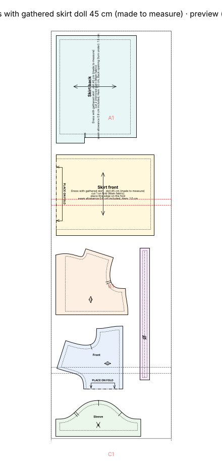
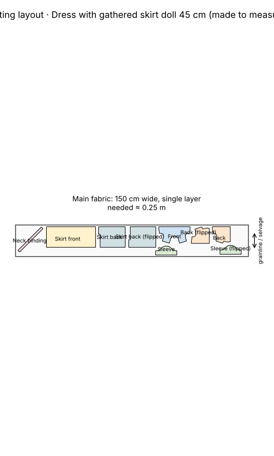

# Doll dress for a 45 cm fabric doll

> *"A dress for my daughter's 45 cm fabric doll. Chest 30 cm, waist 28 cm, hip 31 cm, head 32 cm."*

A gathered dress drafted from the doll's own measurements: 6 mm seam allowances, a back opening with Velcro instead of a neckline the head wouldn't fit through, bias-bound neckline.

## At a glance

- **Pieces:** 6
- **Fabric to buy:** main fabric 0.25 m at 150 cm width
- **Sewing steps:** 24
- **Sewability checks:** 45 of 45 OK

## Cutting layout

## Files

| File | What it is |
|---|---|
| [`cutting_layout.png`](cutting_layout.png) | Cutting layout on the fabric, with fabric amounts |
| [`doll_dress_45cm_a4_preview.png`](doll_dress_45cm_a4_preview.png) | Preview picture of the print file |
| [`doll_dress_45cm_a4_tiled.pdf`](doll_dress_45cm_a4_tiled.pdf) | Print file as A4 pages to tape together (last page: overview) |
| [`doll_dress_45cm_master_1to1.svg`](doll_dress_45cm_master_1to1.svg) | The whole pattern as one 1:1 SVG |
| [`pattern.json`](pattern.json) | All pieces, measurements and construction values as data |
| [`sewing_instructions.md`](sewing_instructions.md) | The same instructions as text, with a picture per step |
| [`sewing_instructions.pdf`](sewing_instructions.pdf) | Illustrated sewing booklet, then measurements, pieces and checks |
| [`steps`](steps) | Step pictures used by sewing_instructions.md |
| [`validation_report.md`](validation_report.md) | Every sewability check with target and actual value |

Print the PDF at **100 % / actual size** and check the 5 × 5 cm square before cutting.
