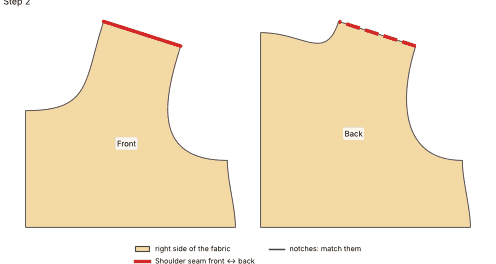
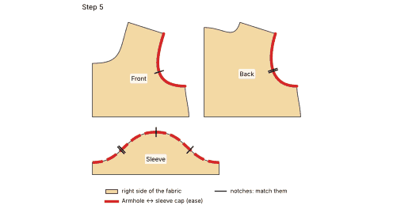
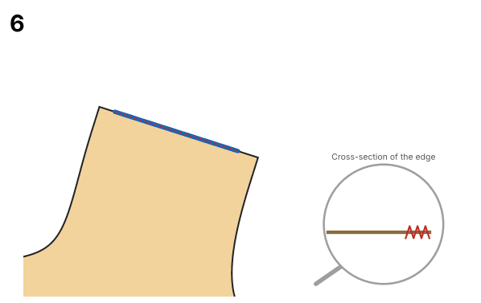
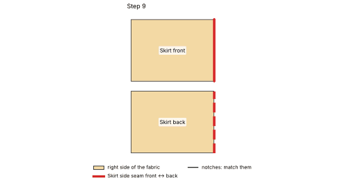
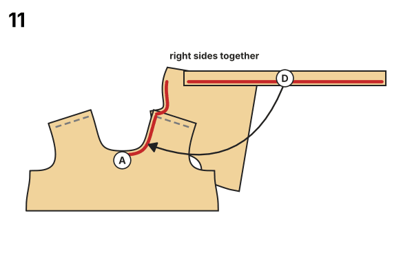

# Dress with gathered skirt · doll 45 cm (made to measure)

*wide fit, Woven (0 % stretch)* · original parametric draft. The pattern is yours to use.

> **Important:** With a new pattern, first sew a **test garment** from inexpensive fabric with similar stretch and check the fit.

## Files

- PDF A4 tiles to glue (3 pages + overview): `doll_dress_45cm_a4_tiled.pdf`
- Preview A4 tiles: `doll_dress_45cm_a4_preview.png`
- SVG master 1:1: `doll_dress_45cm_master_1to1.svg`
- Cutting layout: `cutting_layout.png`
- Sewing instructions (PDF): `sewing_instructions.pdf`
- Sewing instructions (Markdown): `sewing_instructions.md`

## Printing

- Always print at **100 % / "Actual size"** (not "Fit to page").
- Measure the **5 × 5 cm** control square before you cut.
- Plotter (610 mm roll): the page is 600 mm wide in portrait. In the print dialog choose a custom paper size with exactly this width and length, and turn rotation/scaling off.

## Body measurements

| Body measurement | Value | Source |
|---|---|---|
| Body height | 45.0 cm | user |
| Chest | 30.0 cm | user |
| Waist | 28.0 cm | user |
| Hip | 31.0 cm | user |
| Head | 32.0 cm | user |
| Neck | 15.1 cm | derived |
| Inseam | 14.0 cm | user |
| Side length | 22.0 cm | user |
| Arm length | 12.0 cm | user |
| Back length | 9.0 cm | derived |
| Shoulder width | 3.2 cm | derived |
| Thigh | 18.0 cm | derived |
| Ankle | 11.4 cm | derived |

## Finished measurements (virtually sewn)

| Finished measurement | Value |
|---|---|
| Chest width | 36.9 cm |
| Hem width | 60.9 cm |
| Dress length from neck point | 20.7 cm |
| Sleeve length | 4.2 cm |
| Sleeve opening | 12.5 cm |
| Upper-arm width | 12.5 cm |
| Neckline circumference | 20.4 cm |
| Waist seam (bodice) | 38.1 cm |
| Skirt top edge (ungathered) | 60.9 cm |
| Skirt length | 11.4 cm |

## Pattern pieces

| Piece | Cutting | Fabric | Seam allowance |
|---|---|---|---|
| Front | cut 1 on fold | Main fabric | seam allowance 0.6 cm included; Neckline: 0.4 cm |
| Back | cut 2 (mirrored pair) | Main fabric | seam allowance 0.6 cm included; Back opening (turn under): 1.5 cm; Neckline: 0.4 cm |
| Sleeve | cut 2 (mirrored pair) | Main fabric | seam allowance 0.6 cm included; Sleeve hem: 1.0 cm |
| Neck binding (bias) | cut 1 | Main fabric | seam allowance 0.4 cm included |
| Skirt front | cut 1 on fold | Main fabric | seam allowance 0.6 cm included; Hem: 1.0 cm |
| Skirt back | cut 2 (mirrored pair) | Main fabric | seam allowance 0.6 cm included; Hem: 1.0 cm; Back opening (turn under): 1.5 cm |

## Fabric needed

- **Main fabric:** about 0.25 m at 150 cm width (single layer, incl. 10 % for shrinkage; folded would need 0.35 m)
- Doll clothes: narrow seam allowances (6 mm). Sew with a short stitch (1.5–2 mm) and finish woven edges with pinking shears, a narrow zigzag or a little fray stop.
- Thin, soft fabrics work best (cotton poplin, batiste, old T-shirts); thick fabric makes the tiny seams bulky.
- The back opens completely: close it with narrow Velcro (1 cm) or 2–3 small snaps.

Cutting layout: see `cutting_layout.png` (grainline arrow parallel to the selvage, "flipped" = place the piece face down, "×2" = cut through both layers of the folded fabric, which gives a mirrored pair, "(unfolded)" = cut-on-fold piece shown opened out).

**Cut on fold** (Front, Skirt front): the paper piece is only one half. Its fold edge (dash-dot line, bracket arrows "PLACE ON FOLD") is the centre of the piece: it gets no seam allowance and is never cut. Where the cutting layout shows a piece "(unfolded)" on a single layer, fold the fabric along the grain just wide enough for the piece and place the fold edge on that fold, or trace the paper piece, flip it over along the fold edge and trace the second half.

## Sewing instructions

Seam allowance is included in the pattern (see table). 

1. **Prepare:** pre-wash the fabric, cut out the pieces, snip the notches 3–4 mm deep.
2. **Shoulders:** place front and back right sides together and sew the shoulder seams with a straight stitch, then finish the edges.
   
3. **Back opening:** finish both centre back edges, press the opening allowance (1.5 cm) to the inside and stitch it down. The two edges overlap at the centre back: sew a strip of narrow Velcro (or two or three snaps) onto the overlap, the soft side on the left back, the hook side on the right back. The garment opens completely, which makes dressing easy (dolls, small children).
4. **Neck binding:** fold the bias strip lengthwise wrong sides together and press. Pin it right sides together to the neckline (raw edges together), letting each end stick out past the opening edge by the allowance, and sew. Fold the ends in, turn the binding to the inside so it covers the seam allowance, and stitch it down close to the fold.
5. **Set in the sleeves:** pin the centre of the sleeve cap (top notch) to the shoulder seam, match the front/back notches and sew the sleeve in flat (ease the cap in slightly if needed).
   
6. **Side and sleeve seams:** sew in one go from the hem over the underarm to the sleeve hem; the underarm seams meet exactly.
   
7. **Sleeve hem:** press the hem allowance under and sew with a straight stitch.
8. **Skirt centre back seam:** sew the skirt back pieces right sides together from the hem up to the notch; above the notch the seam stays open (it continues the back opening).
9. **Skirt side seams:** sew skirt front and back right sides together with a straight stitch, then finish the edges.
   
10. **Gather the skirt:** run two gathering threads along the top edge and pull them up to the bodice waist (gather ratio 1.6); spread the gathers evenly.
11. **Waist seam:** pin the skirt right sides together to the bodice (side seams meet, centre front/back meet) and sew with a straight stitch, then finish the edges.
   
12. **Hem:** press the hem allowance under twice and stitch.
13. Done! Press the seams.

## Validation report

### Sewability check

| Area | Check | Target | Actual | Δ | Result | Note |
|---|---|---|---|---|---|---|
| Seam pairs | Side seam front ↔ back | 3.1 cm | 3.1 cm | +0.0 mm | ✅ OK |  |
| Seam pairs | Armhole ↔ sleeve cap (ease) | ease 3–8 mm | 13.8 cm ↔ 14.3 cm | +5.4 mm | ✅ OK | Woven: 3–8 mm |
| Seam pairs | Shoulder seam front ↔ back | 3.7 cm | 3.7 cm | +0.0 mm | ✅ OK |  |
| Seam pairs | Sleeve seam (front ↔ back) | 1.2 cm | 1.2 cm | +0.0 mm | ✅ OK |  |
| Seam pairs | Neck binding ↔ neckline | 20.4 cm | 20.4 cm | +0.0 mm | ✅ OK |  |
| Seam pairs | Waist seam bodice ↔ skirt (gathered) | 40–100 % of 60.9 cm | 38.1 cm = 63 % | -228.4 mm | ✅ OK | gather ratio 1.6 (allowed 1–2.5) |
| Seam pairs | Skirt side seam front ↔ back | 11.4 cm | 11.4 cm | +0.0 mm | ✅ OK |  |
| Seam pairs | Skirt centre back seam (left ↔ right) | 7.4 cm | 7.4 cm | +0.0 mm | ✅ OK | open for the top 4.0 cm (notch) |
| Angles/transitions | Underarm: side seam ↔ armhole front | 90° | 91.9° | +1.9° | ✅ OK |  |
| Angles/transitions | Underarm: side seam ↔ armhole back | 90° | 92.2° | +2.2° | ✅ OK |  |
| Angles/transitions | Shoulder ↔ armhole (front + back) | 180° | 180.6° | +0.6° | ✅ OK |  |
| Angles/transitions | Sleeve cap top (smooth) | 180° | 178.2° | -1.8° | ✅ OK |  |
| Angles/transitions | Sleeve underarm ↔ cap front | 90° | 90.9° | +0.9° | ✅ OK |  |
| Angles/transitions | Shoulder ↔ neckline (front + back) | 180° | 180.9° | +0.9° | ✅ OK |  |
| Angles/transitions | Neckline at centre front | 90° | 90.4° | +0.4° | ✅ OK |  |
| Angles/transitions | Neckline at centre back | 90° | 89.0° | -1.0° | ✅ OK |  |
| Angles/transitions | Hem at centre front | 90° | 90.0° | +0.0° | ✅ OK |  |
| Angles/transitions | Hem ↔ side seam front | 90° | 88.8° | -1.2° | ✅ OK |  |
| Angles/transitions | Skirt hem ↔ side seam | 90° | 90.0° | +0.0° | ✅ OK |  |
| Angles/transitions | Skirt side seam ↔ waist | 90° | 90.0° | +0.0° | ✅ OK |  |
| Angles/transitions | Skirt waist ↔ centre | 90° | 90.0° | +0.0° | ✅ OK |  |
| Measurements | Chest circumference pattern = body + ease | 36.6 cm | 36.9 cm | +0.8 % | ✅ OK | body 30 cm + +22 % ease |
| Measurements | Head fits through the back opening | ≥ 33.6 cm | 38.1 cm | +45.0 mm | ✅ OK | neckline + both edges of the back opening ≥ head circumference + 5 % |
| Measurements | Dress goes on through the back opening | ≥ 32.6 cm | 46.0 cm | +134.9 mm | ✅ OK | waist seam + both edges of the skirt opening ≥ hip + 5 % |
| Measurements | Dress length plausible | 14.9 cm – 33.5 cm | 20.7 cm | +0.0 mm | ✅ OK | from the neck point |
| Geometry | Front: outline & seam allowance | closed, SA present | ok |  | ✅ OK | seam allowance 0.6 cm included; Neckline: 0.4 cm |
| Labels | Front: grainline & cutting | present | cut 1 on fold |  | ✅ OK | Main fabric |
| Geometry | Back: outline & seam allowance | closed, SA present | ok |  | ✅ OK | seam allowance 0.6 cm included; Back opening (turn under): 1.5 cm; Neckline: 0.4 cm |
| Labels | Back: grainline & cutting | present | cut 2 (mirrored pair) |  | ✅ OK | Main fabric |
| Geometry | Sleeve: outline & seam allowance | closed, SA present | ok |  | ✅ OK | seam allowance 0.6 cm included; Sleeve hem: 1.0 cm |
| Labels | Sleeve: grainline & cutting | present | cut 2 (mirrored pair) |  | ✅ OK | Main fabric |
| Geometry | Neck binding (bias): outline & seam allowance | closed, SA present | ok |  | ✅ OK | seam allowance 0.4 cm included |
| Labels | Neck binding (bias): grainline & cutting | present | cut 1 |  | ✅ OK | Main fabric |
| Geometry | Skirt front: outline & seam allowance | closed, SA present | ok |  | ✅ OK | seam allowance 0.6 cm included; Hem: 1.0 cm |
| Labels | Skirt front: grainline & cutting | present | cut 1 on fold |  | ✅ OK | Main fabric |
| Geometry | Skirt back: outline & seam allowance | closed, SA present | ok |  | ✅ OK | seam allowance 0.6 cm included; Hem: 1.0 cm; Back opening (turn under): 1.5 cm |
| Labels | Skirt back: grainline & cutting | present | cut 2 (mirrored pair) |  | ✅ OK | Main fabric |
| Geometry | Back: turned allowance lies flat | ≤ 0.5 mm | 0.0 mm |  | ✅ OK | Back opening (turn under): corners mirrored at the fold line |
| Geometry | Sleeve: turned allowance lies flat | ≤ 0.5 mm | 0.0 mm |  | ✅ OK | Sleeve hem: corners mirrored at the fold line |
| Geometry | Front: cut-on-fold edge | straight, no SA, 90° corners, on grain | ok, corners ≤ 0.4° off 90° |  | ✅ OK | Centre (fold) |
| Geometry | Skirt front: cut-on-fold edge | straight, no SA, 90° corners, on grain | ok, corners ≤ 0.0° off 90° |  | ✅ OK | Centre (fold) |
| Labels | Front: notches | on the cutting line | 1 notch mark(s) |  | ✅ OK |  |
| Labels | Back: notches | on the cutting line | 2 notch mark(s) |  | ✅ OK |  |
| Labels | Sleeve: notches | on the cutting line | 4 notch mark(s) |  | ✅ OK | 1 at corners |
| Labels | Skirt back: notches | on the cutting line | 2 notch mark(s) |  | ✅ OK |  |

**Result:** 45 OK, 0 warning(s), 0 error(s): the pattern is sewable.

### Construction values

Override any of these with the option `construction`, values in mm (e.g. `{"construction": {"chest_width": 366}}`).

| Name | Value | Derived from | Note |
|---|---|---|---|
| `chest_width` | 36.6 cm | chest × (1 + 22 % ease) |  |
| `neck_width_half` | 3.5 cm | neck / 5 + 1.5 cm |  |
| `front_neck_depth` | 4.0 cm | neck_width_half + 1.5 cm |  |
| `back_neck_depth` | 0.5 cm | fixed |  |
| `shoulder_length` | 3.7 cm | shoulder + allowance for fit 'wide' |  |
| `shoulder_slope` | 17 | fixed |  |
| `armhole_depth` | 6.3 cm | 18 % of chest_width + 2.5 cm + 3 %, limited to option armhole_depth_max |  |
| `body_length` | 9.3 cm | option body_length |  |
