# Dress with gathered skirt · doll 45 cm (made to measure)

*wide fit, Woven (0 % stretch)* · original parametric draft. The pattern is yours to use.

> **Important:** With a new pattern, first sew a **test garment** from inexpensive fabric with similar stretch and check the fit.

## Files

- PDF A4 tiles to glue (3 pages + overview): `doll_dress_45cm_a4_tiled.pdf`
- Preview A4 tiles: `doll_dress_45cm_a4_preview.png`
- SVG master 1:1: `doll_dress_45cm_master_1to1.svg`
- Cutting layout: `cutting_layout.png`
- Sewing instructions (PDF): `sewing_instructions.pdf`
- Sewing instructions (Markdown): `sewing_instructions.md`

## Printing

- Always print at **100 % / "Actual size"** (not "Fit to page").
- Measure the **5 × 5 cm** control square before you cut.
- Plotter (610 mm roll): the page is 600 mm wide in portrait. In the print dialog choose a custom paper size with exactly this width and length, and turn rotation/scaling off.

## Body measurements

| Body measurement | Value | Source |
|---|---|---|
| Body height | 45.0 cm | user |
| Chest | 30.0 cm | user |
| Waist | 28.0 cm | user |
| Hip | 31.0 cm | user |
| Head | 32.0 cm | user |
| Neck | 15.1 cm | derived |
| Inseam | 14.0 cm | user |
| Side length | 22.0 cm | user |
| Arm length | 12.0 cm | user |
| Back length | 9.0 cm | derived |
| Shoulder width | 3.2 cm | derived |
| Thigh | 18.0 cm | derived |
| Ankle | 11.4 cm | derived |

## Finished measurements (virtually sewn)

| Finished measurement | Value |
|---|---|
| Chest width | 36.9 cm |
| Hem width | 60.9 cm |
| Dress length from neck point | 20.7 cm |
| Sleeve length | 4.2 cm |
| Sleeve opening | 12.5 cm |
| Upper-arm width | 12.5 cm |
| Neckline circumference | 19.0 cm |
| Waist seam (bodice) | 38.1 cm |
| Skirt top edge (ungathered) | 60.9 cm |
| Skirt length | 11.4 cm |

## Pattern pieces

| Piece | Cutting | Fabric | Seam allowance |
|---|---|---|---|
| Front | cut 1 on fold | Main fabric | seam allowance 0.6 cm included; Neckline: 0.4 cm |
| Back | cut 2 (mirrored pair) | Main fabric | seam allowance 0.6 cm included; Back opening (turn under): 1.5 cm; Neckline: 0.4 cm |
| Sleeve | cut 2 (mirrored pair) | Main fabric | seam allowance 0.6 cm included; Sleeve hem: 1.0 cm |
| Neck binding (bias) | cut 1 | Main fabric | seam allowance 0.4 cm included |
| Skirt front | cut 1 on fold | Main fabric | seam allowance 0.6 cm included; Hem: 1.0 cm |
| Skirt back | cut 2 (mirrored pair) | Main fabric | seam allowance 0.6 cm included; Hem: 1.0 cm; Back opening (turn under): 1.5 cm |

## Fabric needed

- **Main fabric:** about 0.20 m at 150 cm width (single layer, incl. 10 % for shrinkage; folded would need 0.30 m)
- Doll clothes: narrow seam allowances (6 mm). Sew with a short stitch (1.5–2 mm) and finish woven edges with pinking shears, a narrow zigzag or a little fray stop.
- Thin, soft fabrics work best (cotton poplin, batiste, old T-shirts); thick fabric makes the tiny seams bulky.
- The back opens completely: close it with narrow Velcro (1 cm) or 2–3 small snaps.

Cutting layout: see `cutting_layout.png` (grainline arrow parallel to the selvage, "flipped" = place the piece face down, "×2" = cut through both layers of the folded fabric, which gives a mirrored pair, "(unfolded)" = cut-on-fold piece shown opened out).

**Cut on fold** (Front, Skirt front): the paper piece is only one half. Its fold edge (dash-dot line, bracket arrows "PLACE ON FOLD") is the centre of the piece: it gets no seam allowance and is never cut. Where the cutting layout shows a piece "(unfolded)" on a single layer, fold the fabric along the grain just wide enough for the piece and place the fold edge on that fold, or trace the paper piece, flip it over along the fold edge and trace the second half.

## Sewing instructions

The printed instructions (`sewing_instructions.pdf`) show every step as a picture of your pieces: parts list, tools, then one action per step.

Seam allowance is included in the pattern (see table). 

1. **Pre-wash the fabric**. Wash and dry it the way you will wash the garment later, so it shrinks now, not after sewing.
2. **Cut out all pieces**. Follow the cutting layout; grainline arrows parallel to the selvage. Single layer: cut the second piece of a pair with the paper piece turned over (printed side down).
3. **Snip the notches**. Cut 3–4 mm into the seam allowance at every notch. Tip: Never deeper than half the seam allowance.
4. **Set up the machine**. Sewing machine: universal needle 80, polyester thread. Sew a test seam on two layers of a scrap. See the basics page at the front of the booklet.
5. **Sew the shoulder seams**. Lay front and back right sides together, shoulder edges level, and pin. Sew with 6 mm seam allowance from the neckline to the armhole. Press the allowances towards the back. (a straight stitch, then finish the edges) Do this twice.
   
6. **Finish the shoulder seams**. Finish both allowances together, from the right side of the upper layer. Press them towards the back. (sewing machine: wide zigzag 4 × 1.5 mm over the edge) Do this twice.
   
7. **Finish the opening edges**. Finish both centre back edges separately. (sewing machine: wide zigzag 4 × 1.5 mm over the edge) Do this twice.
   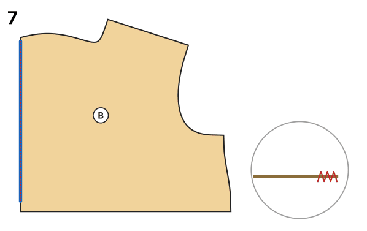
8. **Turn in the opening edges**. Fold the opening edge 1.5 cm to the wrong side and press. Stitch it down close to the finished edge. (sewing machine: straight stitch 3 mm) Do this twice.
   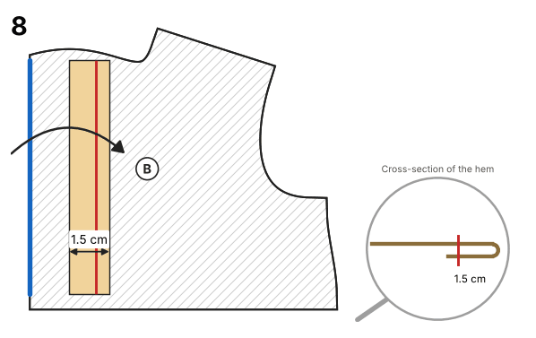
9. **Sew on the Velcro**. Lay the right back over the left back so the edges overlap at the centre back. Sew the soft side to the right side of the left back and the hook side to the inside of the right back, stitching round each strip (or sew on 2–3 snaps). (sewing machine: straight stitch 3 mm) Tip: The garment opens completely: easy dressing.
10. **Fold the binding in half**. Fold the bias strip lengthwise wrong sides together, raw edges level, and press. Shape it into a curve with the iron.
   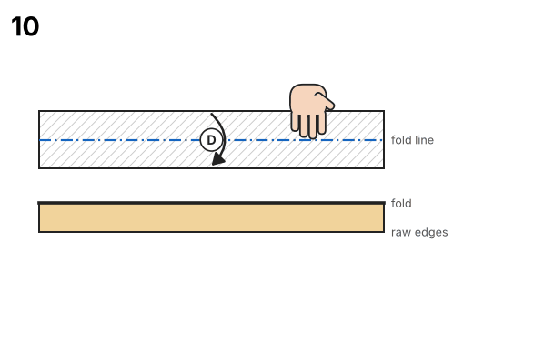
11. **Sew the neck binding on**. Lay the binding on the right side of the neckline, raw edges level; let each end stick out past the opening edge by the allowance. Pin without stretching. Sew with 4.2 mm seam allowance. Trim the allowance to half and clip it in the curves. (a straight stitch, then finish the edges)
   
12. **Stitch the binding down**. Fold the ends in. Turn the binding to the inside over the allowance and press. Stitch it down close to the fold. (sewing machine: straight stitch 3 mm) Press first: the binding then rolls inside by itself.
   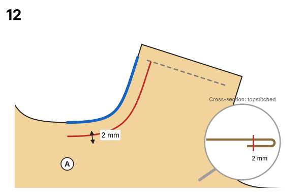
13. **Set in the sleeves**. Open the body out flat, right side up. Lay the sleeve right side down on the armhole: top of the cap on the shoulder seam, single notch on the front, double notch on the back. Pin from the middle to both ends, easing in the extra length of the cap. Sew with 6 mm seam allowance, sleeve underneath; press the allowances towards the sleeve. (a straight stitch, then finish the edges) Do this twice. Tip: Sleeve on the bottom: the feed dogs ease the cap in without pleats.
   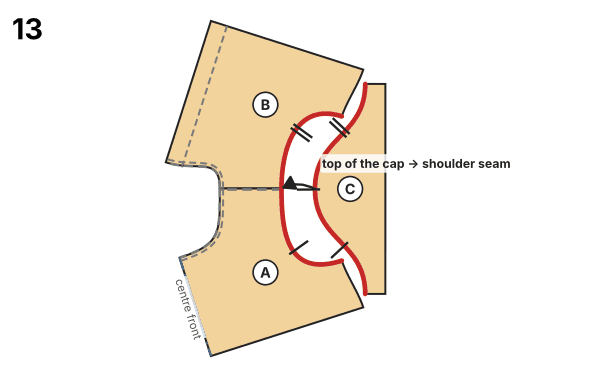
14. **Finish the armhole seams**. Finish both allowances together, from the right side of the upper layer. Press them towards the back. (sewing machine: wide zigzag 4 × 1.5 mm over the edge) Do this twice.
   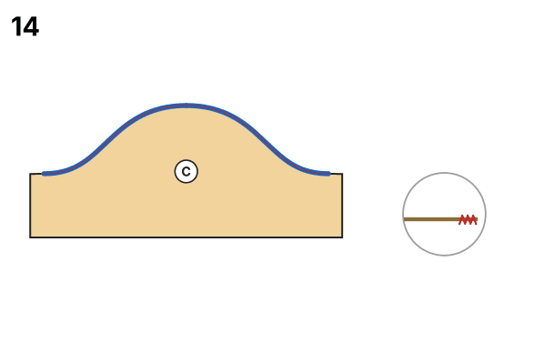
15. **Sew side and sleeve seams**. Fold the garment right sides together at the shoulders, the sleeves folded in half lengthwise. Pin side and sleeve seam so that the armhole seams meet exactly at the underarm. Sew in one go with 6 mm seam allowance, from the hem over the underarm to the sleeve hem. Press the allowances towards the back. (a straight stitch, then finish the edges) Do this twice.
   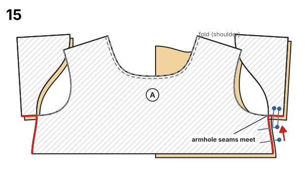
16. **Finish the side seams**. Finish both allowances together, from the right side of the upper layer. Press them towards the back. (sewing machine: wide zigzag 4 × 1.5 mm over the edge) Do this twice.
   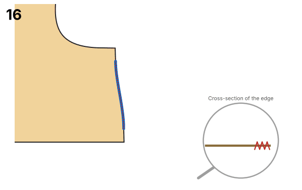
17. **Hem the sleeves**. Fold the sleeve hem 10 mm to the wrong side and press. Sew it down 6 mm from the fold, from the right side. (a straight stitch) Do this twice. Slide the sleeve over the free arm of the machine.
   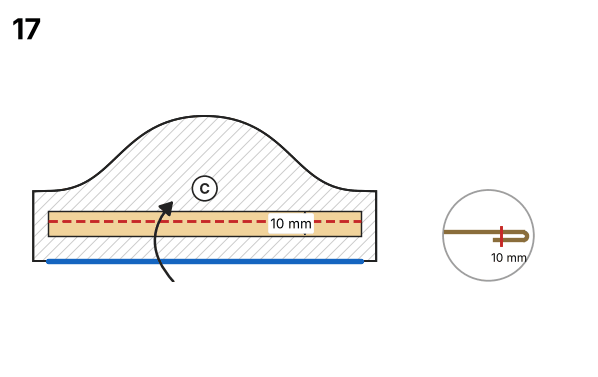
18. **Sew the skirt centre back seam**. Lay the skirt back pieces right sides together, centre back edges level. Sew with 6 mm seam allowance from the hem up to the notch. Above the notch the seam stays open and continues the back opening. (a straight stitch, then finish the edges) Tip: Backstitch firmly at the notch: the opening pulls there.
   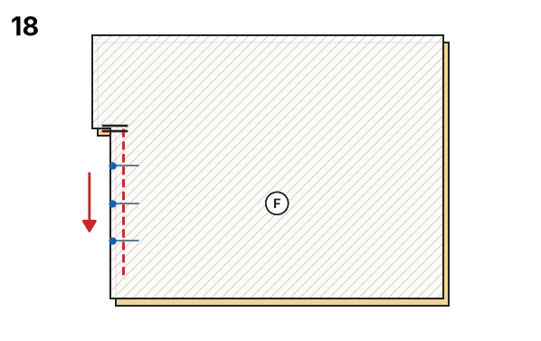
19. **Sew the skirt side seams**. Lay skirt front and back right sides together, side edges level. Sew with 6 mm seam allowance from the waist to the hem. Press the allowances towards the back. (a straight stitch, then finish the edges) Do this twice.
   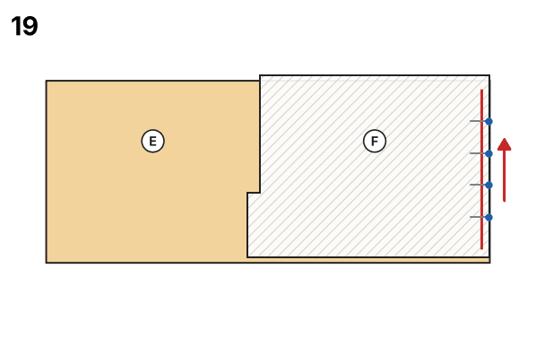
20. **Finish the skirt side seams**. (sewing machine: wide zigzag 4 × 1.5 mm over the edge) Do this twice.
   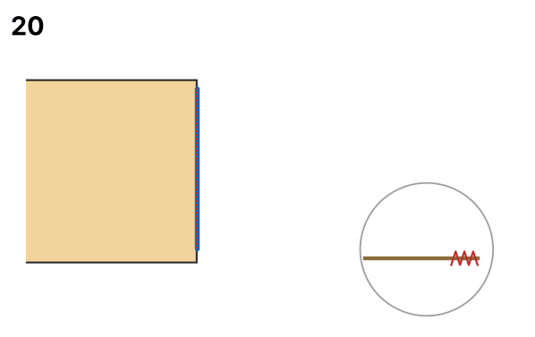
21. **Gather the skirt top edge**. Sew two rows of the longest stitch inside the seam allowance, 5 mm apart; leave long thread ends. Pull the bobbin threads until the edge matches the bodice waist (gather ratio 1.6). Spread the gathers evenly and knot the threads. (sewing machine: 2 rows of the longest straight stitch, loose ends) Pull from both ends towards the middle: the threads break less easily.
   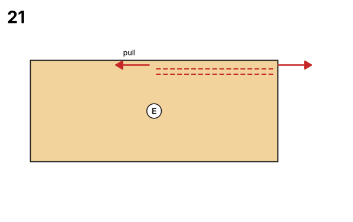
22. **Sew skirt and bodice together**. Turn the skirt wrong side out and slip the bodice into it, right side out, so the right sides lie together and the waist edges are level. Match the side seams and the centre front and back, and pin. Sew with 6 mm seam allowance, skirt on top. Press the allowances towards the bodice. (a straight stitch, then finish the edges) Sew over the gathers slowly and keep them straight with a pin tip.
   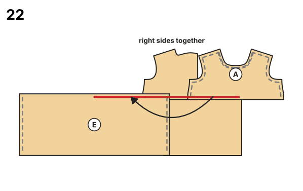
23. **Sew the hem**. Fold the hem 5 mm to the wrong side and press, then fold it again by the same amount. Sew it down close to the inner fold. (a straight stitch)
   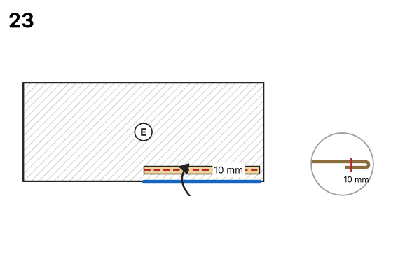
24. **Final pressing**. Press all seams.

## Validation report

### Sewability check

| Area | Check | Target | Actual | Δ | Result | Note |
|---|---|---|---|---|---|---|
| Seam pairs | Side seam front ↔ back | 3.1 cm | 3.1 cm | +0.0 mm | ✅ OK |  |
| Seam pairs | Armhole ↔ sleeve cap (ease) | ease 3–8 mm | 13.8 cm ↔ 14.3 cm | +5.4 mm | ✅ OK | Woven: 3–8 mm |
| Seam pairs | Shoulder seam front ↔ back | 3.7 cm | 3.7 cm | +0.0 mm | ✅ OK |  |
| Seam pairs | Sleeve seam (front ↔ back) | 1.2 cm | 1.2 cm | +0.0 mm | ✅ OK |  |
| Seam pairs | Neck binding ↔ neckline | 19.0 cm | 19.0 cm | +0.0 mm | ✅ OK |  |
| Seam pairs | Waist seam bodice ↔ skirt (gathered) | 40–100 % of 60.9 cm | 38.1 cm = 63 % | -228.4 mm | ✅ OK | gather ratio 1.6 (allowed 1–2.5) |
| Seam pairs | Skirt side seam front ↔ back | 11.4 cm | 11.4 cm | +0.0 mm | ✅ OK |  |
| Seam pairs | Skirt centre back seam (left ↔ right) | 7.4 cm | 7.4 cm | +0.0 mm | ✅ OK | open for the top 4.0 cm (notch) |
| Angles/transitions | Underarm: side seam ↔ armhole front | 90° | 91.9° | +1.9° | ✅ OK |  |
| Angles/transitions | Underarm: side seam ↔ armhole back | 90° | 92.2° | +2.2° | ✅ OK |  |
| Angles/transitions | Shoulder ↔ armhole (front + back) | 180° | 180.6° | +0.6° | ✅ OK |  |
| Angles/transitions | Sleeve cap top (smooth) | 180° | 178.2° | -1.8° | ✅ OK |  |
| Angles/transitions | Sleeve underarm ↔ cap front | 90° | 90.9° | +0.9° | ✅ OK |  |
| Angles/transitions | Shoulder ↔ neckline (front + back) | 180° | 181.1° | +1.1° | ✅ OK |  |
| Angles/transitions | Neckline at centre front | 90° | 90.3° | +0.3° | ✅ OK |  |
| Angles/transitions | Neckline at centre back | 90° | 89.0° | -1.0° | ✅ OK |  |
| Angles/transitions | Hem at centre front | 90° | 90.0° | +0.0° | ✅ OK |  |
| Angles/transitions | Hem ↔ side seam front | 90° | 88.8° | -1.2° | ✅ OK |  |
| Angles/transitions | Skirt hem ↔ side seam | 90° | 90.0° | +0.0° | ✅ OK |  |
| Angles/transitions | Skirt side seam ↔ waist | 90° | 90.0° | +0.0° | ✅ OK |  |
| Angles/transitions | Skirt waist ↔ centre | 90° | 90.0° | +0.0° | ✅ OK |  |
| Measurements | Chest circumference pattern = body + ease | 36.6 cm | 36.9 cm | +0.8 % | ✅ OK | body 30 cm + +22 % ease |
| Measurements | Head fits through the back opening | ≥ 33.6 cm | 36.7 cm | +30.8 mm | ✅ OK | neckline + both edges of the back opening ≥ head circumference + 5 % |
| Common practice | Chest ease for fit 'wide' | 20 – 34 % | 22 % | +0 % | ✅ OK | guide value for this fit |
| Common practice | Crew neck depth (front) | 2.8 cm – 3.9 cm | 3.2 cm | +0.0 mm | ✅ OK | about as deep as the half neck width |
| Common practice | Neck width (half) | 3.2 cm – 4.0 cm | 3.5 cm | +0.0 mm | ✅ OK | neck / 5 + 0.5 to 1.0 cm |
| Common practice | Sleeve cap height for this shoulder | 1.8 cm – 3.4 cm | 3.0 cm | +0.0 mm | ✅ OK | lower cap for a dropped shoulder |
| Measurements | Dress goes on through the back opening | ≥ 32.6 cm | 46.0 cm | +134.9 mm | ✅ OK | waist seam + both edges of the skirt opening ≥ hip + 5 % |
| Measurements | Dress length plausible | 14.9 cm – 33.5 cm | 20.7 cm | +0.0 mm | ✅ OK | from the neck point |
| Geometry | Front: outline & seam allowance | closed, SA present | ok |  | ✅ OK | seam allowance 0.6 cm included; Neckline: 0.4 cm |
| Labels | Front: grainline & cutting | present | cut 1 on fold |  | ✅ OK | Main fabric |
| Geometry | Back: outline & seam allowance | closed, SA present | ok |  | ✅ OK | seam allowance 0.6 cm included; Back opening (turn under): 1.5 cm; Neckline: 0.4 cm |
| Labels | Back: grainline & cutting | present | cut 2 (mirrored pair) |  | ✅ OK | Main fabric |
| Geometry | Sleeve: outline & seam allowance | closed, SA present | ok |  | ✅ OK | seam allowance 0.6 cm included; Sleeve hem: 1.0 cm |
| Labels | Sleeve: grainline & cutting | present | cut 2 (mirrored pair) |  | ✅ OK | Main fabric |
| Geometry | Neck binding (bias): outline & seam allowance | closed, SA present | ok |  | ✅ OK | seam allowance 0.4 cm included |
| Labels | Neck binding (bias): grainline & cutting | present | cut 1 |  | ✅ OK | Main fabric |
| Geometry | Skirt front: outline & seam allowance | closed, SA present | ok |  | ✅ OK | seam allowance 0.6 cm included; Hem: 1.0 cm |
| Labels | Skirt front: grainline & cutting | present | cut 1 on fold |  | ✅ OK | Main fabric |
| Geometry | Skirt back: outline & seam allowance | closed, SA present | ok |  | ✅ OK | seam allowance 0.6 cm included; Hem: 1.0 cm; Back opening (turn under): 1.5 cm |
| Labels | Skirt back: grainline & cutting | present | cut 2 (mirrored pair) |  | ✅ OK | Main fabric |
| Geometry | Back: turned allowance lies flat | ≤ 0.5 mm | 0.0 mm |  | ✅ OK | Back opening (turn under): corners mirrored at the fold line |
| Geometry | Sleeve: turned allowance lies flat | ≤ 0.5 mm | 0.0 mm |  | ✅ OK | Sleeve hem: corners mirrored at the fold line |
| Geometry | Front: cut-on-fold edge | straight, no SA, 90° corners, on grain | ok, corners ≤ 0.3° off 90° |  | ✅ OK | Centre (fold) |
| Geometry | Skirt front: cut-on-fold edge | straight, no SA, 90° corners, on grain | ok, corners ≤ 0.0° off 90° |  | ✅ OK | Centre (fold) |
| Labels | Front: notches | on the cutting line | 1 notch mark(s) |  | ✅ OK |  |
| Labels | Back: notches | on the cutting line | 2 notch mark(s) |  | ✅ OK |  |
| Labels | Sleeve: notches | on the cutting line | 4 notch mark(s) |  | ✅ OK | 1 at corners |
| Labels | Skirt back: notches | on the cutting line | 2 notch mark(s) |  | ✅ OK |  |

**Result:** 49 OK, 0 warning(s), 0 error(s): the pattern is sewable.

### Construction values

Override any of these with the option `construction`, values in mm (e.g. `{"construction": {"chest_width": 366}}`).

| Name | Value | Derived from | Note |
|---|---|---|---|
| `chest_width` | 36.6 cm | chest × (1 + 22 % ease) |  |
| `neck_width_half` | 3.5 cm | neck / 5 + 1.5 cm |  |
| `front_neck_depth` | 3.2 cm | 0.95 × neck_width_half − 0.5 cm |  |
| `back_neck_depth` | 0.5 cm | fixed |  |
| `shoulder_length` | 3.7 cm | shoulder + allowance for fit 'wide' |  |
| `shoulder_slope` | 17 | fixed |  |
| `armhole_depth` | 6.3 cm | 18 % of chest_width + 2.5 cm + 3 %, limited to option armhole_depth_max |  |
| `body_length` | 9.3 cm | option body_length |  |
