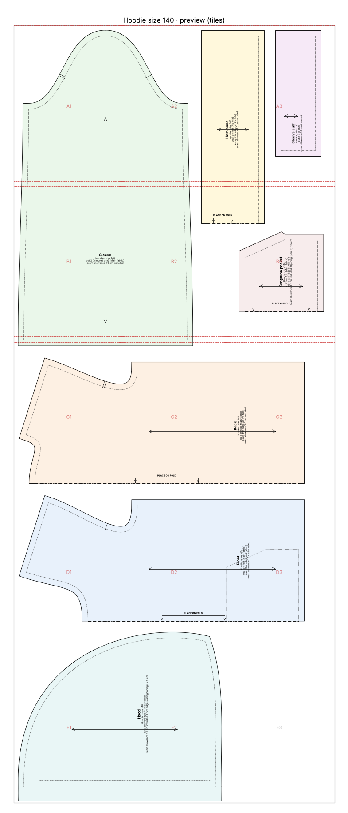
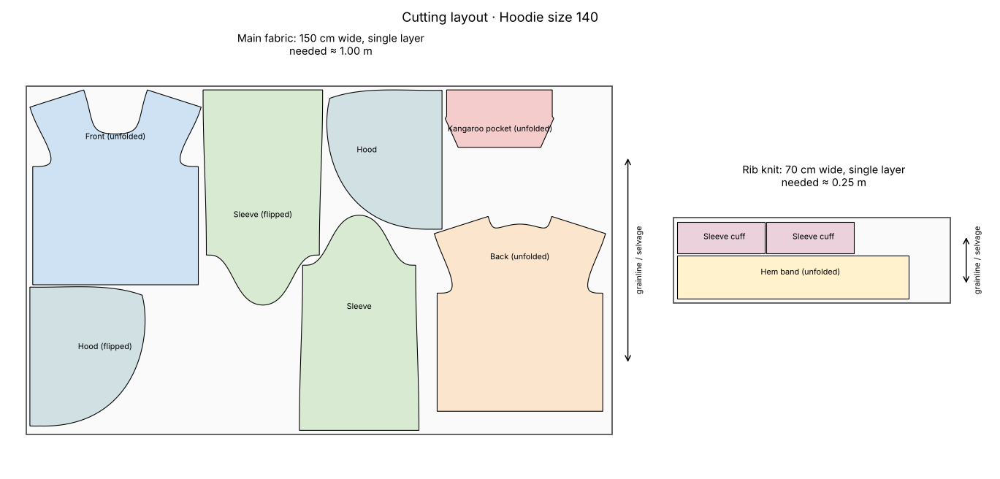
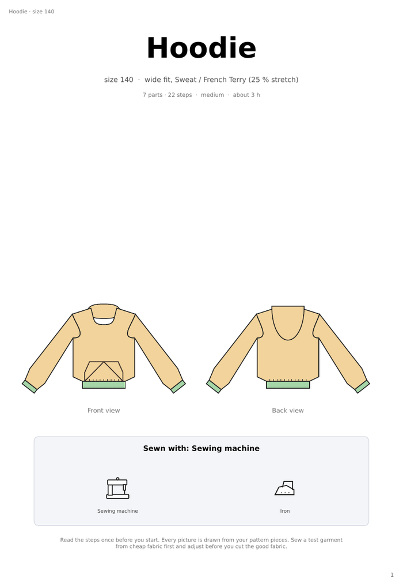
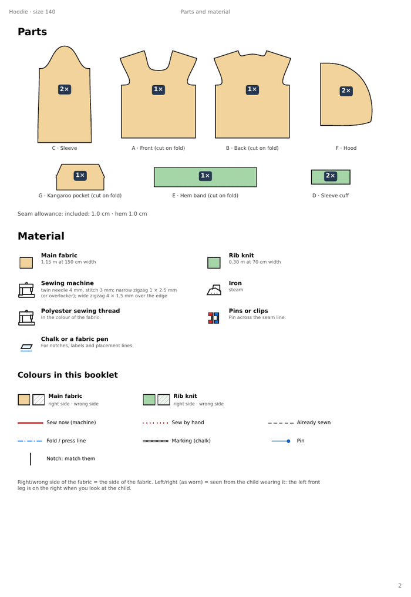
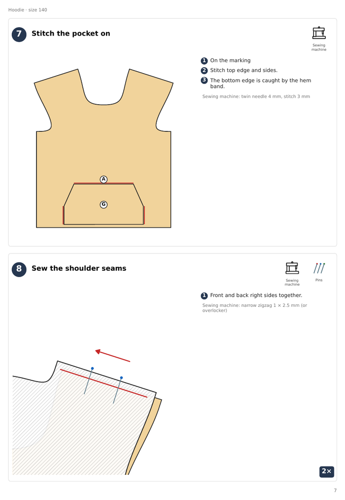

# Hoodie with kangaroo pocket, size 140

> *"A hoodie with kangaroo pocket for my son, size 140, sweat fabric, A4 pages."*

Hood, kangaroo pocket, set-in sleeves, rib cuffs and hem band. The sewing booklet has the most steps of all examples.

## At a glance

- **Pieces:** 7
- **Fabric to buy:** main fabric 1.15 m at 150 cm width, rib knit 0.30 m at 70 cm width
- **Sewing steps:** 22
- **Sewability checks:** 47 of 47 OK

## Cutting layout

## Sewing booklet

<table><tr>
<td></td>
<td></td>
<td></td>
</tr></table>

## Files

| File | What it is |
|---|---|
| [`cutting_layout.png`](cutting_layout.png) | Cutting layout on the fabric, with fabric amounts |
| [`hoodie_size140_a4_preview.png`](hoodie_size140_a4_preview.png) | Preview picture of the print file |
| [`hoodie_size140_a4_tiled.pdf`](hoodie_size140_a4_tiled.pdf) | Print file as A4 pages to tape together (last page: overview) |
| [`hoodie_size140_master_1to1.svg`](hoodie_size140_master_1to1.svg) | The whole pattern as one 1:1 SVG |
| [`pattern.json`](pattern.json) | All pieces, measurements and construction values as data |
| [`sewing_instructions.md`](sewing_instructions.md) | The same instructions as text, with a picture per step |
| [`sewing_instructions.pdf`](sewing_instructions.pdf) | Illustrated sewing booklet, then measurements, pieces and checks |
| [`steps`](steps) | Step pictures used by sewing_instructions.md |
| [`validation_report.md`](validation_report.md) | Every sewability check with target and actual value |

Print the PDF at **100 % / actual size** and check the 5 × 5 cm square before cutting.
