# Hoodie · size 140

*wide fit, Sweat / French Terry (25 % stretch)* · original parametric draft. The pattern is yours to use.

> **Important:** With a new pattern, first sew a **test garment** from inexpensive fabric with similar stretch and check the fit.

## Files

- PDF A4 tiles to glue (15 pages + overview): `hoodie_size140_a4_tiled.pdf`
- Preview A4 tiles: `hoodie_size140_a4_preview.png`
- SVG master 1:1: `hoodie_size140_master_1to1.svg`
- Cutting layout: `cutting_layout.png`
- Sewing instructions (PDF): `sewing_instructions.pdf`
- Sewing instructions (Markdown): `sewing_instructions.md`

## Printing

- Always print at **100 % / "Actual size"** (not "Fit to page").
- Measure the **5 × 5 cm** control square before you cut.
- Plotter (610 mm roll): the page is 600 mm wide in portrait. In the print dialog choose a custom paper size with exactly this width and length, and turn rotation/scaling off.

## Body measurements

| Body measurement | Value | Source |
|---|---|---|
| Body height | 140.0 cm | table |
| Chest | 69.0 cm | table |
| Waist | 60.0 cm | table |
| Hip | 75.0 cm | table |
| Head | 53.5 cm | table |
| Neck | 31.0 cm | table |
| Inseam | 64.5 cm | table |
| Side length | 84.0 cm | table |
| Arm length | 56.0 cm | table |
| Back length | 34.0 cm | table |
| Shoulder width | 11.2 cm | table |
| Thigh | 42.0 cm | table |
| Ankle | 20.2 cm | table |

## Finished measurements (virtually sewn)

| Finished measurement | Value |
|---|---|
| Chest width | 80.7 cm |
| Hem width | 56.5 cm |
| Length from neck point | 52.2 cm |
| Sleeve length | 56.1 cm |
| Sleeve opening | 20.0 cm |
| Upper-arm width | 26.9 cm |
| Neckline circumference | 51.1 cm |
| Hood height | 33.5 cm |

## Pattern pieces

| Piece | Cutting | Fabric | Seam allowance |
|---|---|---|---|
| Front | cut 1 on fold | Main fabric | seam allowance 1.0 cm included; Neckline: 0.7 cm |
| Back | cut 1 on fold | Main fabric | seam allowance 1.0 cm included; Neckline: 0.7 cm |
| Sleeve | cut 2 (mirrored pair) | Main fabric | seam allowance 1.0 cm included |
| Sleeve cuff | cut 2 | Rib knit | seam allowance 1.0 cm included |
| Hem band | cut 1 on fold | Rib knit | seam allowance 1.0 cm included |
| Hood | cut 2 (mirrored pair) | Main fabric | seam allowance 1.0 cm included; Front edge (casing/facing): 2.5 cm |
| Kangaroo pocket | cut 1 on fold | Main fabric | seam allowance 1.0 cm included; Opening (hem it): 1.5 cm |

## Fabric needed

- **Main fabric:** about 1.15 m at 150 cm width (single layer, incl. 10 % for shrinkage; folded would need 1.35 m)
- **Rib knit:** about 0.30 m at 70 cm width (single layer, incl. 10 % for shrinkage)

Cutting layout: see `cutting_layout.png` (grainline arrow parallel to the selvage, "flipped" = place the piece face down, "×2" = cut through both layers of the folded fabric, which gives a mirrored pair, "(unfolded)" = cut-on-fold piece shown opened out).

**Cut on fold** (Front, Back, Hem band, Kangaroo pocket): the paper piece is only one half. Its fold edge (dash-dot line, bracket arrows "PLACE ON FOLD") is the centre of the piece: it gets no seam allowance and is never cut. Where the cutting layout shows a piece "(unfolded)" on a single layer, fold the fabric along the grain just wide enough for the piece and place the fold edge on that fold, or trace the paper piece, flip it over along the fold edge and trace the second half.

## Sewing instructions

The printed instructions (`sewing_instructions.pdf`) show every step as a picture of your pieces: parts list, tools, then one action per step.

Seam allowance is included in the pattern (see table). Use a jersey/stretch needle for jersey and sweat.

1. **Pre-wash the fabric**. Wash and dry it the way you will wash the garment later, so it shrinks now, not after sewing.
2. **Cut out all pieces**. Follow the cutting layout; grainline arrows parallel to the selvage. Cut both layers at once with long strokes; keep the fabric flat on the table.
3. **Snip the notches**. Cut 3–4 mm into the seam allowance at every notch. Tip: Never deeper than half the seam allowance.
4. **Set up the machine**. Jersey/stretch needle 75–80, polyester thread. Sew a test seam on a scrap first. See the basics page at the front of the booklet.
5. **Hem the pocket openings**. Fold each slanted opening edge 1.5 cm to the wrong side and press. Topstitch 1.2 cm from the fold, right side up, so the stitching catches the raw edge. (sewing machine: twin needle 4 mm, stitch 3 mm)
   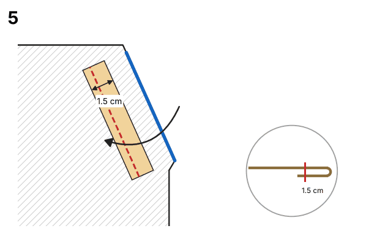
6. **Press the top edge under**. Press the top edge and both short sides 1 cm to the wrong side. Trim the allowance at the corners at an angle so they lie flat.
   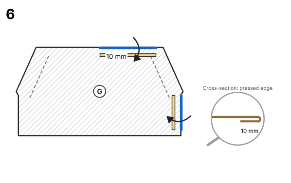
7. **Stitch the pocket on**. Lay the front right side up. Place the pocket right side up on the marking, bottom raw edges level with the hem, and pin. Topstitch 3 mm from the pressed edges: up one side, across the top, down the other side. Baste the bottom edge within the seam allowance; the hem band catches it later. (sewing machine: twin needle 4 mm, stitch 3 mm) Tip: Backstitch or bar tack at the top of each opening: these corners take the strain. Alternative: Pin first, then try on or hold against the child: the pocket may sit 1–2 cm higher or lower than the marking.
   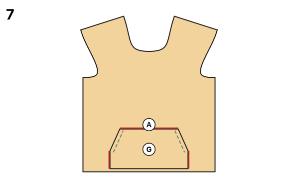
8. **Sew the shoulder seams**. Lay front and back right sides together, shoulder edges level, and pin. Sew with 10 mm seam allowance from the neckline to the armhole. Press the allowances towards the back. (an overlocker or a narrow zigzag/stretch stitch) Do this twice. Knit stretches at the shoulder: sew a strip of clear elastic or twill tape into the seam.
   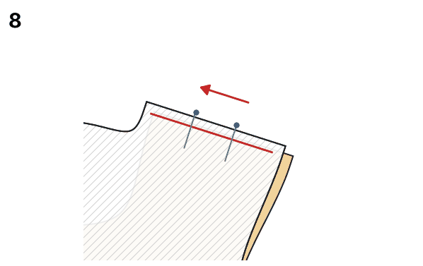
9. **Sew the hood centre seam**. Lay the two hood pieces right sides together, curved back edges level, and pin from the neck edge upwards. Sew with 10 mm seam allowance. Press the allowances to one side. (an overlocker or a narrow zigzag/stretch stitch) Topstitch 6 mm beside the seam through the allowances: the seam stays flat.
   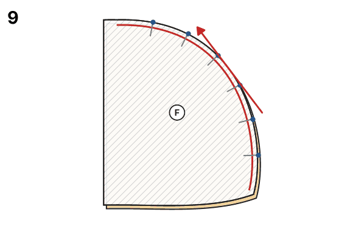
10. **Hem the hood front edge**. Fold the front edge 2.5 cm to the wrong side along the fold line and press. Topstitch 2 cm from the fold, close to the raw edge; leave the ends open for a drawstring. (sewing machine: twin needle 4 mm, stitch 3 mm) Alternative: Lined hood (option hood_lining): no hem, the lining finishes the front edge and the hood is warmer.
   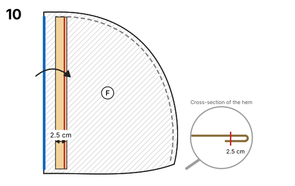
11. **Sew the hood on**. Body opened out flat, right side up. Lay the hood right side down onto the neckline, neck edges level. Hood centre seam on centre back, hood notches on the shoulder seams; front edges meet at centre front (overlap 1 cm). Sew all round with 7 mm seam allowance. (an overlocker or a narrow zigzag/stretch stitch)
   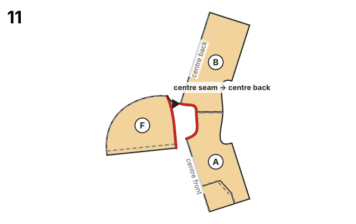
12. **Finish the neck seam**. Finish both allowances together. Press them down towards the body. (sewing machine: wide zigzag 4 × 1.5 mm over the edge) Alternative: Neatest finish: cover the allowance with a strip of jersey or cotton tape from shoulder to shoulder over the back neck and stitch it down on both edges.
   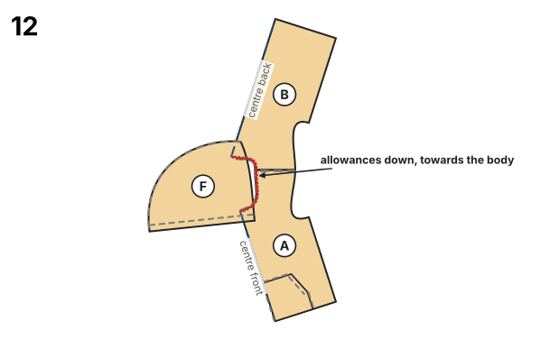
13. **Set in the sleeves**. Open the body out flat, right side up. Lay the sleeve right side down on the armhole: top of the cap on the shoulder seam, single notch on the front, double notch on the back. Pin from the middle to both ends, easing in the extra length of the cap. Sew with 10 mm seam allowance, sleeve underneath; press the allowances towards the sleeve. (an overlocker or a narrow zigzag/stretch stitch) Do this twice. Tip: Sleeve on the bottom: the feed dogs ease the cap in without pleats.
   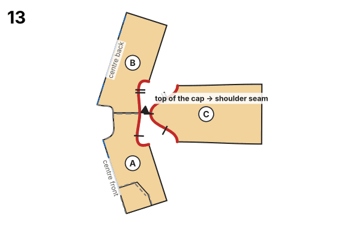
14. **Sew side and sleeve seams**. Fold the garment right sides together at the shoulders, the sleeves folded in half lengthwise. Pin side and sleeve seam so that the armhole seams meet exactly at the underarm. Sew in one go with 10 mm seam allowance, from the hem over the underarm to the sleeve hem. Press the allowances towards the back. (an overlocker or a narrow zigzag/stretch stitch) Do this twice. Alternative: Cuffs first: sew the cuffs on while the sleeve is still flat, then sew side, sleeve and cuff seam in one go. Easier on small sizes.
   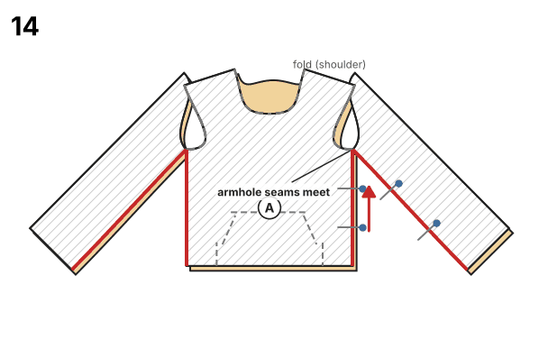
15. **Close the cuffs into rings**. Fold each cuff crosswise right sides together, short edges level. Sew with 10 mm seam allowance; finger-press the allowances open. (an overlocker or a narrow zigzag/stretch stitch) Do this twice.
   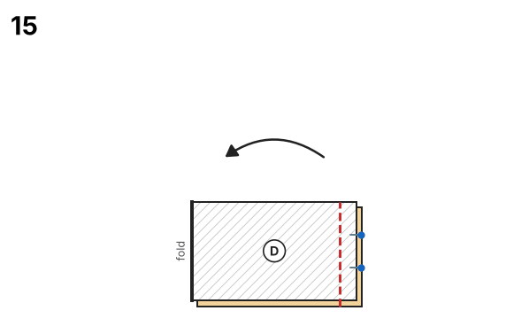
16. **Fold the cuffs in half**. Fold the ring lengthwise wrong sides together, raw edges level. The seam allowance is now inside; the right side shows all round. Do this twice.
   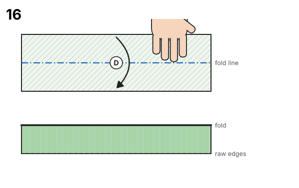
17. **Sew the cuffs on**. Turn the sleeve right side out. Slide the cuff over the sleeve end, raw edges level, cuff seam on the sleeve seam. Pin at the quarters. Sew with the cuff on top, stretching the cuff (not the sleeve) to the length of the sleeve between two pins. (an overlocker or a narrow zigzag/stretch stitch) Do this twice. One hand in front of the presser foot, one behind it: both stretch evenly.
   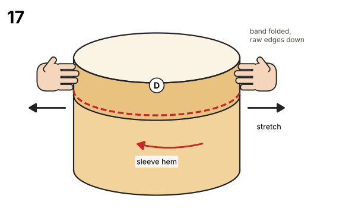
18. **Close the hem band into a ring**. Fold the band crosswise right sides together, short edges level. Sew with 10 mm seam allowance; finger-press the allowances open. (an overlocker or a narrow zigzag/stretch stitch)
   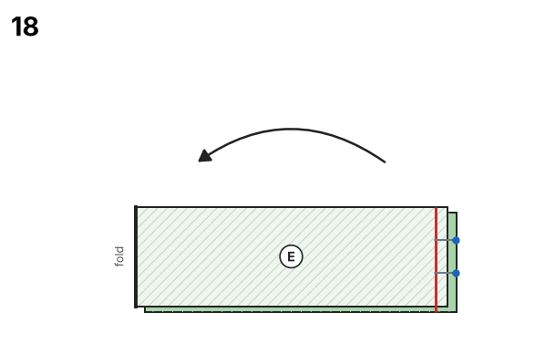
19. **Fold the hem band in half**. Fold lengthwise wrong sides together, raw edges level; press lightly.
   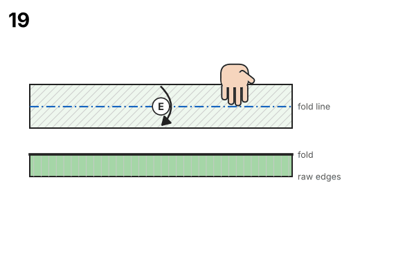
20. **Mark quarters**. Band: put a pin at the cross seam and fold the band flat to find the opposite point; fold again for the two quarter points. Garment: pins at centre front, centre back and both side seams.
   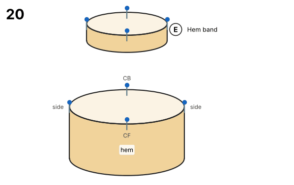
21. **Sew the hem band on**. Garment right side out: slide the band over it, raw edges level, cross seam on a side seam; match the quarter pins. Sew with 10 mm seam allowance, band on top, stretching only the band. Press the allowances towards the garment. (an overlocker or a narrow zigzag/stretch stitch) Sew a little slower over the side seams: four layers.
   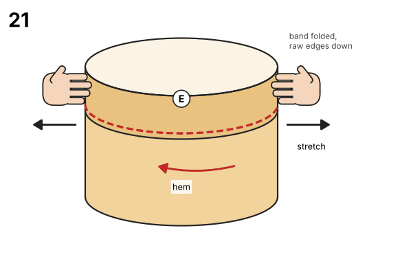
22. **Final pressing**. Press all seams with steam; do not press down hard on sweat.

## Validation report

### Sewability check

| Area | Check | Target | Actual | Δ | Result | Note |
|---|---|---|---|---|---|---|
| Seam pairs | Side seam front ↔ back | 28.2 cm | 28.2 cm | +0.0 mm | ✅ OK |  |
| Seam pairs | Armhole ↔ sleeve cap (ease) | ease 0–8 mm | 38.9 cm ↔ 39.2 cm | +3.2 mm | ✅ OK | Sweat / French Terry: 0–8 mm |
| Seam pairs | Shoulder seam front ↔ back | 12.8 cm | 12.8 cm | +0.0 mm | ✅ OK |  |
| Seam pairs | Sleeve seam (front ↔ back) | 40.3 cm | 40.3 cm | -0.0 mm | ✅ OK |  |
| Seam pairs | Sleeve cuff ↔ sleeve hem (stretched) | 70–85 % of 28.6 cm | 20.0 cm = 70 % | -85.8 mm | ✅ OK | rib band is stretched while sewing |
| Seam pairs | Hem band ↔ hem (stretched) | 70–92 % of 80.7 cm | 56.5 cm = 70 % | -242.2 mm | ✅ OK | rib band is stretched while sewing |
| Seam pairs | Hood ↔ neckline (each side) | 25.6 cm | 25.6 cm | +0.0 mm | ✅ OK |  |
| Seam pairs | Hood centre seam (left ↔ right) | 47.4 cm | 47.4 cm | +0.0 mm | ✅ OK |  |
| Angles/transitions | Underarm: side seam ↔ armhole front | 90° | 90.3° | +0.3° | ✅ OK |  |
| Angles/transitions | Underarm: side seam ↔ armhole back | 90° | 90.5° | +0.5° | ✅ OK |  |
| Angles/transitions | Shoulder ↔ armhole (front + back) | 180° | 179.5° | -0.5° | ✅ OK |  |
| Angles/transitions | Sleeve cap top (smooth) | 180° | 178.4° | -1.6° | ✅ OK |  |
| Angles/transitions | Sleeve underarm ↔ cap front | 90° | 90.8° | +0.8° | ✅ OK |  |
| Angles/transitions | Shoulder ↔ neckline (front + back) | 180° | 180.3° | +0.3° | ✅ OK |  |
| Angles/transitions | Neckline at centre front | 90° | 90.2° | +0.2° | ✅ OK |  |
| Angles/transitions | Neckline at centre back | 90° | 89.6° | -0.4° | ✅ OK |  |
| Angles/transitions | Hem at centre front | 90° | 90.0° | +0.0° | ✅ OK |  |
| Angles/transitions | Hem ↔ side seam front | 90° | 90.0° | +0.0° | ✅ OK |  |
| Angles/transitions | Hood: front edge ↔ neck seam | 90° | 90.0° | +0.0° | ✅ OK |  |
| Measurements | Chest circumference pattern = body + ease | 80.7 cm | 80.7 cm | +0.0 % | ✅ OK | body 69.0 cm + +17 % ease |
| Measurements | Neckline (fabric edge) fits over the head | ≥ 53.5 cm | 63.9 cm | +104.0 mm | ✅ OK | neckline incl. stretch ≥ head circumference |
| Measurements | Hand fits through the sleeve cuff | ≥ 21.4 cm | 36.0 cm | +146.3 mm | ✅ OK | hand circumference ≈ 1.55 × wrist |
| Measurements | Sleeve length plausible | 50.4 cm – 70.0 cm | 56.1 cm | +0.0 mm | ✅ OK | arm length 56.0 cm |
| Measurements | Body length plausible | 42.0 cm – 86.8 cm | 52.2 cm | +0.0 mm | ✅ OK | from the neck point |
| Measurements | Hood tall enough | ≥ 29.4 cm | 33.5 cm | +41.0 mm | ✅ OK | hood height ≥ 0.55 × head circumference |
| Geometry | Front: outline & seam allowance | closed, SA present | ok |  | ✅ OK | seam allowance 1.0 cm included; Neckline: 0.7 cm |
| Labels | Front: grainline & cutting | present | cut 1 on fold |  | ✅ OK | Main fabric |
| Geometry | Back: outline & seam allowance | closed, SA present | ok |  | ✅ OK | seam allowance 1.0 cm included; Neckline: 0.7 cm |
| Labels | Back: grainline & cutting | present | cut 1 on fold |  | ✅ OK | Main fabric |
| Geometry | Sleeve: outline & seam allowance | closed, SA present | ok |  | ✅ OK | seam allowance 1.0 cm included |
| Labels | Sleeve: grainline & cutting | present | cut 2 (mirrored pair) |  | ✅ OK | Main fabric |
| Geometry | Sleeve cuff: outline & seam allowance | closed, SA present | ok |  | ✅ OK | seam allowance 1.0 cm included |
| Labels | Sleeve cuff: grainline & cutting | present | cut 2 |  | ✅ OK | Rib knit |
| Geometry | Hem band: outline & seam allowance | closed, SA present | ok |  | ✅ OK | seam allowance 1.0 cm included |
| Labels | Hem band: grainline & cutting | present | cut 1 on fold |  | ✅ OK | Rib knit |
| Geometry | Hood: outline & seam allowance | closed, SA present | ok |  | ✅ OK | seam allowance 1.0 cm included; Front edge (casing/facing): 2.5 cm |
| Labels | Hood: grainline & cutting | present | cut 2 (mirrored pair) |  | ✅ OK | Main fabric |
| Geometry | Kangaroo pocket: outline & seam allowance | closed, SA present | ok |  | ✅ OK | seam allowance 1.0 cm included; Opening (hem it): 1.5 cm |
| Labels | Kangaroo pocket: grainline & cutting | present | cut 1 on fold |  | ✅ OK | Main fabric |
| Geometry | Hood: turned allowance lies flat | ≤ 0.5 mm | 0.0 mm |  | ✅ OK | Front edge (casing/facing): corners mirrored at the fold line |
| Geometry | Front: cut-on-fold edge | straight, no SA, 90° corners, on grain | ok, corners ≤ 0.2° off 90° |  | ✅ OK | Centre (fold) |
| Geometry | Back: cut-on-fold edge | straight, no SA, 90° corners, on grain | ok, corners ≤ 0.4° off 90° |  | ✅ OK | Centre (fold) |
| Geometry | Hem band: cut-on-fold edge | straight, no SA, 90° corners, on grain | ok, corners ≤ 0.0° off 90° |  | ✅ OK | Centre |
| Geometry | Kangaroo pocket: cut-on-fold edge | straight, no SA, 90° corners, on grain | ok, corners ≤ 0.0° off 90° |  | ✅ OK | Centre (fold) |
| Labels | Front: notches | on the cutting line | 1 notch mark(s) |  | ✅ OK |  |
| Labels | Back: notches | on the cutting line | 2 notch mark(s) |  | ✅ OK |  |
| Labels | Sleeve: notches | on the cutting line | 4 notch mark(s) |  | ✅ OK | 1 at corners |

**Result:** 47 OK, 0 warning(s), 0 error(s): the pattern is sewable.

### Construction values

Override any of these with the option `construction`, values in mm (e.g. `{"construction": {"chest_width": 807}}`).

| Name | Value | Derived from | Note |
|---|---|---|---|
| `chest_width` | 80.7 cm | chest × (1 + 17 % ease) |  |
| `neck_width_half` | 8.5 cm | neck / 5 + 1.5 cm |  |
| `front_neck_depth` | 10.8 cm | neck_width_half + 1.5 cm |  |
| `back_neck_depth` | 1.5 cm | fixed |  |
| `shoulder_length` | 12.7 cm | shoulder + allowance for fit 'wide' |  |
| `shoulder_slope` | 17 | fixed |  |
| `armhole_depth` | 19.5 cm | 18 % of chest_width + 2.5 cm + 3 % |  |
| `body_length` | 52.2 cm | back length + 13 % of height |  |
