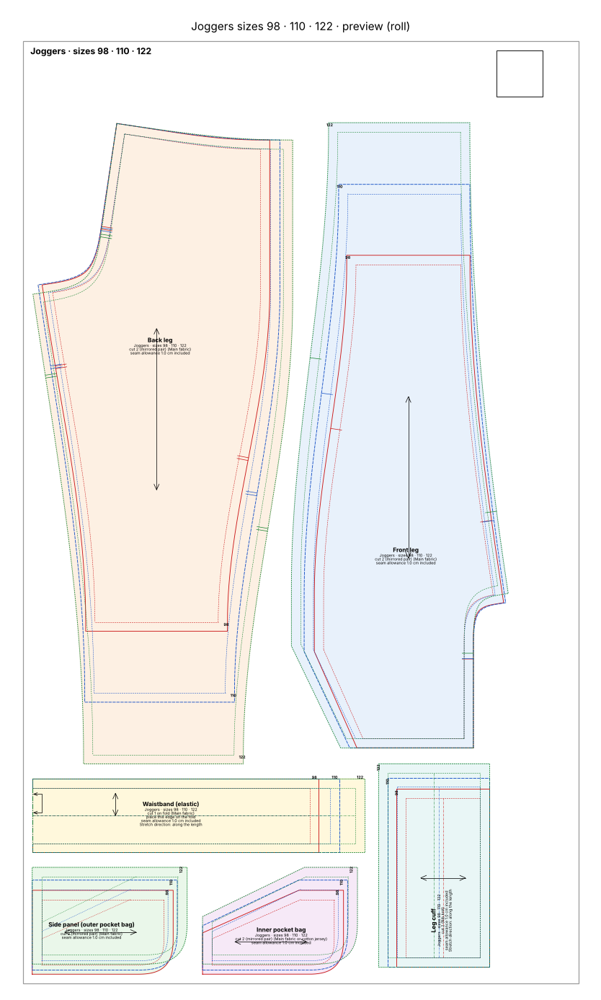
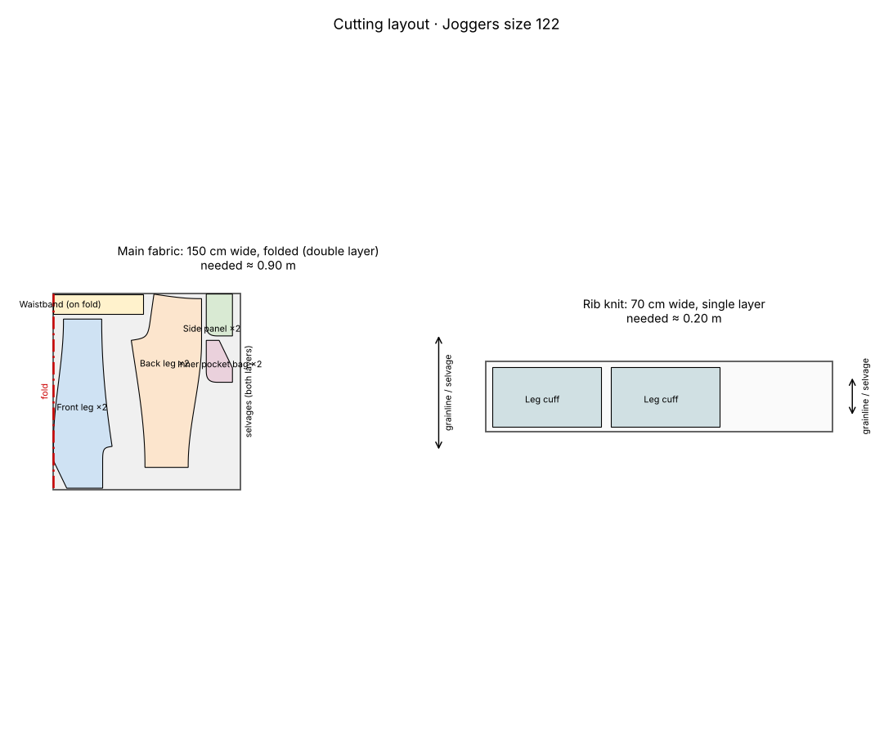

# Joggers in sizes 98, 110 and 122 on one sheet

> *"Joggers in sizes 98, 110 and 122 on one pattern, for the 24" roll."*

Three sizes nested on one roll page. Each size has its own colour, line style and PDF layer (switch sizes off before printing), and every size is checked on its own.

## At a glance

- **Pieces:** 6
- **Fabric to buy:** main fabric 0.90 m at 150 cm width, rib knit 0.20 m at 70 cm width
- **Sewing steps:** 25
- **Sewability checks:** 114 of 114 OK

## Cutting layout

## Files

| File | What it is |
|---|---|
| [`cutting_layout.png`](cutting_layout.png) | Cutting layout on the fabric, with fabric amounts |
| [`joggers_98_110_122_master_1to1.svg`](joggers_98_110_122_master_1to1.svg) | The whole pattern as one 1:1 SVG |
| [`joggers_98_110_122_roll610.pdf`](joggers_98_110_122_roll610.pdf) | Print file for the 610 mm roll, 1:1 |
| [`joggers_98_110_122_roll610_preview.png`](joggers_98_110_122_roll610_preview.png) | Preview picture of the print file |
| [`pattern.json`](pattern.json) | All pieces, measurements and construction values as data |
| [`sewing_instructions.md`](sewing_instructions.md) | The same instructions as text, with a picture per step |
| [`sewing_instructions.pdf`](sewing_instructions.pdf) | Illustrated sewing booklet, then measurements, pieces and checks |
| [`steps`](steps) | Step pictures used by sewing_instructions.md |
| [`validation_report.md`](validation_report.md) | Every sewability check with target and actual value |

Print the PDF at **100 % / actual size** and check the 5 × 5 cm square before cutting.
