# Joggers · sizes 98 · 110 · 122

*normal fit, Sweat / French Terry (25 % stretch)* · original parametric draft. The pattern is yours to use.

> **Important:** With a new pattern, first sew a **test garment** from inexpensive fabric with similar stretch and check the fit.

## Files

- PDF roll 610 mm (600 × 1017 mm): `joggers_98_110_122_roll610.pdf`
- Preview roll 610 mm: `joggers_98_110_122_roll610_preview.png`
- SVG master 1:1: `joggers_98_110_122_master_1to1.svg`
- Cutting layout: `cutting_layout.png`
- Sewing instructions (PDF): `sewing_instructions.pdf`
- Sewing instructions (Markdown): `sewing_instructions.md`

## Printing

- Always print at **100 % / "Actual size"** (not "Fit to page").
- Measure the **5 × 5 cm** control square before you cut.
- Plotter (610 mm roll): the page is 600 mm wide in portrait. In the print dialog choose a custom paper size with exactly this width and length, and turn rotation/scaling off.

## Body measurements

| Body measurement | Value | Source |
|---|---|---|
| Body height | 122.0 cm | table |
| Chest | 62.0 cm | table |
| Waist | 56.0 cm | table |
| Hip | 66.0 cm | table |
| Head | 52.0 cm | table |
| Neck | 28.5 cm | table |
| Inseam | 54.0 cm | table |
| Side length | 72.0 cm | table |
| Arm length | 47.0 cm | table |
| Back length | 29.5 cm | table |
| Shoulder width | 10.0 cm | table |
| Thigh | 37.0 cm | table |
| Ankle | 17.8 cm | table |

## Finished measurements (virtually sewn)

| Finished measurement | Value |
|---|---|
| Hip width | 72.6 cm |
| Thigh width | 46.4 cm |
| Leg width at mid-leg | 36.0 cm |
| Leg opening | 20.0 cm |
| Waistband relaxed | 50.4 cm |
| Waistband stretched (pants top edge) | 69.8 cm |
| Outseam | 73.5 cm |
| Inseam | 54.0 cm |
| Front rise | 19.5 cm |
| Back rise | 21.1 cm |
| Waistband height | 3.0 cm |
| Cuff height | 5.0 cm |
| Crotch seam total | 46.9 cm |

## Sizes in this pattern (nested)

All sizes are drawn on top of each other, aligned at the same construction point. Every size has its own colour and line and its own **PDF layer**: in Acrobat/Reader open the *Layers* panel and switch off the sizes you do not need before printing. Cut along the line of your size. Sizes can be blended: e.g. width of one size, length of another, by drawing a smooth line between the two outlines.

| Size | Line | Fabric needed | Hip width | Thigh width | Leg width at mid-leg | Leg opening |
|---|---|---|---|---|---|---|
| size 98 | red, solid | Main fabric: 0.75 m; Rib knit: 0.15 m | 62.7 cm | 39.9 cm | 31.3 cm | 17.2 cm |
| size 110 | blue, long dashes | Main fabric: 0.80 m; Rib knit: 0.15 m | 67.1 cm | 42.8 cm | 33.3 cm | 18.4 cm |
| size 122 | green, short dashes | Main fabric: 0.90 m; Rib knit: 0.20 m | 72.6 cm | 46.4 cm | 36.0 cm | 20.0 cm |

Fabric, finished measurements and sewing steps below refer to the largest size (size 122); the validation report has one table per size.

## Pattern pieces

| Piece | Cutting | Fabric | Seam allowance |
|---|---|---|---|
| Front leg | cut 2 (mirrored pair) | Main fabric | seam allowance 1.0 cm included |
| Back leg | cut 2 (mirrored pair) | Main fabric | seam allowance 1.0 cm included |
| Side panel (outer pocket bag) | cut 2 (mirrored pair) | Main fabric | seam allowance 1.0 cm included |
| Inner pocket bag | cut 2 (mirrored pair) | Main fabric or cotton jersey | seam allowance 1.0 cm included |
| Waistband (elastic) | cut 1 on fold | Main fabric | seam allowance 1.0 cm included |
| Leg cuff | cut 2 | Rib knit | seam allowance 1.0 cm included |

## Fabric needed

- **Main fabric:** about 0.90 m at 150 cm width (folded selvage to selvage, cut on fold pieces at the fold, incl. 10 % for shrinkage; single layer would need 0.90 m)
- **Rib knit:** about 0.20 m at 70 cm width (single layer, incl. 10 % for shrinkage)
- Elastic 20 mm wide, length 50 cm (+2 cm overlap for joining)

Cutting layout: see `cutting_layout.png` (grainline arrow parallel to the selvage, "flipped" = place the piece face down, "×2" = cut through both layers of the folded fabric, which gives a mirrored pair, "(unfolded)" = cut-on-fold piece shown opened out).

**Cut on fold** (Waistband (elastic)): the paper piece is only one half. Its fold edge (dash-dot line, bracket arrows "PLACE ON FOLD") is the centre of the piece: it gets no seam allowance and is never cut. On the folded fabric, lay the fold edge exactly on the fabric fold, pin it and cut through both layers; opened out you get the whole piece. Where the cutting layout shows a piece "(unfolded)" on a single layer, fold the fabric along the grain just wide enough for the piece and place the fold edge on that fold, or trace the paper piece, flip it over along the fold edge and trace the second half.

## Sewing instructions

The printed instructions (`sewing_instructions.pdf`) show every step as a picture of your pieces: parts list, tools, then one action per step.

Seam allowance is included in the pattern (see table). Use a jersey/stretch needle for jersey and sweat.

1. **Pre-wash the fabric**. Wash and dry it the way you will wash the garment later, so it shrinks now, not after sewing.
2. **Cut out all pieces**. Follow the cutting layout; grainline arrows parallel to the selvage.
3. **Snip the notches**. Cut 3–4 mm into the seam allowance at every notch.
4. **Set up the machine**. Jersey/stretch needle 75–80, polyester thread. Sew a test seam on a scrap first.
5. **Sew the pocket bag to the opening**. Inner pocket bag right sides together on the pocket opening of the front leg. (an overlocker or a narrow zigzag/stretch stitch) Do this twice.
   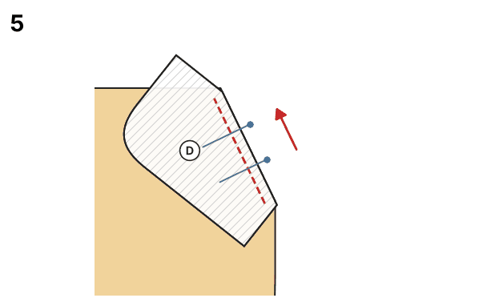
6. **Clip and turn the bag inside**. Clip the curved allowance, turn the bag to the inside and press the edge. Do this twice.
   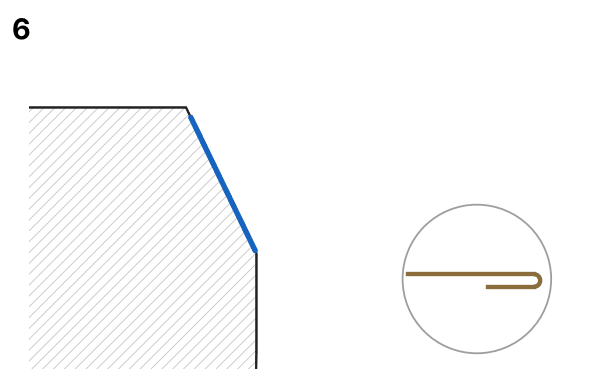
7. **Topstitch the pocket edge**. (sewing machine: twin needle 4 mm, stitch 3 mm) Do this twice.
   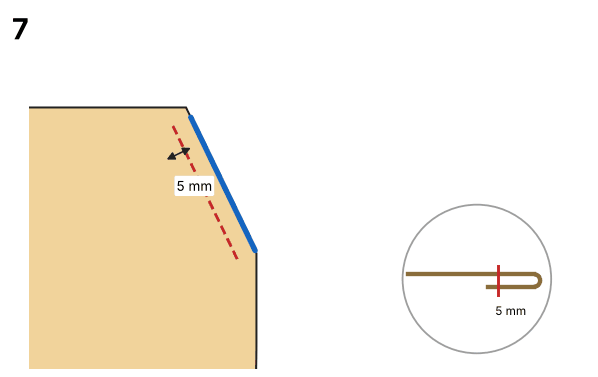
8. **Sew the pocket bag seam**. Side panel right sides together under the pocket bag; the "pocket opening" mark meets the opening edge. (an overlocker or a narrow zigzag/stretch stitch) Do this twice.
   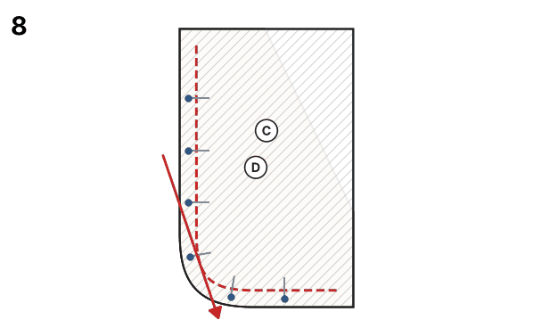
9. **Baste the side panel to the leg**. Top edge and side seam, inside the seam allowance. (sewing machine: longest straight stitch, no backstitch) Do this twice.
   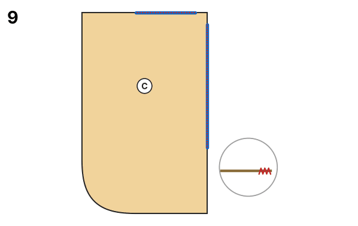
10. **Sew the side seams**. Front and back leg right sides together; single notches = front, double = back. (an overlocker or a narrow zigzag/stretch stitch) Do this twice.
   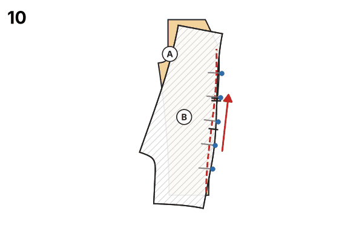
11. **Sew the inseams**. The notches on the inseam meet. (an overlocker or a narrow zigzag/stretch stitch) Do this twice.
   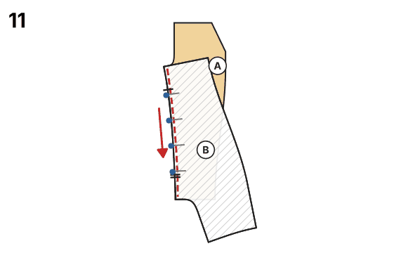
12. **Put one leg inside the other**. Turn one leg right side out and slip it into the other (wrong side out): the legs lie right sides together.
13. **Sew the crotch seam**. In one go from the front to the back top edge; the inseams meet exactly. (an overlocker or a narrow zigzag/stretch stitch) Tip: Sew the crotch curve a second time for strength.
   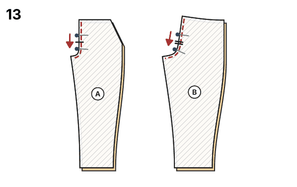
14. **Close the waistband into a ring**. Right sides together across the short ends (centre back); leave 3 cm open for the elastic. (an overlocker or a narrow zigzag/stretch stitch)
   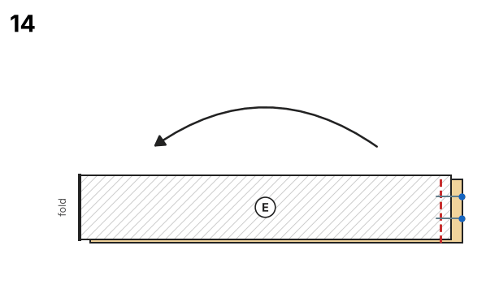
15. **Fold the waistband in half**. Lengthwise, wrong sides together, along the fold line.
   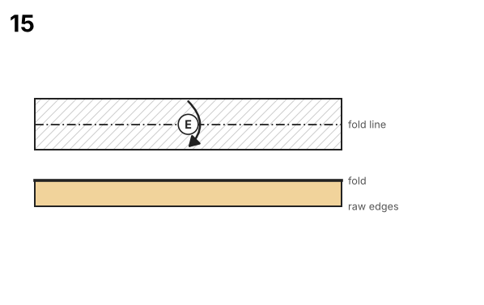
16. **Mark quarters**. On waistband and pants top edge: centre front, centre back, sides.
   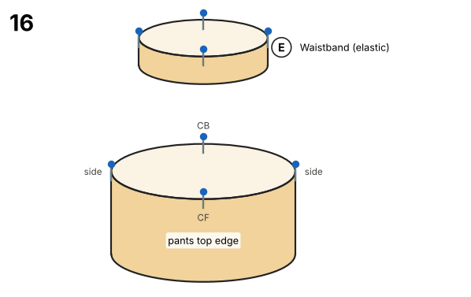
17. **Sew the waistband on**. Raw edges together, opening at the back on the inside; quarter marks meet. (an overlocker or a narrow zigzag/stretch stitch)
   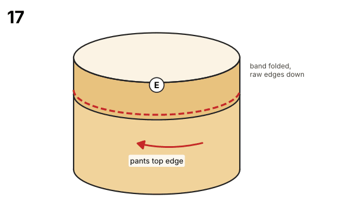
18. **Thread the elastic**. With a safety pin through the opening; overlap the ends by 2 cm and sew them together. (sewing machine: wide zigzag 4 × 2.5 mm)
19. **Close the opening**. Spread the gathers evenly, close the opening and stitch in the ditch at the side seams so the elastic cannot twist. (sewing machine: twin needle 4 mm, stitch 3 mm)
20. **Close the cuffs into rings**. Right sides together across the short ends. (an overlocker or a narrow zigzag/stretch stitch) Do this twice.
   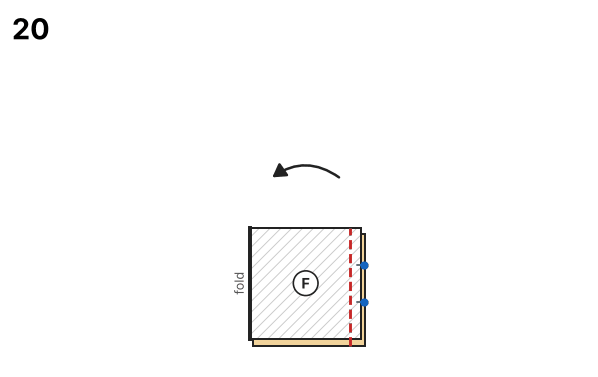
21. **Fold the cuffs in half**. Lengthwise, wrong sides together. Do this twice.
   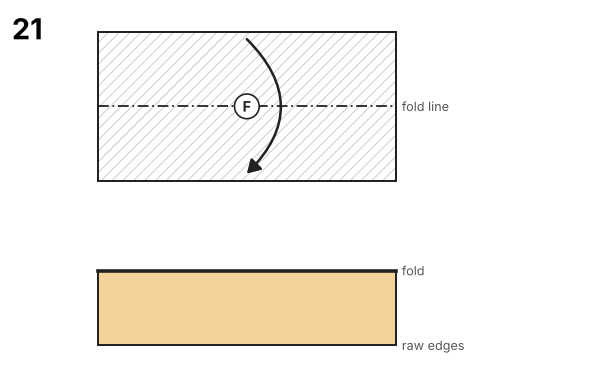
22. **Mark quarters**. On cuff and leg opening. Do this twice.
   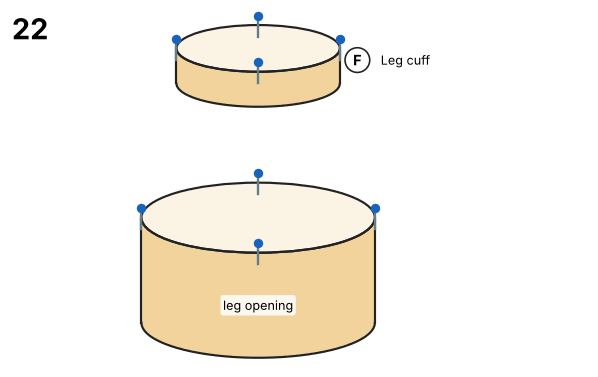
23. **Sew the cuffs on**. Slip the cuff over the right-side-out leg, cuff seam at the inseam. (an overlocker or a narrow zigzag/stretch stitch) Do this twice.
   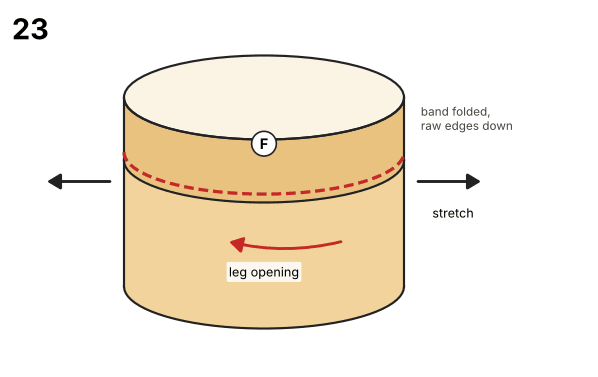
24. **Press the allowance up**. Seam allowance towards the pants. Do this twice.
   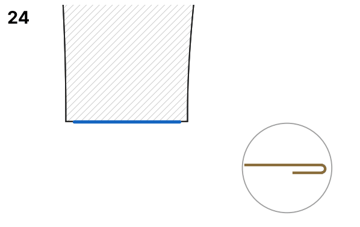
25. **Done!** Press all seams with steam; do not press down hard on sweat.

## Validation report

### Sewability check · size 98

| Area | Check | Target | Actual | Δ | Result | Note |
|---|---|---|---|---|---|---|
| Seam pairs | Side seam front ↔ back | 51.4 cm | 51.4 cm | +0.0 mm | ✅ OK |  |
| Seam pairs | Inseam front ↔ back | 35.9 cm | 35.9 cm | +0.0 mm | ✅ OK |  |
| Seam pairs | Front crotch seam (left ↔ right piece) | 17.2 cm | 17.2 cm | +0.0 mm | ✅ OK |  |
| Seam pairs | Back crotch seam (left ↔ right piece) | 20.8 cm | 20.8 cm | +0.0 mm | ✅ OK |  |
| Seam pairs | Pocket opening: front leg ↔ pocket bag | 10.5 cm | 10.5 cm | +0.0 mm | ✅ OK |  |
| Seam pairs | Pocket bag seam: pocket bag ↔ side panel | 19.4 cm | 19.4 cm | +0.0 mm | ✅ OK |  |
| Seam pairs | Pocket bag ↔ side panel at the side seam | 3.6 cm | 3.6 cm | +0.0 mm | ✅ OK |  |
| Seam pairs | Waistband ↔ pants top edge | 59.9 cm | 59.9 cm | +0.0 mm | ✅ OK |  |
| Seam pairs | Leg cuff ↔ leg opening (stretched) | 70–85 % of 24.6 cm | 17.2 cm = 70 % | -73.9 mm | ✅ OK | rib band is stretched while sewing |
| Angles/transitions | Centre front ↔ waistband | 90° | 90.0° | +0.0° | ✅ OK |  |
| Angles/transitions | Centre back ↔ waistband | 90° | 90.0° | -0.0° | ✅ OK |  |
| Angles/transitions | Crotch ↔ inseam (front + back) | 180° | 180.8° | +0.8° | ✅ OK |  |
| Angles/transitions | Inseam ↔ hem front | 90° | 90.0° | +0.0° | ✅ OK |  |
| Angles/transitions | Hem ↔ side seam front | 90° | 90.1° | +0.1° | ✅ OK |  |
| Angles/transitions | Inseam ↔ hem back | 90° | 90.1° | +0.1° | ✅ OK |  |
| Angles/transitions | Hem ↔ side seam back | 90° | 90.1° | +0.1° | ✅ OK |  |
| Angles/transitions | Side seam ↔ waistband back | 90° | 90.1° | +0.1° | ✅ OK |  |
| Angles/transitions | Side seam ↔ waistband at the side panel | 90° | 90.0° | +0.0° | ✅ OK |  |
| Measurements | Hip circumference pattern = body + ease | 62.7 cm | 62.7 cm | +0.0 % | ✅ OK | body 57.0 cm + +10 % ease |
| Measurements | Top edge fits over the hip | ≥ 58.1 cm | 68.9 cm | +107.6 mm | ✅ OK | top edge incl. usable stretch ≥ hip |
| Measurements | Front rise plausible | 11.8 cm – 20.9 cm | 18.5 cm | +0.0 mm | ✅ OK | body rise 17.0 cm |
| Measurements | Inseam length plausible | 28.9 cm – 44.8 cm | 39.7 cm | +0.0 mm | ✅ OK | body inseam 40.0 cm |
| Measurements | Foot fits through the leg opening | ≥ 20.8 cm | 25.5 cm | +47.3 mm | ✅ OK | heel-instep circumference ≈ 1.35 × ankle |
| Geometry | Front leg: outline & seam allowance | closed, SA present | ok |  | ✅ OK | seam allowance 1.0 cm included |
| Labels | Front leg: grainline & cutting | present | cut 2 (mirrored pair) |  | ✅ OK | Main fabric |
| Geometry | Back leg: outline & seam allowance | closed, SA present | ok |  | ✅ OK | seam allowance 1.0 cm included |
| Labels | Back leg: grainline & cutting | present | cut 2 (mirrored pair) |  | ✅ OK | Main fabric |
| Geometry | Side panel (outer pocket bag): outline & seam allowance | closed, SA present | ok |  | ✅ OK | seam allowance 1.0 cm included |
| Labels | Side panel (outer pocket bag): grainline & cutting | present | cut 2 (mirrored pair) |  | ✅ OK | Main fabric |
| Geometry | Inner pocket bag: outline & seam allowance | closed, SA present | ok |  | ✅ OK | seam allowance 1.0 cm included |
| Labels | Inner pocket bag: grainline & cutting | present | cut 2 (mirrored pair) |  | ✅ OK | Main fabric or cotton jersey |
| Geometry | Waistband (elastic): outline & seam allowance | closed, SA present | ok |  | ✅ OK | seam allowance 1.0 cm included |
| Labels | Waistband (elastic): grainline & cutting | present | cut 1 on fold |  | ✅ OK | Main fabric |
| Geometry | Leg cuff: outline & seam allowance | closed, SA present | ok |  | ✅ OK | seam allowance 1.0 cm included |
| Labels | Leg cuff: grainline & cutting | present | cut 2 |  | ✅ OK | Rib knit |
| Geometry | Waistband (elastic): cut-on-fold edge | straight, no SA, 90° corners, on grain | ok, corners ≤ 0.0° off 90° |  | ✅ OK | Centre front |
| Labels | Front leg: notches | on the cutting line | 3 notch mark(s) |  | ✅ OK |  |
| Labels | Back leg: notches | on the cutting line | 6 notch mark(s) |  | ✅ OK |  |

**Result:** 38 OK, 0 warning(s), 0 error(s): the pattern is sewable.

### Construction values

Override any of these with the option `construction`, values in mm (e.g. `{"construction": {"hip_width": 627}}`).

| Name | Value | Derived from | Note |
|---|---|---|---|
| `hip_width` | 62.7 cm | hip × (1 + 10 % ease) |  |
| `front_back_offset` | 0.5 cm | front quarter narrower, back quarter wider by this amount |  |
| `front_width` | 15.2 cm | hip_width / 4 − front_back_offset |  |
| `back_width` | 16.2 cm | hip_width / 4 + front_back_offset |  |
| `front_crotch_extension` | 3.1 cm | 5 % of hip_width |  |
| `back_crotch_extension` | 6.3 cm | 10 % of hip_width |  |
| `rise` | 15.5 cm | (side length − inseam) + seat ease − waistband height |  |
| `inseam_finished` | 39.7 cm | inseam − allowance to the floor + blousing |  |
| `hem_width` | 24.6 cm | cuff length / cuff stretch ratio |  |

### Sewability check · size 110

| Area | Check | Target | Actual | Δ | Result | Note |
|---|---|---|---|---|---|---|
| Seam pairs | Side seam front ↔ back | 59.0 cm | 59.0 cm | +0.0 mm | ✅ OK |  |
| Seam pairs | Inseam front ↔ back | 43.5 cm | 43.5 cm | +0.0 mm | ✅ OK |  |
| Seam pairs | Front crotch seam (left ↔ right piece) | 17.3 cm | 17.3 cm | +0.0 mm | ✅ OK |  |
| Seam pairs | Back crotch seam (left ↔ right piece) | 21.1 cm | 21.1 cm | +0.0 mm | ✅ OK |  |
| Seam pairs | Pocket opening: front leg ↔ pocket bag | 10.6 cm | 10.6 cm | +0.0 mm | ✅ OK |  |
| Seam pairs | Pocket bag seam: pocket bag ↔ side panel | 20.4 cm | 20.4 cm | +0.0 mm | ✅ OK |  |
| Seam pairs | Pocket bag ↔ side panel at the side seam | 4.1 cm | 4.1 cm | +0.0 mm | ✅ OK |  |
| Seam pairs | Waistband ↔ pants top edge | 64.3 cm | 64.3 cm | +0.0 mm | ✅ OK |  |
| Seam pairs | Leg cuff ↔ leg opening (stretched) | 70–85 % of 26.4 cm | 18.4 cm = 70 % | -79.1 mm | ✅ OK | rib band is stretched while sewing |
| Angles/transitions | Centre front ↔ waistband | 90° | 90.0° | +0.0° | ✅ OK |  |
| Angles/transitions | Centre back ↔ waistband | 90° | 90.0° | -0.0° | ✅ OK |  |
| Angles/transitions | Crotch ↔ inseam (front + back) | 180° | 180.7° | +0.7° | ✅ OK |  |
| Angles/transitions | Inseam ↔ hem front | 90° | 90.0° | +0.0° | ✅ OK |  |
| Angles/transitions | Hem ↔ side seam front | 90° | 90.1° | +0.1° | ✅ OK |  |
| Angles/transitions | Inseam ↔ hem back | 90° | 90.1° | +0.1° | ✅ OK |  |
| Angles/transitions | Hem ↔ side seam back | 90° | 90.1° | +0.1° | ✅ OK |  |
| Angles/transitions | Side seam ↔ waistband back | 90° | 90.1° | +0.1° | ✅ OK |  |
| Angles/transitions | Side seam ↔ waistband at the side panel | 90° | 90.0° | +0.0° | ✅ OK |  |
| Measurements | Hip circumference pattern = body + ease | 67.1 cm | 67.1 cm | +0.0 % | ✅ OK | body 61.0 cm + +10 % ease |
| Measurements | Top edge fits over the hip | ≥ 62.2 cm | 73.9 cm | +117.3 mm | ✅ OK | top edge incl. usable stretch ≥ hip |
| Measurements | Front rise plausible | 13.2 cm – 22.3 cm | 18.5 cm | +0.0 mm | ✅ OK | body rise 17.0 cm |
| Measurements | Inseam length plausible | 34.7 cm – 53.8 cm | 47.9 cm | +0.0 mm | ✅ OK | body inseam 48.0 cm |
| Measurements | Foot fits through the leg opening | ≥ 22.2 cm | 27.3 cm | +50.7 mm | ✅ OK | heel-instep circumference ≈ 1.35 × ankle |
| Geometry | Front leg: outline & seam allowance | closed, SA present | ok |  | ✅ OK | seam allowance 1.0 cm included |
| Labels | Front leg: grainline & cutting | present | cut 2 (mirrored pair) |  | ✅ OK | Main fabric |
| Geometry | Back leg: outline & seam allowance | closed, SA present | ok |  | ✅ OK | seam allowance 1.0 cm included |
| Labels | Back leg: grainline & cutting | present | cut 2 (mirrored pair) |  | ✅ OK | Main fabric |
| Geometry | Side panel (outer pocket bag): outline & seam allowance | closed, SA present | ok |  | ✅ OK | seam allowance 1.0 cm included |
| Labels | Side panel (outer pocket bag): grainline & cutting | present | cut 2 (mirrored pair) |  | ✅ OK | Main fabric |
| Geometry | Inner pocket bag: outline & seam allowance | closed, SA present | ok |  | ✅ OK | seam allowance 1.0 cm included |
| Labels | Inner pocket bag: grainline & cutting | present | cut 2 (mirrored pair) |  | ✅ OK | Main fabric or cotton jersey |
| Geometry | Waistband (elastic): outline & seam allowance | closed, SA present | ok |  | ✅ OK | seam allowance 1.0 cm included |
| Labels | Waistband (elastic): grainline & cutting | present | cut 1 on fold |  | ✅ OK | Main fabric |
| Geometry | Leg cuff: outline & seam allowance | closed, SA present | ok |  | ✅ OK | seam allowance 1.0 cm included |
| Labels | Leg cuff: grainline & cutting | present | cut 2 |  | ✅ OK | Rib knit |
| Geometry | Waistband (elastic): cut-on-fold edge | straight, no SA, 90° corners, on grain | ok, corners ≤ 0.0° off 90° |  | ✅ OK | Centre front |
| Labels | Front leg: notches | on the cutting line | 3 notch mark(s) |  | ✅ OK |  |
| Labels | Back leg: notches | on the cutting line | 6 notch mark(s) |  | ✅ OK |  |

**Result:** 38 OK, 0 warning(s), 0 error(s): the pattern is sewable.

### Construction values

Override any of these with the option `construction`, values in mm (e.g. `{"construction": {"hip_width": 671}}`).

| Name | Value | Derived from | Note |
|---|---|---|---|
| `hip_width` | 67.1 cm | hip × (1 + 10 % ease) |  |
| `front_back_offset` | 0.5 cm | front quarter narrower, back quarter wider by this amount |  |
| `front_width` | 16.3 cm | hip_width / 4 − front_back_offset |  |
| `back_width` | 17.3 cm | hip_width / 4 + front_back_offset |  |
| `front_crotch_extension` | 3.4 cm | 5 % of hip_width |  |
| `back_crotch_extension` | 6.7 cm | 10 % of hip_width |  |
| `rise` | 15.5 cm | (side length − inseam) + seat ease − waistband height |  |
| `inseam_finished` | 47.9 cm | inseam − allowance to the floor + blousing |  |
| `hem_width` | 26.4 cm | cuff length / cuff stretch ratio |  |

### Sewability check · size 122

| Area | Check | Target | Actual | Δ | Result | Note |
|---|---|---|---|---|---|---|
| Seam pairs | Side seam front ↔ back | 65.7 cm | 65.7 cm | +0.0 mm | ✅ OK |  |
| Seam pairs | Inseam front ↔ back | 49.2 cm | 49.2 cm | +0.0 mm | ✅ OK |  |
| Seam pairs | Front crotch seam (left ↔ right piece) | 18.4 cm | 18.4 cm | +0.0 mm | ✅ OK |  |
| Seam pairs | Back crotch seam (left ↔ right piece) | 22.5 cm | 22.5 cm | +0.0 mm | ✅ OK |  |
| Seam pairs | Pocket opening: front leg ↔ pocket bag | 11.4 cm | 11.4 cm | +0.0 mm | ✅ OK |  |
| Seam pairs | Pocket bag seam: pocket bag ↔ side panel | 22.0 cm | 22.0 cm | +0.0 mm | ✅ OK |  |
| Seam pairs | Pocket bag ↔ side panel at the side seam | 4.5 cm | 4.5 cm | +0.0 mm | ✅ OK |  |
| Seam pairs | Waistband ↔ pants top edge | 69.8 cm | 69.8 cm | +0.0 mm | ✅ OK |  |
| Seam pairs | Leg cuff ↔ leg opening (stretched) | 70–85 % of 28.5 cm | 20.0 cm = 70 % | -85.5 mm | ✅ OK | rib band is stretched while sewing |
| Angles/transitions | Centre front ↔ waistband | 90° | 90.0° | +0.0° | ✅ OK |  |
| Angles/transitions | Centre back ↔ waistband | 90° | 90.0° | -0.0° | ✅ OK |  |
| Angles/transitions | Crotch ↔ inseam (front + back) | 180° | 180.7° | +0.7° | ✅ OK |  |
| Angles/transitions | Inseam ↔ hem front | 90° | 90.0° | +0.0° | ✅ OK |  |
| Angles/transitions | Hem ↔ side seam front | 90° | 90.1° | +0.1° | ✅ OK |  |
| Angles/transitions | Inseam ↔ hem back | 90° | 90.0° | +0.0° | ✅ OK |  |
| Angles/transitions | Hem ↔ side seam back | 90° | 90.1° | +0.1° | ✅ OK |  |
| Angles/transitions | Side seam ↔ waistband back | 90° | 90.1° | +0.1° | ✅ OK |  |
| Angles/transitions | Side seam ↔ waistband at the side panel | 90° | 90.0° | +0.0° | ✅ OK |  |
| Measurements | Hip circumference pattern = body + ease | 72.6 cm | 72.6 cm | +0.0 % | ✅ OK | body 66.0 cm + +10 % ease |
| Measurements | Top edge fits over the hip | ≥ 67.3 cm | 80.3 cm | +129.4 mm | ✅ OK | top edge incl. usable stretch ≥ hip |
| Measurements | Front rise plausible | 14.6 cm – 24.0 cm | 19.5 cm | +0.0 mm | ✅ OK | body rise 18.0 cm |
| Measurements | Inseam length plausible | 39.0 cm – 60.5 cm | 54.0 cm | +0.0 mm | ✅ OK | body inseam 54.0 cm |
| Measurements | Foot fits through the leg opening | ≥ 24.1 cm | 29.5 cm | +54.8 mm | ✅ OK | heel-instep circumference ≈ 1.35 × ankle |
| Geometry | Front leg: outline & seam allowance | closed, SA present | ok |  | ✅ OK | seam allowance 1.0 cm included |
| Labels | Front leg: grainline & cutting | present | cut 2 (mirrored pair) |  | ✅ OK | Main fabric |
| Geometry | Back leg: outline & seam allowance | closed, SA present | ok |  | ✅ OK | seam allowance 1.0 cm included |
| Labels | Back leg: grainline & cutting | present | cut 2 (mirrored pair) |  | ✅ OK | Main fabric |
| Geometry | Side panel (outer pocket bag): outline & seam allowance | closed, SA present | ok |  | ✅ OK | seam allowance 1.0 cm included |
| Labels | Side panel (outer pocket bag): grainline & cutting | present | cut 2 (mirrored pair) |  | ✅ OK | Main fabric |
| Geometry | Inner pocket bag: outline & seam allowance | closed, SA present | ok |  | ✅ OK | seam allowance 1.0 cm included |
| Labels | Inner pocket bag: grainline & cutting | present | cut 2 (mirrored pair) |  | ✅ OK | Main fabric or cotton jersey |
| Geometry | Waistband (elastic): outline & seam allowance | closed, SA present | ok |  | ✅ OK | seam allowance 1.0 cm included |
| Labels | Waistband (elastic): grainline & cutting | present | cut 1 on fold |  | ✅ OK | Main fabric |
| Geometry | Leg cuff: outline & seam allowance | closed, SA present | ok |  | ✅ OK | seam allowance 1.0 cm included |
| Labels | Leg cuff: grainline & cutting | present | cut 2 |  | ✅ OK | Rib knit |
| Geometry | Waistband (elastic): cut-on-fold edge | straight, no SA, 90° corners, on grain | ok, corners ≤ 0.0° off 90° |  | ✅ OK | Centre front |
| Labels | Front leg: notches | on the cutting line | 3 notch mark(s) |  | ✅ OK |  |
| Labels | Back leg: notches | on the cutting line | 6 notch mark(s) |  | ✅ OK |  |

**Result:** 38 OK, 0 warning(s), 0 error(s): the pattern is sewable.

### Construction values

Override any of these with the option `construction`, values in mm (e.g. `{"construction": {"hip_width": 726}}`).

| Name | Value | Derived from | Note |
|---|---|---|---|
| `hip_width` | 72.6 cm | hip × (1 + 10 % ease) |  |
| `front_back_offset` | 0.5 cm | front quarter narrower, back quarter wider by this amount |  |
| `front_width` | 17.7 cm | hip_width / 4 − front_back_offset |  |
| `back_width` | 18.7 cm | hip_width / 4 + front_back_offset |  |
| `front_crotch_extension` | 3.6 cm | 5 % of hip_width |  |
| `back_crotch_extension` | 7.3 cm | 10 % of hip_width |  |
| `rise` | 16.5 cm | (side length − inseam) + seat ease − waistband height |  |
| `inseam_finished` | 54.0 cm | inseam − allowance to the floor + blousing |  |
| `hem_width` | 28.5 cm | cuff length / cuff stretch ratio |  |