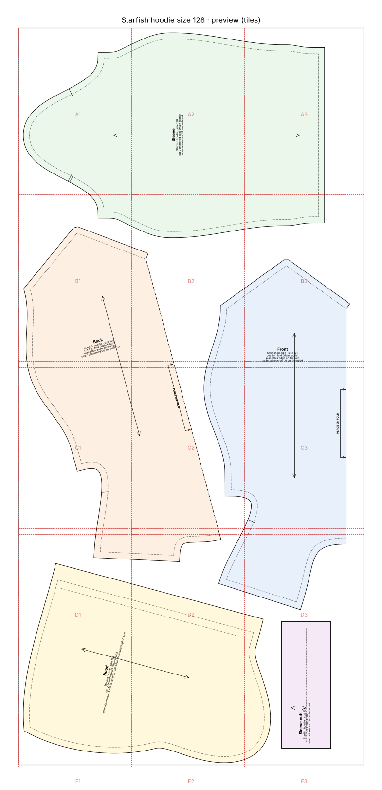
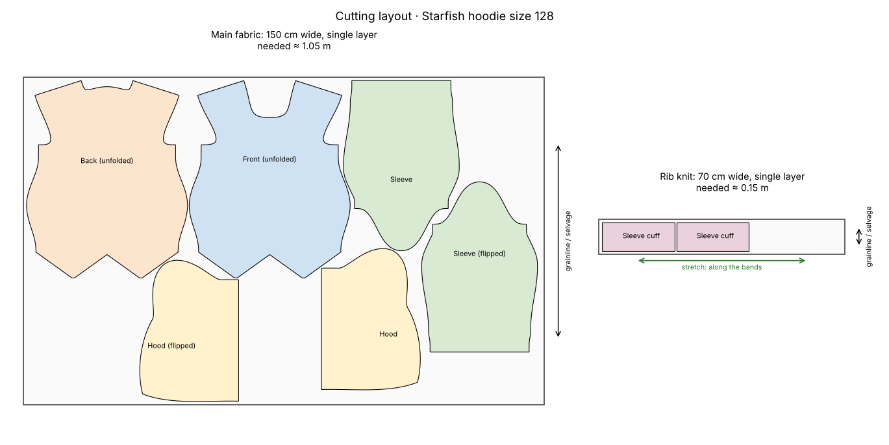

# Starfish hoodie, size 128 (creative silhouette)

> *"A sweatshirt shaped like a starfish for my son, size 128."*

The normal hoodie block reshaped with the `starfish` design: a rounder body, sleeves that taper to points, two pointed 'legs' at the hem and a pointed hood as the fifth point. The validation report lists every feature as an intended deviation and re-checks room to move and sewability.

## At a glance

- **Pieces:** 5
- **Fabric to buy:** main fabric 1.05 m at 150 cm width, rib knit 0.15 m at 70 cm width
- **Sewing steps:** 16
- **Sewability checks:** 51 of 51 OK

## Cutting layout

## Files

| File | What it is |
|---|---|
| [`cutting_layout.png`](cutting_layout.png) | Cutting layout on the fabric, with fabric amounts |
| [`pattern.json`](pattern.json) | All pieces, measurements and construction values as data |
| [`sewing_instructions.md`](sewing_instructions.md) | The same instructions as text, with a picture per step |
| [`sewing_instructions.pdf`](sewing_instructions.pdf) | Illustrated sewing booklet, then measurements, pieces and checks |
| [`starfish_hoodie_size128_a4_preview.png`](starfish_hoodie_size128_a4_preview.png) | Preview picture of the print file |
| [`starfish_hoodie_size128_a4_tiled.pdf`](starfish_hoodie_size128_a4_tiled.pdf) | Print file as A4 pages to tape together (last page: overview) |
| [`starfish_hoodie_size128_master_1to1.svg`](starfish_hoodie_size128_master_1to1.svg) | The whole pattern as one 1:1 SVG |
| [`steps`](steps) | Step pictures used by sewing_instructions.md |
| [`validation_report.md`](validation_report.md) | Every sewability check with target and actual value |

Print the PDF at **100 % / actual size** and check the 5 × 5 cm square before cutting.
