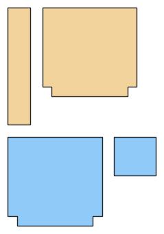

# Bags: tote and drawstring bag

*Deutsche Version: [README.md](README.md)*

Lined tote with boxed corners and inner pocket, or drawstring bag; no body measurements.

Module: `bag` · Picture: no size

## Example prompts for every option

| Option | Prompt |
|---|---|
| `style = tote, drawstring` | *"A drawstring bag."* |
| `bag_size = small, medium, large` | *"A large tote."* |
| `width_cm, height_cm, depth_cm` | *"A tote 40 × 35 × 10 cm."* |
| `lining, pocket` | *"Unlined tote."* |

## Works for every garment

| What | Prompt |
|---|---|
| fabric, stretch | *… from jersey with 40 % stretch.* |
| size or measurements | *… for me: chest 96, waist 80, hip 102, height 168.* |
| printing | *… as A4 pages / on the 24" roll / as A0.* |
| machines | *… I only sew with an overlocker.* |
| language | *… instructions in English.* |

All options with their values: [references/options.md](../../../references/options.md).
