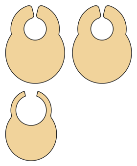

# Baby bib

*Deutsche Version: [README.md](README.md)*

Classic with a snap or bandana style, absorbent back.

Module: `bib` · Picture: size 74

## Example prompts for every option

| Option | Prompt |
|---|---|
| `style = classic, bandana` | *"A bandana bib in 74."* |
| `absorbent` | *"Bib without the absorbent layer."* |
| `length_cm` | *"A longer bib (25 cm)."* |

## Works for every garment

| What | Prompt |
|---|---|
| fabric, stretch | *… from jersey with 40 % stretch.* |
| size or measurements | *… for me: chest 96, waist 80, hip 102, height 168.* |
| printing | *… as A4 pages / on the 24" roll / as A0.* |
| machines | *… I only sew with an overlocker.* |
| language | *… instructions in English.* |

All options with their values: [references/options.md](../../../references/options.md).
