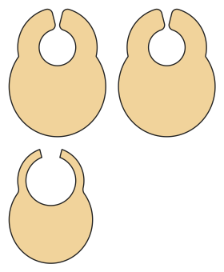

# Lätzchen

*English version: [README.en.md](README.en.md)*

Klassisch mit Druckknopf oder als Halstuch-Lätzchen, saugfähige Rückseite.

Modul: `bib` · Beispielbild: Größe 74

## Beispiel-Prompts für alle Optionen

| Option | Prompt |
|---|---|
| `style = classic, bandana` | *„Ein Halstuch-Lätzchen in 74.“* |
| `absorbent` | *„Lätzchen ohne saugfähige Lage.“* |
| `length_cm` | *„Ein längeres Lätzchen (25 cm).“* |

## Geht bei jedem Kleidungsstück

| Angabe | Prompt |
|---|---|
| fabric, stretch | *… aus Jersey mit 40 % Dehnung.* |
| Größe oder Maße | *… für mich: Brust 96, Taille 80, Hüfte 102, Größe 168.* |
| Druck | *… auf A4 zum Kleben / auf der 24"-Rolle / als A0.* |
| Maschinen | *… ich nähe nur mit der Overlock.* |
| Sprache | *… Anleitung auf Deutsch.* |

Alle Optionen mit Werten: [references/options.md](../../../references/options.md).
