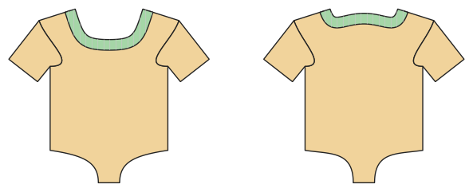

# Bodysuit, swimsuit, wrap bodysuit

*Deutsche Version: [README.md](README.md)*

Knit with elastane: snap crotch, leg bands; swimsuit with lining and elastic; baby wrap bodysuit.

Module: `bodysuit` · Picture: size 74

## Example prompts for every option

| Option | Prompt |
|---|---|
| `style = body, swimsuit, wrap` | *"A swimsuit for me, size 38."* |
| `style = wrap` | *"A wrap bodysuit for a newborn, size 56."* |
| `sleeve_length = none, short, long` | *"Long-sleeve bodysuit in 80."* |
| `leg_cut = normal, high, low` | *"Swimsuit with a high leg cut."* |

## Works for every garment

| What | Prompt |
|---|---|
| fabric, stretch | *… from jersey with 40 % stretch.* |
| size or measurements | *… for me: chest 96, waist 80, hip 102, height 168.* |
| printing | *… as A4 pages / on the 24" roll / as A0.* |
| machines | *… I only sew with an overlocker.* |
| language | *… instructions in English.* |

All options with their values: [references/options.md](../../../references/options.md).
