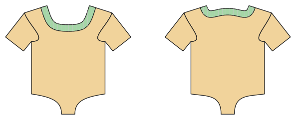

# Body, Badeanzug, Wickelbody

*English version: [README.en.md](README.en.md)*

Jersey mit Elasthan: Druckknöpfe im Schritt, Beinbündchen; Badeanzug mit Futter und Gummi; Baby-Wickelbody.

Modul: `bodysuit` · Beispielbild: Größe 74

## Beispiel-Prompts für alle Optionen

| Option | Prompt |
|---|---|
| `style = body, swimsuit, wrap` | *„Einen Badeanzug für mich, Größe 38.“* |
| `style = wrap` | *„Einen Wickelbody für ein Neugeborenes, Größe 56.“* |
| `sleeve_length = none, short, long` | *„Langarmbody in 80.“* |
| `leg_cut = normal, high, low` | *„Badeanzug mit hohem Beinausschnitt.“* |

## Geht bei jedem Kleidungsstück

| Angabe | Prompt |
|---|---|
| fabric, stretch | *… aus Jersey mit 40 % Dehnung.* |
| Größe oder Maße | *… für mich: Brust 96, Taille 80, Hüfte 102, Größe 168.* |
| Druck | *… auf A4 zum Kleben / auf der 24"-Rolle / als A0.* |
| Maschinen | *… ich nähe nur mit der Overlock.* |
| Sprache | *… Anleitung auf Deutsch.* |

Alle Optionen mit Werten: [references/options.md](../../../references/options.md).
