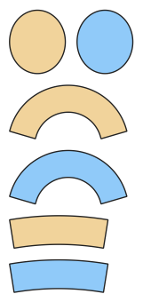

# Bucket hat / sun hat

*Deutsche Version: [README.md](README.md)*

Lined or reversible.

Module: `bucket_hat` · Picture: size 116

## Example prompts for every option

| Option | Prompt |
|---|---|
| `reversible` | *"A reversible bucket hat."* |
| `brim_cm` | *"Sun hat with a wide brim (8 cm)."* |

## Works for every garment

| What | Prompt |
|---|---|
| fabric, stretch | *… from jersey with 40 % stretch.* |
| size or measurements | *… for me: chest 96, waist 80, hip 102, height 168.* |
| printing | *… as A4 pages / on the 24" roll / as A0.* |
| machines | *… I only sew with an overlocker.* |
| language | *… instructions in English.* |

All options with their values: [references/options.md](../../../references/options.md).
