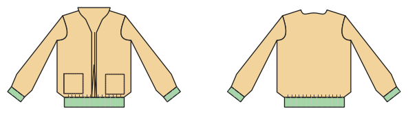

# Cardigan

*Deutsche Version: [README.md](README.md)*

Knit or sweat jacket with a continuous button band, V or round neck, pockets.

Module: `cardigan` · Picture: women's size 38

## Example prompts for every option

| Option | Prompt |
|---|---|
| `neckline = v, round` | *"A round-neck cardigan in 128."* |
| `pockets` | *"Cardigan without pockets."* |
| `band_fabric = main, rib` | *"Cardigan with a rib band."* |
| `hem_band, sleeve_cuffs` | *"Cardigan without the hem band."* |

## Works for every garment

| What | Prompt |
|---|---|
| fabric, stretch | *… from jersey with 40 % stretch.* |
| size or measurements | *… for me: chest 96, waist 80, hip 102, height 168.* |
| printing | *… as A4 pages / on the 24" roll / as A0.* |
| machines | *… I only sew with an overlocker.* |
| language | *… instructions in English.* |

All options with their values: [references/options.md](../../../references/options.md).
