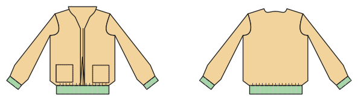

# Cardigan / Strickjacke

*English version: [README.en.md](README.en.md)*

Jacke aus Strick oder Sweat mit durchgehender Knopfleiste, V- oder Rundhals, Taschen.

Modul: `cardigan` · Beispielbild: Damengröße 38

## Beispiel-Prompts für alle Optionen

| Option | Prompt |
|---|---|
| `neckline = v, round` | *„Ein Cardigan mit Rundhals in 128.“* |
| `pockets` | *„Cardigan ohne Taschen.“* |
| `band_fabric = main, rib` | *„Cardigan mit Blende aus Bündchen.“* |
| `hem_band, sleeve_cuffs` | *„Cardigan ohne Saumbündchen.“* |

## Geht bei jedem Kleidungsstück

| Angabe | Prompt |
|---|---|
| fabric, stretch | *… aus Jersey mit 40 % Dehnung.* |
| Größe oder Maße | *… für mich: Brust 96, Taille 80, Hüfte 102, Größe 168.* |
| Druck | *… auf A4 zum Kleben / auf der 24"-Rolle / als A0.* |
| Maschinen | *… ich nähe nur mit der Overlock.* |
| Sprache | *… Anleitung auf Deutsch.* |

Alle Optionen mit Werten: [references/options.md](../../../references/options.md).
