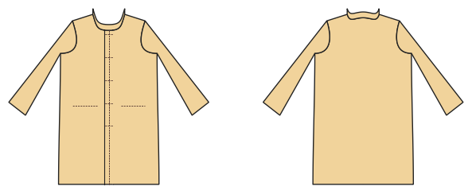

# Coat

*Deutsche Version: [README.md](README.md)*

Lined knee-length coat with flap pockets and stand collar.

Module: `coat` · Picture: women's size 40

## Example prompts for every option

| Option | Prompt |
|---|---|
| `length = knee, midi` | *"A knee-length wool coat, size 40."* |
| `pockets = flap, welt, jetted` | *"Coat with welt pockets."* |
| `collar = stand, none` | *"Coat without collar."* |

## Works for every garment

| What | Prompt |
|---|---|
| fabric, stretch | *… from jersey with 40 % stretch.* |
| size or measurements | *… for me: chest 96, waist 80, hip 102, height 168.* |
| printing | *… as A4 pages / on the 24" roll / as A0.* |
| machines | *… I only sew with an overlocker.* |
| language | *… instructions in English.* |

All options with their values: [references/options.md](../../../references/options.md).
