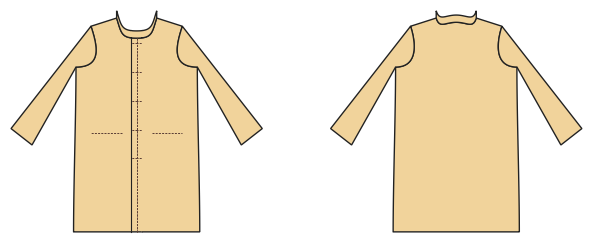

# Mantel

*English version: [README.en.md](README.en.md)*

Gefütterter Mantel in Knielänge mit Klappentaschen und Stehkragen.

Modul: `coat` · Beispielbild: Damengröße 40

## Beispiel-Prompts für alle Optionen

| Option | Prompt |
|---|---|
| `length = knee, midi` | *„Einen Wollmantel in Knielänge, Größe 40.“* |
| `pockets = flap, welt, jetted` | *„Mantel mit Leistentaschen.“* |
| `collar = stand, none` | *„Mantel ohne Kragen.“* |

## Geht bei jedem Kleidungsstück

| Angabe | Prompt |
|---|---|
| fabric, stretch | *… aus Jersey mit 40 % Dehnung.* |
| Größe oder Maße | *… für mich: Brust 96, Taille 80, Hüfte 102, Größe 168.* |
| Druck | *… auf A4 zum Kleben / auf der 24"-Rolle / als A0.* |
| Maschinen | *… ich nähe nur mit der Overlock.* |
| Sprache | *… Anleitung auf Deutsch.* |

Alle Optionen mit Werten: [references/options.md](../../../references/options.md).
