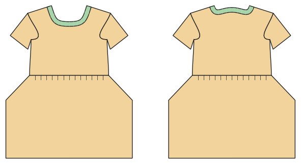

# Dress

*Deutsche Version: [README.md](README.md)*

T-shirt bodice with a skirt (gathered, A-line, circle) or a T-shirt dress; pockets, waist elastic.

Module: `dress` · Picture: size 116

## Example prompts for every option

| Option | Prompt |
|---|---|
| `style = waist_seam, shirt_dress` | *"A T-shirt dress in 116."* |
| `skirt = gathered, a_line, circle` | *"A dress with a circle skirt, size 128."* |
| `length = mini, knee, midi, maxi` | *"A midi dress for me, size 40."* |
| `pockets, waist_elastic` | *"Dress with in-seam pockets."* |
| `sleeve_length` | *"Long-sleeve dress."* |
| `style_lines = princess, yoke, color_block` | *"A dress with princess seams."* |

## Works for every garment

| What | Prompt |
|---|---|
| fabric, stretch | *… from jersey with 40 % stretch.* |
| size or measurements | *… for me: chest 96, waist 80, hip 102, height 168.* |
| printing | *… as A4 pages / on the 24" roll / as A0.* |
| machines | *… I only sew with an overlocker.* |
| language | *… instructions in English.* |

All options with their values: [references/options.md](../../../references/options.md).
