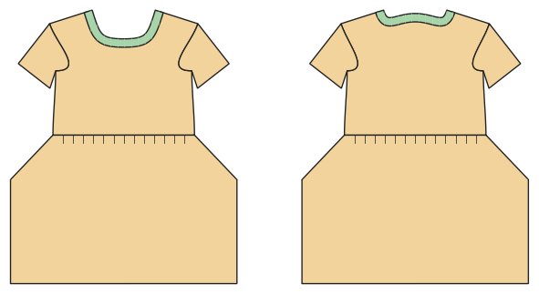

# Kleid

*English version: [README.en.md](README.en.md)*

T-Shirt-Oberteil mit Rock (gezogen, A-Linie, Teller) oder T-Shirt-Kleid; Taschen, Gummi in der Taille.

Modul: `dress` · Beispielbild: Größe 116

## Beispiel-Prompts für alle Optionen

| Option | Prompt |
|---|---|
| `style = waist_seam, shirt_dress` | *„Ein T-Shirt-Kleid in 116.“* |
| `skirt = gathered, a_line, circle` | *„Kleid mit Tellerrock, Größe 128.“* |
| `length = mini, knee, midi, maxi` | *„Ein Midikleid für mich, Größe 40.“* |
| `pockets, waist_elastic` | *„Kleid mit Nahttaschen.“* |
| `sleeve_length` | *„Langarmkleid.“* |
| `style_lines = princess, yoke, color_block` | *„Kleid mit Prinzessnähten.“* |

## Geht bei jedem Kleidungsstück

| Angabe | Prompt |
|---|---|
| fabric, stretch | *… aus Jersey mit 40 % Dehnung.* |
| Größe oder Maße | *… für mich: Brust 96, Taille 80, Hüfte 102, Größe 168.* |
| Druck | *… auf A4 zum Kleben / auf der 24"-Rolle / als A0.* |
| Maschinen | *… ich nähe nur mit der Overlock.* |
| Sprache | *… Anleitung auf Deutsch.* |

Alle Optionen mit Werten: [references/options.md](../../../references/options.md).
