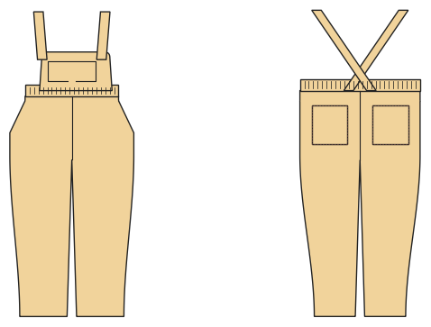

# Dungarees

*Deutsche Version: [README.md](README.md)*

Pants with a bib and crossed straps buttoned onto it; bib pocket, elastic waistband.

Module: `dungarees` · Picture: size 104

## Example prompts for every option

| Option | Prompt |
|---|---|
| `style = trousers, jogger` | *"Corduroy dungarees for my son, size 104."* |
| `length = long, 7/8, knee, short` | *"Short dungarees in 92."* |
| `bib_pocket` | *"Dungarees without the bib pocket."* |
| `fabric = woven, corduroy, sweat …` | *"Sweat dungarees with cuffs."* |
| `pockets` | *"Dungarees with slanted and back pockets."* |

## Works for every garment

| What | Prompt |
|---|---|
| fabric, stretch | *… from jersey with 40 % stretch.* |
| size or measurements | *… for me: chest 96, waist 80, hip 102, height 168.* |
| printing | *… as A4 pages / on the 24" roll / as A0.* |
| machines | *… I only sew with an overlocker.* |
| language | *… instructions in English.* |

All options with their values: [references/options.md](../../../references/options.md).
