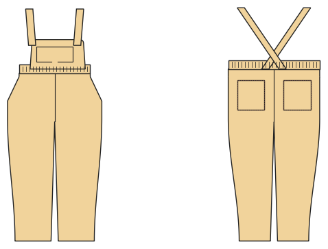

# Latzhose

*English version: [README.en.md](README.en.md)*

Hose mit Latz und gekreuzten Trägern, die am Latz geknöpft werden; Latztasche, Gummibund hinten.

Modul: `dungarees` · Beispielbild: Größe 104

## Beispiel-Prompts für alle Optionen

| Option | Prompt |
|---|---|
| `style = trousers, jogger` | *„Eine Latzhose aus Cord für meinen Sohn, Größe 104.“* |
| `length = long, 7/8, knee, short` | *„Kurze Latzhose (Latzshorts) in 92.“* |
| `bib_pocket` | *„Latzhose ohne Latztasche.“* |
| `fabric = woven, corduroy, sweat …` | *„Latzhose aus Sweat mit Bündchen.“* |
| `pockets` | *„Latzhose mit Eingrifftaschen und Gesäßtaschen.“* |

## Geht bei jedem Kleidungsstück

| Angabe | Prompt |
|---|---|
| fabric, stretch | *… aus Jersey mit 40 % Dehnung.* |
| Größe oder Maße | *… für mich: Brust 96, Taille 80, Hüfte 102, Größe 168.* |
| Druck | *… auf A4 zum Kleben / auf der 24"-Rolle / als A0.* |
| Maschinen | *… ich nähe nur mit der Overlock.* |
| Sprache | *… Anleitung auf Deutsch.* |

Alle Optionen mit Werten: [references/options.md](../../../references/options.md).
