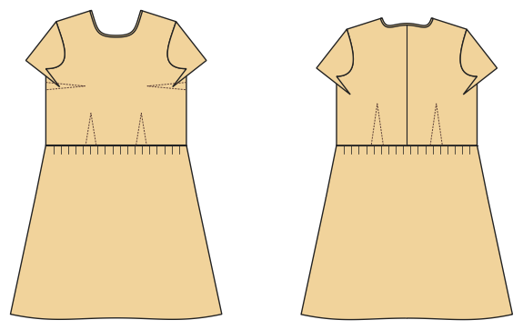

# Fitted woven dress

*Deutsche Version: [README.md](README.md)*

Woven dress with bust and waist darts, invisible zip and a bias-bound neckline.

Module: `fitted_dress` · Picture: women's size 38

## Example prompts for every option

| Option | Prompt |
|---|---|
| `skirt = a_line, gathered` | *"A fitted dress with a gathered skirt, size 38."* |
| `sleeve_length = none, short, long` | *"A sleeveless fitted dress."* |
| `length = knee, midi` | *"A fitted midi dress."* |
| `pockets` | *"With in-seam pockets."* |

## Works for every garment

| What | Prompt |
|---|---|
| fabric, stretch | *… from jersey with 40 % stretch.* |
| size or measurements | *… for me: chest 96, waist 80, hip 102, height 168.* |
| printing | *… as A4 pages / on the 24" roll / as A0.* |
| machines | *… I only sew with an overlocker.* |
| language | *… instructions in English.* |

All options with their values: [references/options.md](../../../references/options.md).
