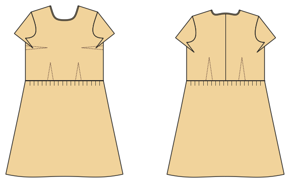

# Tailliertes Kleid (gewebt)

*English version: [README.en.md](README.en.md)*

Gewebtes Kleid mit Brust- und Taillenabnähern, nahtverdecktem Reißverschluss und Schrägband am Ausschnitt.

Modul: `fitted_dress` · Beispielbild: Damengröße 38

## Beispiel-Prompts für alle Optionen

| Option | Prompt |
|---|---|
| `skirt = a_line, gathered` | *„Ein tailliertes Kleid mit gezogenem Rock, Größe 38.“* |
| `sleeve_length = none, short, long` | *„Ärmelloses Etuikleid.“* |
| `length = knee, midi` | *„Tailliertes Midikleid.“* |
| `pockets` | *„Mit Nahttaschen.“* |

## Geht bei jedem Kleidungsstück

| Angabe | Prompt |
|---|---|
| fabric, stretch | *… aus Jersey mit 40 % Dehnung.* |
| Größe oder Maße | *… für mich: Brust 96, Taille 80, Hüfte 102, Größe 168.* |
| Druck | *… auf A4 zum Kleben / auf der 24"-Rolle / als A0.* |
| Maschinen | *… ich nähe nur mit der Overlock.* |
| Sprache | *… Anleitung auf Deutsch.* |

Alle Optionen mit Werten: [references/options.md](../../../references/options.md).
