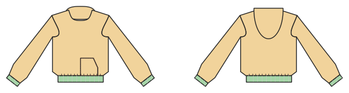

# Hoodie, sweatshirt, zip jacket

*Deutsche Version: [README.md](README.md)*

Hood (optionally lined), kangaroo pocket, bands; pullover or zip-up jacket.

Module: `hoodie` · Picture: size 140

## Example prompts for every option

| Option | Prompt |
|---|---|
| `hood, hood_lining` | *"A hoodie with a lined hood in 140."* |
| `hood = false` | *"A sweatshirt without hood."* |
| `kangaroo` | *"Hoodie without the kangaroo pocket."* |
| `front = closed, zip` | *"A zip-up sweat jacket, size 128."* |
| `sleeve_style = set_in, raglan` | *"Raglan hoodie in size 38."* |
| `style_lines = princess, yoke, color_block` | *"Hoodie with a front and back yoke."* |

## Works for every garment

| What | Prompt |
|---|---|
| fabric, stretch | *… from jersey with 40 % stretch.* |
| size or measurements | *… for me: chest 96, waist 80, hip 102, height 168.* |
| printing | *… as A4 pages / on the 24" roll / as A0.* |
| machines | *… I only sew with an overlocker.* |
| language | *… instructions in English.* |

All options with their values: [references/options.md](../../../references/options.md).
