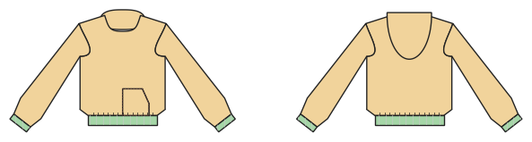

# Hoodie, Sweatshirt, Sweatjacke

*English version: [README.en.md](README.en.md)*

Kapuze (auch gefüttert), Kängurutasche, Bündchen; geschlossen oder als Jacke mit Reißverschluss.

Modul: `hoodie` · Beispielbild: Größe 140

## Beispiel-Prompts für alle Optionen

| Option | Prompt |
|---|---|
| `hood, hood_lining` | *„Ein Hoodie mit gefütterter Kapuze in 140.“* |
| `hood = false` | *„Ein Sweatshirt ohne Kapuze.“* |
| `kangaroo` | *„Hoodie ohne Kängurutasche.“* |
| `front = closed, zip` | *„Eine Sweatjacke mit Reißverschluss, Größe 128.“* |
| `sleeve_style = set_in, raglan` | *„Raglan-Hoodie in Größe 38.“* |
| `style_lines = princess, yoke, color_block` | *„Hoodie mit Passe vorne und hinten.“* |

## Geht bei jedem Kleidungsstück

| Angabe | Prompt |
|---|---|
| fabric, stretch | *… aus Jersey mit 40 % Dehnung.* |
| Größe oder Maße | *… für mich: Brust 96, Taille 80, Hüfte 102, Größe 168.* |
| Druck | *… auf A4 zum Kleben / auf der 24"-Rolle / als A0.* |
| Maschinen | *… ich nähe nur mit der Overlock.* |
| Sprache | *… Anleitung auf Deutsch.* |

Alle Optionen mit Werten: [references/options.md](../../../references/options.md).
