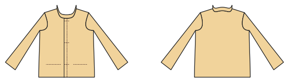

# Jacket (lined, woven)

*Deutsche Version: [README.md](README.md)*

Lined jacket with button front, facings, stand collar and welt, jetted or flap pockets.

Module: `jacket` · Picture: women's size 38

## Example prompts for every option

| Option | Prompt |
|---|---|
| `pockets = welt, jetted, flap` | *"A lined jacket with jetted pockets, size 38."* |
| `collar = stand, none` | *"Jacket without collar."* |
| `lining` | *"Unlined jacket."* |
| `buttons` | *"Jacket with 4 buttons."* |
| `length` | *"A longer jacket (hip length)."* |

## Works for every garment

| What | Prompt |
|---|---|
| fabric, stretch | *… from jersey with 40 % stretch.* |
| size or measurements | *… for me: chest 96, waist 80, hip 102, height 168.* |
| printing | *… as A4 pages / on the 24" roll / as A0.* |
| machines | *… I only sew with an overlocker.* |
| language | *… instructions in English.* |

All options with their values: [references/options.md](../../../references/options.md).
