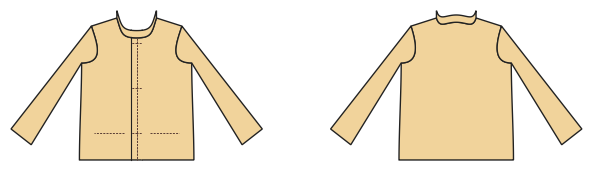

# Jacke (gefüttert, gewebt)

*English version: [README.en.md](README.en.md)*

Gefütterte Jacke mit Knopfleiste, Besätzen, Stehkragen und Paspel-, Leisten- oder Klappentaschen.

Modul: `jacket` · Beispielbild: Damengröße 38

## Beispiel-Prompts für alle Optionen

| Option | Prompt |
|---|---|
| `pockets = welt, jetted, flap` | *„Eine gefütterte Jacke mit Paspeltaschen, Größe 38.“* |
| `collar = stand, none` | *„Jacke ohne Kragen.“* |
| `lining` | *„Jacke ohne Futter.“* |
| `buttons` | *„Jacke mit 4 Knöpfen.“* |
| `length` | *„Etwas längere Jacke (Hüftlänge).“* |

## Geht bei jedem Kleidungsstück

| Angabe | Prompt |
|---|---|
| fabric, stretch | *… aus Jersey mit 40 % Dehnung.* |
| Größe oder Maße | *… für mich: Brust 96, Taille 80, Hüfte 102, Größe 168.* |
| Druck | *… auf A4 zum Kleben / auf der 24"-Rolle / als A0.* |
| Maschinen | *… ich nähe nur mit der Overlock.* |
| Sprache | *… Anleitung auf Deutsch.* |

Alle Optionen mit Werten: [references/options.md](../../../references/options.md).
