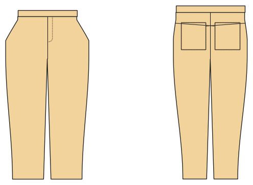

# Jeans

*Deutsche Version: [README.md](README.md)*

Five-pocket jeans: zip fly, scoop pockets, back yoke, patch back pockets, coin pocket, waistband with button, belt loops.

Module: `jeans` · Picture: women's size 38

## Example prompts for every option

| Option | Prompt |
|---|---|
| `fit = slim, normal, wide` | *"Slim jeans for me, size 38, stretch denim."* |
| `leg_shape = straight, tapered, bootcut, flare` | *"Bootcut jeans in men's size 52."* |
| `length = long, 7/8, knee, short` | *"Denim shorts in 140."* |
| `coin_pocket, belt_loops` | *"Jeans without coin pocket and belt loops."* |
| `back_pockets = 0, 1, 2` | *"Jeans with one back pocket only."* |

## Works for every garment

| What | Prompt |
|---|---|
| fabric, stretch | *… from jersey with 40 % stretch.* |
| size or measurements | *… for me: chest 96, waist 80, hip 102, height 168.* |
| printing | *… as A4 pages / on the 24" roll / as A0.* |
| machines | *… I only sew with an overlocker.* |
| language | *… instructions in English.* |

All options with their values: [references/options.md](../../../references/options.md).
