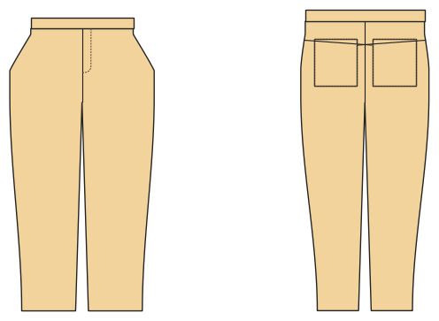

# Jeans

*English version: [README.en.md](README.en.md)*

Fünf-Taschen-Jeans: Reißverschluss-Hosenschlitz, eingeschnittene Taschen, Passe hinten, aufgesetzte Gesäßtaschen, Uhrentasche, Bund mit Knopf, Gürtelschlaufen.

Modul: `jeans` · Beispielbild: Damengröße 38

## Beispiel-Prompts für alle Optionen

| Option | Prompt |
|---|---|
| `fit = slim, normal, wide` | *„Eine Slim-Jeans für mich, Größe 38, Stretchdenim.“* |
| `leg_shape = straight, tapered, bootcut, flare` | *„Bootcut-Jeans in Herrengröße 52.“* |
| `length = long, 7/8, knee, short` | *„Jeansshorts in 140.“* |
| `coin_pocket, belt_loops` | *„Jeans ohne Uhrentasche und ohne Gürtelschlaufen.“* |
| `back_pockets = 0, 1, 2` | *„Jeans mit nur einer Gesäßtasche.“* |

## Geht bei jedem Kleidungsstück

| Angabe | Prompt |
|---|---|
| fabric, stretch | *… aus Jersey mit 40 % Dehnung.* |
| Größe oder Maße | *… für mich: Brust 96, Taille 80, Hüfte 102, Größe 168.* |
| Druck | *… auf A4 zum Kleben / auf der 24"-Rolle / als A0.* |
| Maschinen | *… ich nähe nur mit der Overlock.* |
| Sprache | *… Anleitung auf Deutsch.* |

Alle Optionen mit Werten: [references/options.md](../../../references/options.md).
