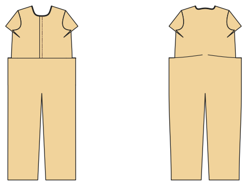

# Jumpsuit, playsuit, boiler suit

*Deutsche Version: [README.md](README.md)*

Bodice and pants joined at the waist seam, buttons or zip, elastic in the back waist, tie belt.

Module: `jumpsuit` · Picture: women's size 38

## Example prompts for every option

| Option | Prompt |
|---|---|
| `style = jumpsuit, boiler` | *"A viscose jumpsuit for me, size 38."* |
| `style = boiler` | *"A boiler suit with zip and shirt collar, men's size 52."* |
| `length = long, 7/8, short` | *"A short playsuit in 128."* |
| `sleeve_length = short, long` | *"Jumpsuit with long sleeves."* |
| `closure = buttons, zip` | *"Jumpsuit with a front zip instead of buttons."* |
| `collar = none, stand, shirt` | *"Jumpsuit with a stand collar."* |
| `belt, chest_pocket, pockets` | *"Jumpsuit without belt, with a chest pocket."* |

## Works for every garment

| What | Prompt |
|---|---|
| fabric, stretch | *… from jersey with 40 % stretch.* |
| size or measurements | *… for me: chest 96, waist 80, hip 102, height 168.* |
| printing | *… as A4 pages / on the 24" roll / as A0.* |
| machines | *… I only sew with an overlocker.* |
| language | *… instructions in English.* |

All options with their values: [references/options.md](../../../references/options.md).
