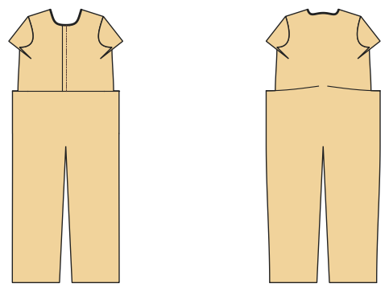

# Jumpsuit, Playsuit, Overall

*English version: [README.en.md](README.en.md)*

Oberteil und Hose an der Taillennaht verbunden, Knopfleiste oder Reißverschluss, Gummi im Rückenteil, Bindegürtel.

Modul: `jumpsuit` · Beispielbild: Damengröße 38

## Beispiel-Prompts für alle Optionen

| Option | Prompt |
|---|---|
| `style = jumpsuit, boiler` | *„Einen Jumpsuit aus Viskose für mich, Größe 38.“* |
| `style = boiler` | *„Einen Overall (Boiler Suit) mit Reißverschluss und Hemdkragen, Herrengröße 52.“* |
| `length = long, 7/8, short` | *„Einen kurzen Playsuit in 128.“* |
| `sleeve_length = short, long` | *„Jumpsuit mit langen Ärmeln.“* |
| `closure = buttons, zip` | *„Jumpsuit mit Reißverschluss vorne statt Knöpfen.“* |
| `collar = none, stand, shirt` | *„Jumpsuit mit Stehkragen.“* |
| `belt, chest_pocket, pockets` | *„Jumpsuit ohne Gürtel, mit Brusttasche.“* |

## Geht bei jedem Kleidungsstück

| Angabe | Prompt |
|---|---|
| fabric, stretch | *… aus Jersey mit 40 % Dehnung.* |
| Größe oder Maße | *… für mich: Brust 96, Taille 80, Hüfte 102, Größe 168.* |
| Druck | *… auf A4 zum Kleben / auf der 24"-Rolle / als A0.* |
| Maschinen | *… ich nähe nur mit der Overlock.* |
| Sprache | *… Anleitung auf Deutsch.* |

Alle Optionen mit Werten: [references/options.md](../../../references/options.md).
