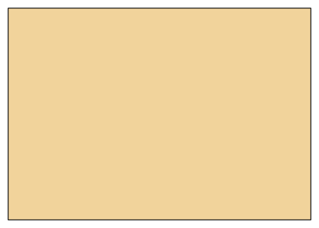

# Loopschal

*English version: [README.en.md](README.en.md)*

Schlauchschal, einfach oder doppelt gelegt.

Modul: `loop` · Beispielbild: Größe 128

## Beispiel-Prompts für alle Optionen

| Option | Prompt |
|---|---|
| `wraps = 1, 2` | *„Ein Loop zum zweimal Herumlegen.“* |
| `height` | *„Ein schmaler Loop (20 cm hoch).“* |

## Geht bei jedem Kleidungsstück

| Angabe | Prompt |
|---|---|
| fabric, stretch | *… aus Jersey mit 40 % Dehnung.* |
| Größe oder Maße | *… für mich: Brust 96, Taille 80, Hüfte 102, Größe 168.* |
| Druck | *… auf A4 zum Kleben / auf der 24"-Rolle / als A0.* |
| Maschinen | *… ich nähe nur mit der Overlock.* |
| Sprache | *… Anleitung auf Deutsch.* |

Alle Optionen mit Werten: [references/options.md](../../../references/options.md).
