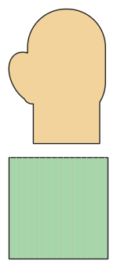

# Fäustlinge

*English version: [README.en.md](README.en.md)*

Daumen im Profil, optional mit Bündchen und Verbindungsschnur; für Babys ohne Daumen.

Modul: `mittens` · Beispielbild: Größe 116

## Beispiel-Prompts für alle Optionen

| Option | Prompt |
|---|---|
| `thumb` | *„Babyfäustlinge ohne Daumen, Größe 74.“* |
| `cuff` | *„Fäustlinge ohne Bündchen.“* |
| `string` | *„Fäustlinge mit Verbindungsschnur.“* |

## Geht bei jedem Kleidungsstück

| Angabe | Prompt |
|---|---|
| fabric, stretch | *… aus Jersey mit 40 % Dehnung.* |
| Größe oder Maße | *… für mich: Brust 96, Taille 80, Hüfte 102, Größe 168.* |
| Druck | *… auf A4 zum Kleben / auf der 24"-Rolle / als A0.* |
| Maschinen | *… ich nähe nur mit der Overlock.* |
| Sprache | *… Anleitung auf Deutsch.* |

Alle Optionen mit Werten: [references/options.md](../../../references/options.md).
