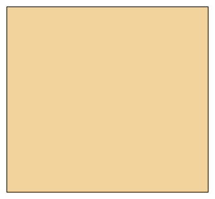

# Neck gaiter and neckerchief

*Deutsche Version: [README.md](README.md)*

Neck gaiter or triangle neckerchief.

Module: `neckwear` · Picture: size 116

## Example prompts for every option

| Option | Prompt |
|---|---|
| `style = gaiter, neckerchief` | *"A neckerchief for my child, 116."* |
| `height_cm` | *"A tall neck gaiter (25 cm)."* |

## Works for every garment

| What | Prompt |
|---|---|
| fabric, stretch | *… from jersey with 40 % stretch.* |
| size or measurements | *… for me: chest 96, waist 80, hip 102, height 168.* |
| printing | *… as A4 pages / on the 24" roll / as A0.* |
| machines | *… I only sew with an overlocker.* |
| language | *… instructions in English.* |

All options with their values: [references/options.md](../../../references/options.md).
