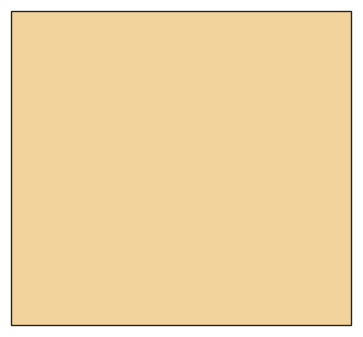

# Halstuch und Schlauchschal

*English version: [README.en.md](README.en.md)*

Schlauchschal (Neck Gaiter) oder Dreieckstuch.

Modul: `neckwear` · Beispielbild: Größe 116

## Beispiel-Prompts für alle Optionen

| Option | Prompt |
|---|---|
| `style = gaiter, neckerchief` | *„Ein Dreieckstuch für mein Kind, 116.“* |
| `height_cm` | *„Ein hoher Schlauchschal (25 cm).“* |

## Geht bei jedem Kleidungsstück

| Angabe | Prompt |
|---|---|
| fabric, stretch | *… aus Jersey mit 40 % Dehnung.* |
| Größe oder Maße | *… für mich: Brust 96, Taille 80, Hüfte 102, Größe 168.* |
| Druck | *… auf A4 zum Kleben / auf der 24"-Rolle / als A0.* |
| Maschinen | *… ich nähe nur mit der Overlock.* |
| Sprache | *… Anleitung auf Deutsch.* |

Alle Optionen mit Werten: [references/options.md](../../../references/options.md).
