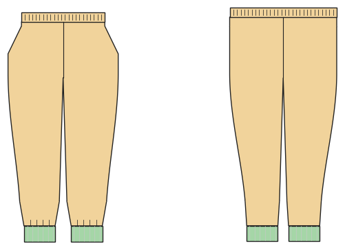

# Pants (joggers, harem pants, leggings, pull-on trousers)

*Deutsche Version: [README.md](README.md)*

The pants block: elastic waistband, cuffs or hem, pockets, lengths from shorts to long.

Module: `pants_basic` · Picture: size 122

## Example prompts for every option

| Option | Prompt |
|---|---|
| `style = jogger, harem, leggings, trousers` | *"Harem pants in size 122 from sweat fabric."* |
| `fit = slim, normal, wide, oversized, harem` | *"Wide-fit joggers in 140."* |
| `length = long, 7/8, knee, short` | *"Shorts in 116 from jersey."* |
| `waistband = casing, rib, yoga, tunnel` | *"Leggings with a wide yoga waistband for me, size 38."* |
| `cuffs` | *"Joggers without cuffs, plain hem."* |
| `pockets = side, back_patch, cargo` | *"Pull-on trousers with slanted pockets and cargo pockets."* |
| `leg_shape = straight, tapered, bootcut, flare` | *"Flared trousers from jersey with elastane, size 36."* |
| `fake_fly` | *"Joggers with a fake fly (topstitched J)."* |
| `hem_finish = plain, elastic_casing` | *"Pants with an elastic casing at the hem instead of cuffs."* |

## Works for every garment

| What | Prompt |
|---|---|
| fabric, stretch | *… from jersey with 40 % stretch.* |
| size or measurements | *… for me: chest 96, waist 80, hip 102, height 168.* |
| printing | *… as A4 pages / on the 24" roll / as A0.* |
| machines | *… I only sew with an overlocker.* |
| language | *… instructions in English.* |

All options with their values: [references/options.md](../../../references/options.md).
