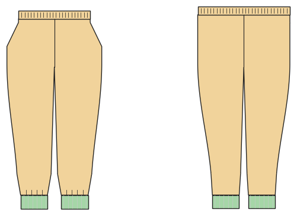

# Hose (Jogger, Pumphose, Leggings, Schlupfhose)

*English version: [README.en.md](README.en.md)*

Der Hosengrundschnitt: Gummibund, Bündchen oder Saum, Taschen, Längen von kurz bis lang.

Modul: `pants_basic` · Beispielbild: Größe 122

## Beispiel-Prompts für alle Optionen

| Option | Prompt |
|---|---|
| `style = jogger, harem, leggings, trousers` | *„Eine Pumphose in Größe 122 aus Sweat.“* |
| `fit = slim, normal, wide, oversized, harem` | *„Joggpants in 140, weit geschnitten.“* |
| `length = long, 7/8, knee, short` | *„Kurze Hose (Shorts) in 116 aus Jersey.“* |
| `waistband = casing, rib, yoga, tunnel` | *„Leggings mit breitem Yoga-Bund für mich, Größe 38.“* |
| `cuffs` | *„Jogger ohne Bündchen, mit normalem Saum.“* |
| `pockets = side, back_patch, cargo` | *„Schlupfhose mit Eingrifftaschen und Cargotaschen.“* |
| `leg_shape = straight, tapered, bootcut, flare` | *„Eine Schlaghose aus Jersey mit Elasthan, Größe 36.“* |
| `fake_fly` | *„Jogger mit angedeutetem Hosenschlitz (Ziernaht).“* |
| `hem_finish = plain, elastic_casing` | *„Hose mit Gummizug im Saum statt Bündchen.“* |

## Geht bei jedem Kleidungsstück

| Angabe | Prompt |
|---|---|
| fabric, stretch | *… aus Jersey mit 40 % Dehnung.* |
| Größe oder Maße | *… für mich: Brust 96, Taille 80, Hüfte 102, Größe 168.* |
| Druck | *… auf A4 zum Kleben / auf der 24"-Rolle / als A0.* |
| Maschinen | *… ich nähe nur mit der Overlock.* |
| Sprache | *… Anleitung auf Deutsch.* |

Alle Optionen mit Werten: [references/options.md](../../../references/options.md).
