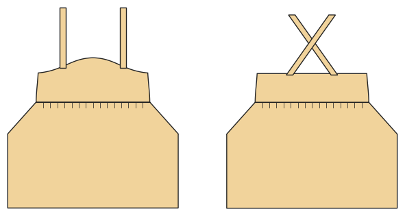

# Pinafore dress

*Deutsche Version: [README.md](README.md)*

Lined bib bodice, crossed straps with buttons, gathered skirt.

Module: `pinafore` · Picture: size 116

## Example prompts for every option

| Option | Prompt |
|---|---|
| `skirt = gathered, a_line` | *"A corduroy pinafore, size 116, A-line skirt."* |
| `length = mini, knee, midi` | *"A short pinafore."* |
| `pockets` | *"With pockets."* |

## Works for every garment

| What | Prompt |
|---|---|
| fabric, stretch | *… from jersey with 40 % stretch.* |
| size or measurements | *… for me: chest 96, waist 80, hip 102, height 168.* |
| printing | *… as A4 pages / on the 24" roll / as A0.* |
| machines | *… I only sew with an overlocker.* |
| language | *… instructions in English.* |

All options with their values: [references/options.md](../../../references/options.md).
