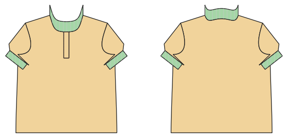

# Polo shirt

*Deutsche Version: [README.md](README.md)*

Half placket, rib-knit collar, sleeve bands, optional side vents.

Module: `polo` · Picture: men's size 52

## Example prompts for every option

| Option | Prompt |
|---|---|
| `sleeve_length = short, long` | *"A polo shirt in men's 52."* |
| `collar_fabric = rib, main` | *"Polo with the collar from the main fabric."* |
| `side_vents` | *"Polo with side vents."* |
| `buttons` | *"Polo with 2 buttons."* |

## Works for every garment

| What | Prompt |
|---|---|
| fabric, stretch | *… from jersey with 40 % stretch.* |
| size or measurements | *… for me: chest 96, waist 80, hip 102, height 168.* |
| printing | *… as A4 pages / on the 24" roll / as A0.* |
| machines | *… I only sew with an overlocker.* |
| language | *… instructions in English.* |

All options with their values: [references/options.md](../../../references/options.md).
