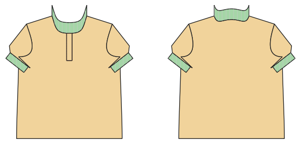

# Poloshirt

*English version: [README.en.md](README.en.md)*

Halbe Knopfleiste, Strickkragen aus Bündchen, Ärmelbündchen, optional Seitenschlitze.

Modul: `polo` · Beispielbild: Herrengröße 52

## Beispiel-Prompts für alle Optionen

| Option | Prompt |
|---|---|
| `sleeve_length = short, long` | *„Ein Poloshirt in Herrengröße 52.“* |
| `collar_fabric = rib, main` | *„Polo mit Kragen aus dem Oberstoff.“* |
| `side_vents` | *„Polo mit Seitenschlitzen.“* |
| `buttons` | *„Polo mit 2 Knöpfen.“* |

## Geht bei jedem Kleidungsstück

| Angabe | Prompt |
|---|---|
| fabric, stretch | *… aus Jersey mit 40 % Dehnung.* |
| Größe oder Maße | *… für mich: Brust 96, Taille 80, Hüfte 102, Größe 168.* |
| Druck | *… auf A4 zum Kleben / auf der 24"-Rolle / als A0.* |
| Maschinen | *… ich nähe nur mit der Overlock.* |
| Sprache | *… Anleitung auf Deutsch.* |

Alle Optionen mit Werten: [references/options.md](../../../references/options.md).
