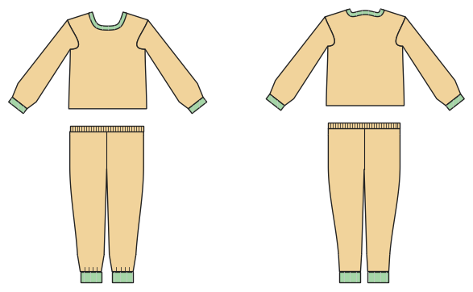

# Pyjamas

*Deutsche Version: [README.md](README.md)*

Top and pants in one order: one cutting layout and one booklet for both.

Module: `pyjama` · Picture: size 128

## Example prompts for every option

| Option | Prompt |
|---|---|
| `top = tshirt, shirt` | *"Pyjamas with a button-up top for me, men's 52."* |
| `length = long, short` | *"A shorty pyjama set in 140."* |
| `cuffs` | *"Pyjamas with cuffs on sleeves and legs."* |
| `collar = none, stand, shirt` | *"Button-up top with a shirt collar."* |

## Works for every garment

| What | Prompt |
|---|---|
| fabric, stretch | *… from jersey with 40 % stretch.* |
| size or measurements | *… for me: chest 96, waist 80, hip 102, height 168.* |
| printing | *… as A4 pages / on the 24" roll / as A0.* |
| machines | *… I only sew with an overlocker.* |
| language | *… instructions in English.* |

All options with their values: [references/options.md](../../../references/options.md).
