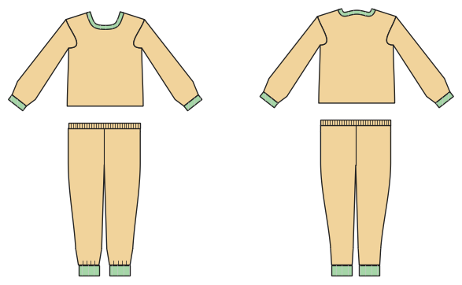

# Schlafanzug

*English version: [README.en.md](README.en.md)*

Oberteil und Hose in einem Auftrag: ein Zuschnittplan und ein Heft für beide Teile.

Modul: `pyjama` · Beispielbild: Größe 128

## Beispiel-Prompts für alle Optionen

| Option | Prompt |
|---|---|
| `top = tshirt, shirt` | *„Einen Schlafanzug mit geknöpftem Oberteil für mich, Herrengröße 52.“* |
| `length = long, short` | *„Einen Shorty in 140.“* |
| `cuffs` | *„Schlafanzug mit Bündchen an Armen und Beinen.“* |
| `collar = none, stand, shirt` | *„Geknöpftes Oberteil mit Hemdkragen.“* |

## Geht bei jedem Kleidungsstück

| Angabe | Prompt |
|---|---|
| fabric, stretch | *… aus Jersey mit 40 % Dehnung.* |
| Größe oder Maße | *… für mich: Brust 96, Taille 80, Hüfte 102, Größe 168.* |
| Druck | *… auf A4 zum Kleben / auf der 24"-Rolle / als A0.* |
| Maschinen | *… ich nähe nur mit der Overlock.* |
| Sprache | *… Anleitung auf Deutsch.* |

Alle Optionen mit Werten: [references/options.md](../../../references/options.md).
