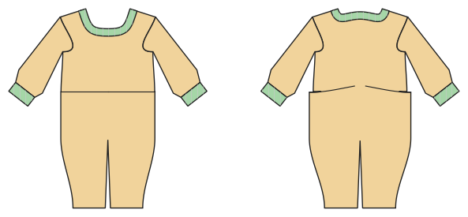

# Baby romper

*Deutsche Version: [README.md](README.md)*

Romper (sizes 50–92) with snaps along the inner legs, cuffs or feet.

Module: `romper` · Picture: size 68

## Example prompts for every option

| Option | Prompt |
|---|---|
| `feet` | *"A footed romper, size 68."* |
| `sleeve_length = short, long` | *"A short-sleeve romper for summer, size 62."* |
| `fabric = jersey, interlock, fleece` | *"Romper from interlock."* |

## Works for every garment

| What | Prompt |
|---|---|
| fabric, stretch | *… from jersey with 40 % stretch.* |
| size or measurements | *… for me: chest 96, waist 80, hip 102, height 168.* |
| printing | *… as A4 pages / on the 24" roll / as A0.* |
| machines | *… I only sew with an overlocker.* |
| language | *… instructions in English.* |

All options with their values: [references/options.md](../../../references/options.md).
